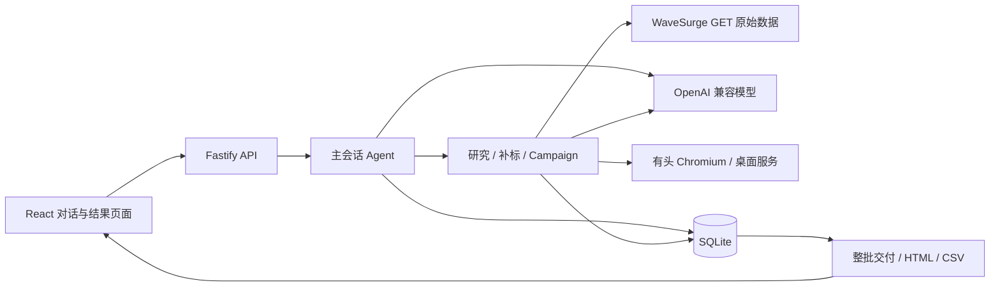

# Creator Studio

基于 WaveSurge 的 Creator 智能筛选应用。用户通过自然语言描述目标创作者，系统获取候选、调用大模型逐人核验并保存实际画像标签，待同一次请求的全部工作结束后，在聊天中交付结构化 HTML 文档与 CSV。

支持从 Campaign 的产品、受众和营销目标出发，交互确定不同 Creator 类型、筛选条件和配额，再生成跨组去重的最终名单。

**文档入口：** [公网多场景端到端验收](docs/testing/public-scenarios-2026-10-13/report.md) · [架构与 Agent 设计](docs/architecture.md) · [原始实施方案](docs/implementation-plan.md) · [测试记录](docs/testing/README.md) · [完整文档索引](docs/README.md)

支持通过公网 HTTP 页面发送自然语言需求，由 Agent 选择检索词、读取真实 WaveSurge 资料并逐人核验；运行中可继续查询进度，结束后自动交付报告和 CSV。2026-10-13 实际开放搜索完成跑步场景3/3、家用咖啡场景2/2。最新验收按具体场景列出输入范围、实际人数、匹配依据和下载结果，便于直接复核和重跑。

## 功能与题目要求

| 题目要求 | 系统实现 | 交付入口 |
|---|---|---|
| 自然语言混合条件筛选 | 数量、平台、所在地、粉丝区间、内容、外观、自述、必选条件与偏好分别解析；有歧义时先澄清 | 研究对话、侧栏任务 |
| 候选召回与逐人分析 | WaveSurge 获取原始资料；独立候选核验上下文提交逐条件判断、理由、证据和实际画像 | 结果弹窗中的逐条件判断、标签与来源 |
| 结构化结果文档 | HTML 按研究/分组组织清单；每位包含资料、判断、理由、标签、证据；CSV 保留结构字段 | 聊天中的综合报告与下载链接 |
| Campaign 目标交互 | 目标 → 澄清 → 类型/理由/范围/配额 → 可修订草案 → 确认 → 多组研究与去重分配 | Campaign 方案、总报告和子报告 |

系统还支持参考图片、任务执行期间继续对话、已有结果补标与重新核验、标签/平台/判断筛选、上下文备份/载入/压缩、配置提示词及持久浏览器桌面。

## 快速启动

需要 Docker Desktop。复制配置模板并填写真实服务凭据：

```sh
cp .env.example .env
docker compose up -d --build
```

打开 [http://localhost:3000](http://localhost:3000)。首次启动随机生成管理员密码，读取方法：

```sh
docker compose exec -T app cat /app/data/admin-bootstrap.txt
```

不要把该命令的输出提交到仓库或测试报告。

| 配置项 | 用途 |
|---|---|
| `BASE_URL` | OpenAI 兼容模型服务地址，可填写服务根地址或 `/v1` 地址 |
| `API_KEY` | 模型服务密钥，仅后端使用 |
| `MODEL_ID` | 模型名称；视觉核验需要模型支持图片输入和工具调用 |
| `WAVESURGE_TOKEN` | WaveSurge 访问 Token，仅后端使用 |
| `ADMIN_PASSWORD` | 可选；首次初始化时指定管理员密码，未填写则随机生成 |

Docker 内访问本机模型代理时，`http://127.0.0.1:8317` 会转换为 `host.docker.internal`，请求路径补齐 `/v1/chat/completions`。应用设置持久化在数据库中；修改已经保存的模型配置请使用页面「设置」，不是仅修改 `.env`。

应用只向本机发布 3000 端口。数据库、浏览器 profile 和内部桌面凭据使用独立持久卷，桌面服务不公开内部端口。

```sh
docker compose ps
docker compose logs --tail=40 app desktop
docker compose restart app desktop
docker compose down
```

普通停止和重启保留数据。`docker compose down -v` 会删除持久卷及历史，日常操作不需要使用它。

## 使用示例

直接筛选可以这样开始：

> 找3位Instagram跑步类个人创作者，粉丝1万至10万，地区不限。必须有本人第一人称的跑步训练、马拉松或越野跑参赛体验，排除运动品牌、店铺、赛事或机构官方、明星和纯搬运。只核验公开文字，标注内容方向与表达方式。请自行选择英文检索词开放搜索，不指定账号；分析预算12人，基础资料最多80个账号。请直接开始，结束在聊天里给我报告和CSV。

助手把平台、数量、粉丝区间和个人体验条件分别保存，再选择检索词获取候选。每位包含逐条件判断、实际内容标签与来源；信息不足保留为待核实。需要外观判断时，可明确要求实际图像核验；必要页面被登录或验证码阻塞时，默认先请求用户确认，再移交同一VNC浏览器。

也支持精确指定账号的研究：

> 帮我看看 Instagram 的 tylerlcrawford 和 valstechtalkk，粉丝1万到10万，地区不限。我要分享数码产品实际使用经验的个人创作者，两个人都分析并标一下内容方向、表达风格，最后选1位。先只看已有文字资料，不打开网页。这批全结束再给我报告。

「两个都分析、只选一位」会区分分析预算和入选配额。数据来自实际服务，具体结论以当时资料为准。

Campaign 可以这样开始：

> 我们要推广一款降噪耳机，主要面向大学生，想让大家认识产品，也希望能带动推荐转化。先帮我想想找哪几类博主，我们一起把范围定下来。

确认类型、平台、地区、粉丝范围和人数后，助手保存方案版本。打开「Campaign 方案」查看理由和配额，再确认当前版本开始。多个组可以分析重叠候选，最终同一平台账号只占一个组的名额。

已有结果可以继续补标：

> 给刚才这批人的内容使用场景再补一项标签，备选也要标，只用已存资料，原来的判断和入选别改。全部完成后给我一份综合报告。

纯补标更新画像及审计版本；明确要求「重新打开本人主页核验」时，才重新访问页面核对原条件。

## 结果文档

研究完成、部分完成、失败或取消后，同一次请求已经登记的全部工作都到达终态，程序自动在聊天中发送一次综合交付。候选逐人完成时更新保存结果和进度，最终名单按整批交付。

HTML 包含研究范围、分组、目标、合格候选、实际入选、缺额，以及每位创作者的身份链接、基础资料、逐条件三态判断、匹配说明、画像标签、证据引用和可用截图。Campaign 总文档直接展示入选者的逐人说明；子报告、查询和 CSV 使用相同的最终分配。

在线 HTML 按需加载截图，避免完整研究的图片造成数十 MB 页面。报告顶部可以下载含内嵌截图的离线 HTML；当前筛选范围会保留，离线文件可能较大。截图、原始返回和审计记录完整保存在服务器。

CSV 共 25 列。除基础资料、判断、标签、证据和画像外，还包含记录 ID、来源任务、分组、入选口径、Campaign 分配及独立研究预选，便于逐条复核。

多组报告区分「记录数」和「去重账号人数」：同两人在三组各被核验一次，是 6 条判断记录、2 个账号。合格候选与实际入选分别统计，合格备选仍保留。

结果界面默认匹配完整标签值；显式切换「文字包含」可使用子串查询，界面说明它可能包括否定标签。HTML/CSV 跟随最后成功的查询，迟到请求不会覆盖新筛选。

## 架构与技术栈

应用采用单 TypeScript 项目与两个长期运行容器：Fastify 应用服务、持久图形桌面服务；一次性服务初始化内部凭据。React 页面通过 HTTP 获取当前状态，SQLite 保存消息、任务、判断、配置、证据和交付记录。



| 层 | 主要技术 |
|---|---|
| 运行时与语言 | Node.js 24、TypeScript 7、pnpm 11 |
| 前端 | React 19、Vite 8、React Markdown / GFM |
| 后端 | Fastify 5、Ajv 契约校验、Cookie 会话 |
| 存储 | Node 内置 `node:sqlite`、WAL、事务与 JSON 业务文档 |
| 模型 | OpenAI 兼容 Chat Completions、工具调用、图片输入 |
| 桌面 | Playwright、有头 Chromium、Xvfb/Openbox、VNC/noVNC、WebSocket |
| 测试与部署 | Vitest 5、Testing Library、Playwright Test、Docker Compose |

具体依赖版本由 [package.json](package.json) 和 [pnpm-lock.yaml](pnpm-lock.yaml) 固定。

## 代码逻辑与 Agent 设计

主 Agent 负责理解、澄清、规划、调用工具和答复。候选排序、逐人核验与历史压缩使用独立上下文和受限工具。程序负责保存事实、验证引用、预算、配额、幂等和交付时机。

一次消息的主要执行步骤：

1. 保存用户消息及待处理状态。Agent 每次调用读取当前配置和最新任务事实。
2. 将条件转换为 `SearchSpec`，或交互保存 `Campaign` 草案；已确认工作通过工具登记到请求批次。
3. 后台读取 WaveSurge 候选与资料，执行基础条件预筛，并按分析预算逐人核验。
4. 核验模型提交 `judgments`、`annotations`、`facts`；程序校验真实引用、数值范围及视觉依据。
5. 所有必选条件为 `match` 才合格。偏好用于排序；没有证据为 `unknown`；独立画像实际值生成可查询标签。
6. 保存结果和历史版本，按组配额入选；Campaign 跨组去重。报告通过统一读视图计算当前分配，不覆盖原预选审计记录。
7. 批次登记封口且所有工作终态后，事务内写入交付记录与聊天报告。刷新、上下文载入和正常重启不会重放已执行工具或重发报告。

进行中的模型调用使用固定输入，新消息在后续调用与完整工具结果边界注入。清空或载入上下文不删除已登记后台工作。完整说明见 [架构与 Agent 设计](docs/architecture.md)。

| 目录/模块 | 职责 |
|---|---|
| `src/shared/` | 搜索与 Campaign 契约、消息类型、默认提示词 |
| `src/server/bootstrap.ts` | 初始化存储、模型、WaveSurge、Agent、任务与 API |
| `src/server/agent.ts`、`context.ts` | 对话循环、工具回执、消息注入、上下文摘要与恢复 |
| `src/server/research.ts`、`discovery.ts`、`instagram.ts` | 候选获取、基础预筛、分析预算、后台调度与重试 |
| `src/server/verify.ts`、`browser-verifier.ts`、`assessment.ts`、`verdict.ts` | 模型核验、页面观察、画像验证、条件合格判定 |
| `src/server/enrichment.ts`、`campaign.ts` | 补标/重核验、方案版本和跨组去重分配 |
| `src/server/report-scope.ts`、`reports.ts`、`work-delivery.ts` | 分组/入选读视图、结构化文档、整批一次交付 |
| `src/server/store.ts`、`auth.ts`、`settings.ts` | SQLite 事务、管理员会话、配置及密钥脱敏 |
| `src/client/` | 对话、消息时间、任务、方案、结果、设置与桌面页面 |
| `src/desktop/`、`deploy/` | 持久 Chromium、页面观察/输入协议、容器图形环境 |
| `tests/` | 单元、集成、React 交互、浏览器端到端用例及受控夹具 |
| `docs/`、`dev-reports/` | 设计、接口参考、测试方案、最终报告及历史修复记录 |

## WaveSurge 数据路径与边界

接口依据 [docs/api.md](docs/api.md)、[docs/guide.md](docs/guide.md)、[docs/SKILL.md](docs/SKILL.md)。根目录三份同名文件保留为原始参考副本。

Instagram 新研究使用同步 GET：

- 关键词搜索：`/instagram/v3/search_users`，可明确选择 v1/v2/v3，默认 v3，选定后不自动切换。
- 精确账号/粉丝/简介：`/instagram/v1/fetch_user_info_by_username_v2`。
- 近期帖子与分页：`/instagram/v1/fetch_user_posts`。
- 单帖详情：`/instagram/v2/fetch_post_info`。

每次支持 1–5 个短关键词，每词最多 3 页；每人最多 2 页帖子（每页 12 条）和 2 条单帖详情。泛搜索先读基础资料并排除明确不符的粉丝范围，再占用逐人分析名额。精确指定的完整账号列表支持全部分析。基础读取预算与分析预算分别记录。

YouTube/TikTok/X 当前读取 `/discover/db?platform=...&limit=500&sort=fit_desc` 的已有名单，再按本次目标进行候选排序和逐人核验。新研究不提交旧异步 `POST /creator-search/requests`；旧任务保留 GET 状态恢复。平台内付费搜索、策略和外联没有开放为工具。

资料可用性决定真实结果规模。HTTP 200、召回相关性或账号主题不等于所有条件通过；数据缺失、来源不足和服务失败都会如实写入报告。系统不保证任意组合都存在 20 位符合全部条件的真实创作者。

## 开发与测试

需要 Node.js 24 和 pnpm 11.25；推荐先使用 Docker 运行完整桌面能力。

```sh
pnpm install --frozen-lockfile
pnpm typecheck
pnpm test
pnpm coverage
pnpm build
pnpm exec playwright install chromium
pnpm e2e
```

`pnpm e2e` 创建隔离 Compose 项目，使用配置的真实模型、受控 WaveSurge 返回及候选网页，执行完整浏览器回归；其中包含桌面协助与持久浏览器恢复用例。退出时清理本次临时容器和网络，保留数据卷，不修改主部署。默认端口 3550/3551，可用 `QA_APP_PORT`、`QA_PERSISTENCE_PORT` 调整。

最新回归包含默认人工确认/VNC接管、单次跳过及交还后续跑；另在真实公网入口验证开放搜索、运行中续聊及报告下载，见 [测试目录](docs/testing/README.md)。全量历史 E2E 可使用 `pnpm e2e:historical`；依赖既有任务 ID 的历史用例缺少参数时会明确跳过。

| 测试资料 | 位置 |
|---|---|
| 总体方案与分层策略 | [docs/test-plan.md](docs/test-plan.md) |
| 本轮范围、数据与执行方案 | [docs/testing/final-2026-10-11/test-plan.md](docs/testing/final-2026-10-11/test-plan.md) |
| 保留的用例集与逐项结论 | [docs/testing/final-2026-10-11/test-cases.md](docs/testing/final-2026-10-11/test-cases.md) |
| 最新公网多场景验收 | [docs/testing/public-scenarios-2026-10-13/report.md](docs/testing/public-scenarios-2026-10-13/report.md) |
| 历史补救与发布记录 | [docs/testing/public-acceptance-2026-10-13/report.md](docs/testing/public-acceptance-2026-10-13/report.md) |
| 历史验收报告（含更正） | [docs/testing/final-2026-10-11/report.md](docs/testing/final-2026-10-11/report.md) |
| 过程截图和结构化证据 | [docs/testing/final-2026-10-11/screenshots.md](docs/testing/final-2026-10-11/screenshots.md)、该目录下 `evidence/` |
| R4 修复依据与阶段验证 | [dev-reports/retest-r4-fixes-2026-10-10.md](dev-reports/retest-r4-fixes-2026-10-10.md) |
| 桌面实现与复用说明 | [docs/container-computer-use.md](docs/container-computer-use.md) |

`.gitignore` 排除真实 `.env`、密码/数据库/浏览器状态、依赖、构建、覆盖率和临时执行材料；提交的最终测试文档及精选证据保存在 `docs/testing/`。历史本机原始 QA 工作目录保留在 `.gstack/qa-reports/`，不随 Git 提交。

## 整理提交包

```sh
python3 scripts/package-submission.py
```

生成 `output/submission/creator-studio-2026-10-11.zip`，包含代码、锁文件、设计说明、测试用例、最终报告和公开证据，以及文档直接引用的公开历史附件。真实 `.env`、数据库、密码、浏览器状态及私有追踪材料排除。解压后按快速启动说明填写配置即可构建；机器本身的模型服务与 WaveSurge 凭据不随项目分发。

自动化默认限制 4 个并发 worker，单用例超时和逐文件 100% 覆盖率门槛保持原配置。
