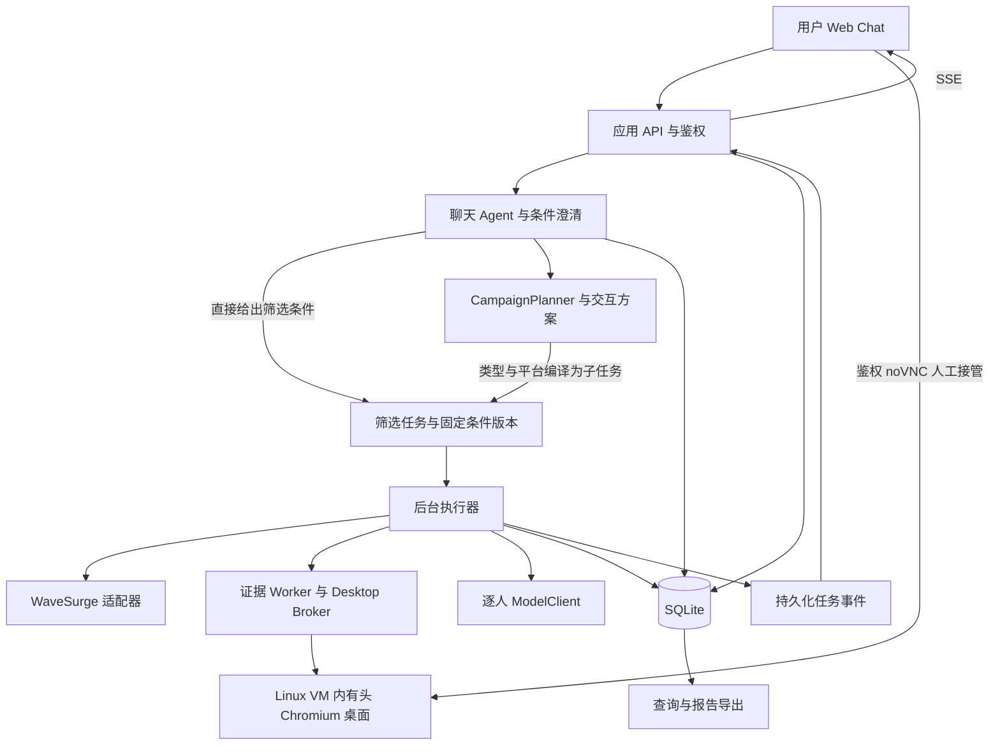
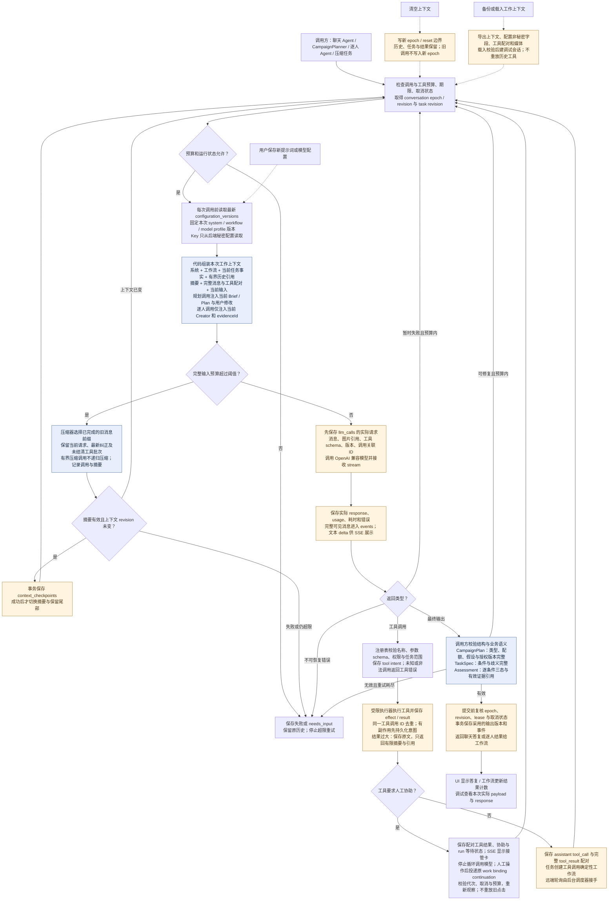
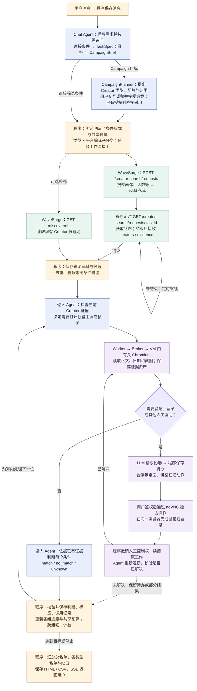
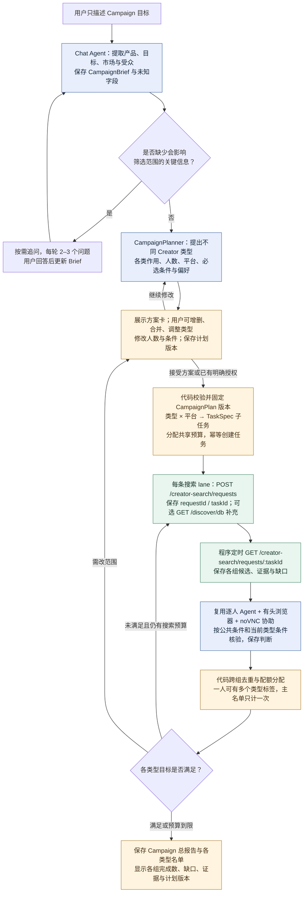

# WaveSurge Creator 筛选应用功能与技术方案

> 本文保留为前期设计记录。当前实现、实际验收与功能边界以 [Creator Studio 交付报告](creator-studio-delivery-2026-10-10.md) 为准。

初次分析：2026 年 10 月 9 日，Asia/Shanghai；方案修订：2026 年 10 月 10 日。主要 API 观测为 10 月 9 日 23:03，无头浏览器追加验证见第十五节；本次按用户要求把 Linux 虚拟机、有头浏览器与 noVNC 人工接管纳入首版，第十六节给出消息执行简图；Campaign 目标交互升级为完整 P0，第十七节明确多类型规划及执行方案。本文承接「分析设计完善」会话，结合更新后的 api.md、WaveSurge 实际返回与本地 OpenClaw 源码，确定功能、模块边界和验收标准。接口及无头浏览器观测是已完成的验证；虚拟机桌面、Agent 和应用流程仍是待实现的方案。

建议实现一个有任务状态的 Creator 筛选应用：用户通过聊天确定条件，后台召回候选、补充证据并逐人调用模型，最后交付可复核的名单。应用自己的数据库管理任务和结果，模型负责需求理解与定性判断。首版使用独立的薄 Agent 运行层，借鉴 OpenClaw 的工具循环、上下文投影与压缩原则；在 Linux 虚拟机内运行持久桌面容器，Agent 与人工通过同一个有头 Chromium 获取证据。

## 一 需要调整的结论

1. **无 Campaign 的候选读取确实可用。** 当前账号没有 Campaign，`GET /discover/db` 不传 `campaignId` 仍返回候选。因此可以用现有候选池开展开发与补充召回。但其条件检索和分页能力有限，不能把它当作任意条件的全库搜索。
2. **直接搜索的非空结果和免邮箱交付已经实际取得。** `GET /creator-search/requests/:taskId` 直接返回 `creators`、`alsoFound`、结束摘要和 usage。省略邮箱参数的首轮交付 0 人，说明中出现公开邮箱门槛；相同画像显式传 `emailReadyRequired: false` 的第二轮交付 2 人，其中一人的 contact 没有 email。无联系方式要求时必须显式传 false；不能据省略参数的行为推定永久默认值。
3. **服务端预计值与实际观测需要区分。** 两个小样本运行时均返回 `expectedDurationHours: 5`；分别在提交约 28.5 和 12.7 分钟后的轮询观测到 done。实际结束时刻未返回，这些是观测上界，不是精确耗时或后续 SLA。当天开发应尽早发起搜索，并准备标明来源和时间的真实快照。
4. **直接搜索已有文字证据，但视觉条件仍需补充。** 第二轮返回头像、主页 URL、粉丝数、带发布日期的帖子链接及文字证据、粉丝抽样画像；没有帖子图片或视频数组。现有池 500 条 Instagram 样本的 qualification 均为空。帖子文字可支撑主题复核，不能证明戴眼镜或近期视觉风格。
5. **费用说明存在适用范围冲突。** 文档称聊天免费，实际价目表列出 `agent_turn = 6 credits`，描述为 Strategy chat turn。不能据此断言 `/codex-chat/.../turns` 一定扣 6，也不能继续保证所有官方聊天免费。首版使用自己的聊天和模型调用，不依赖这个尚未澄清的收费入口。
6. **OpenClaw 的私有 core 包不能直接作为独立依赖安装。** `agent-core`、`llm-core` 是私有 workspace 包；公开的 `@openclaw/ai` 是模型适配层，不提供完整业务任务运行时。

这些修正保留了之前方案的核心方向：逐人判断、三态结果、持久化进度和独立复核仍然必要。

## 二 WaveSurge 接口验证

初次读取的三份文档与引用会话附件一致。用户随后更新 api.md；重新读取后，该文件也与本次 HTTPS 获取的公开 API 文档一致。新版新增的示例用于解释接口，以下结论仍优先依据令牌实测；示例中的对象 ID 没有作为真实资源调用。观测仅适用于本次账号、请求和时间范围。[API 文档](https://wavesurge.ai/api/v1/public/docs/api.md)、[使用文档](https://wavesurge.ai/api/v1/public/docs/guide.md)、[官方 Skill](https://wavesurge.ai/api/v1/public/docs/skill/SKILL.md)。

| 验证项 | 实际返回 | 技术影响 |
| --- | --- | --- |
| Cookie 调用 `/auth/me` | HTTP 200 | `.env` 中的令牌有效；凭据留在后端 |
| Bearer 调用 `/auth/me` | HTTP 200 | 此接口支持 Bearer |
| Bearer 调用 `/codex-chat/conversations` | HTTP 401，要求 browser session | 官方聊天统一使用 Cookie |
| 未鉴权调用 `/discover/db` | HTTP 401 | 候选读取需要登录身份 |
| 未鉴权调用 `/pricing` | HTTP 200，`{data, asOf, actor}` | 价格适配器要解开 `data` 信封 |
| `/kol/campaigns` | 空列表 | 本次无 Campaign 读取候选的结论有明确前提 |
| 无 Campaign 的 `/discover/db` | Instagram、TikTok、YouTube、twitter 均 HTTP 200 | 可以读取当前账号可见的现有候选池 |
| `/discover/db` 缺少 `platform` | HTTP 400，只有 `{error}` | 错误不保证都有 `code/category` |
| `/discover/db` 带粉丝范围参数 | HTTP 200，仍返回 489,740、387,441、334,901 粉丝的账号 | 本次测试的 `minFollowers/maxFollowers` query 没有生效，必须本地过滤 |
| 免费直接搜索，`count=2` | HTTP 201，返回 `taskId` | 自然语言新搜索采用此入口 |
| 相同 `requestId` 和 body 再提交一次 | HTTP 201，返回相同 `taskId` | 相同请求的幂等重放已验证；不同 body 冲突尚未验证 |
| 直接搜索状态与结束 | 两次均 HTTP 200，running → done；分别交付 0 人、2 人，含 summary/usage | done 只表示远端结束；应用仍须逐条件复核 |
| 直接搜索的交付门槛 | 远端说明公开邮箱记录缺失、第三方查询 `apify_http_403` | 原请求未要求邮箱；不能把内部 403 当作 WaveSurge 登录失效 |
| 显式 `emailReadyRequired: false` | 对照搜索 done，交付 2 人；其中一人没有 email 字段 | 本次验证可交付无邮箱候选；不要求联系方式时显式传 false |
| 两个头像 URL，无凭据读取 | HTTP 206，JPEG 类型与文件头吻合 | 样本头像可直接读取；访问期限和其他媒体未证明 |
| 两次搜索结束后的余额与流水 | 余额均为 2,058，差值 0；最近两笔流水一致 | 本次空结果及非空结果的免费搜索均未观察到扣积分 |
| 已有项目的 brief 与 creator-search/current | HTTP 200；briefRevision=0、brief={}；current 为 needs_requirements、latestTask=null | 已验证项目式状态读取；不用于未关联项目的直接搜索 |

本次创建了一个直接搜索任务、做了一次相同请求的幂等验证，并创建了显式不要求邮箱的对照搜索；没有发送官方聊天 turn、确认付费工作、外联或付款。

### 直接搜索任务

已创建的远端任务为 `16a57ca6-521f-4843-8bb2-a3eccbd1a7ff`，请求 ID 为 `creator-filter-contract-20261009-instagram-01`。这是 2 位 Instagram 科技内容创作者的小样本搜索，粉丝条件为 10,000 至 100,000。

首次任务完成响应的关键字段如下，`summary` 与 `usage` 仅列出部分字段：

```json
{
  "status": "done",
  "strategyOperationId": null,
  "creators": [],
  "alsoFound": [],
  "summary": { "delivered": 0, "requested": 2 },
  "usage": { "modelCalls": 75, "providerCalls": 99 },
  "expectedDurationHours": null
}
```

任务的 `summary.lanes[].shortfallReason` 称，两位潜在候选人的公开邮箱没有通过 `creator_contacts` 记录，第三方联系方式查询出现 `apify_http_403`，因此没有交付。原始请求没有传入 `emailReadyRequired: true`，公开联系方式也不是本次搜索需求。这个额外交付门槛会直接影响本题的筛选闭环。该原因来自远端任务说明，本次未直接调用第三方核验；WaveSurge 状态接口本身返回 HTTP 200。[完成响应](</Users/shawn/coding/projects/wavesurge/wavesurge_testing/validation/2026-10-09/direct-search-done-05.json>)。

对照任务 `184099be-3293-4547-a46e-83adae772fd1` 使用相同画像、平台、人数、语言和粉丝范围，仅改用新 requestId 并显式传入 `emailReadyRequired: false`。23:02:28 的观测已 done，summary.requested=2、delivered=2、shortfallReason=null；返回 mikebanh_（36,502 粉丝，地区 Canada）和 securitywithsam（10,250 粉丝，地区 United States）。后者 contact 只有网站及其他线索，没有 email。本次结果直接证明了该入口能够交付无邮箱候选，支持首版显式传 false；两次异步搜索不是同一候选的确定性重放，仍不能据此证明所有账号的默认参数语义。[非空完成响应](</Users/shawn/coding/projects/wavesurge/wavesurge_testing/validation/2026-10-09/direct-search-noemail-poll-03.json>)。

第二轮确认了非空 Creator item：profileUrl、avatarUrl、providerUserId、factorGrades、contact、audience、evidence[] 等字段；evidence 包含 url、kind、text、provider、publishedAt。平台提供的是源资料与判断线索，尚未通过应用自己的模型复核。第一轮 usage 为 75 次模型 / 99 次 provider 调用，第二轮为 55 / 104。usage.byPath 是服务端内部调用观测，不能作为新增的公共 API；*CostUsd 也不能作为用户价格。本地 ModelClient 预算不控制这些远端内部调用。

### 现有候选池的用途

`/discover/db` 的响应包含 `summary`、`tiers`、`creators`、`strategy`、`screening`、`scraping`、`collecting`、`latestCreatorSearchTaskId`、`latestSearchFunnel`、`target`、`fulfilled` 和 `campaignState`。无 Campaign 时多个工作状态字段为空。

一次 `platform=instagram&limit=500&sort=followers_asc` 查询返回 500 个不同 ID，粉丝数为 1,010 至 5,445，因此没有账号通过 10,000 至 100,000 的粉丝条件。其中 277 条有头像，77 条有非空 `audience`，25 条有非空 `publishedLink`，`qualification` 全为空。另一次 `fit_desc&limit=50` 查询只有 1 位通过该粉丝范围。

这些都是排序后的样本。接口没有提供已验证的 cursor，`summary.byPlatform` 的 500 也不能作为全库数量或穷尽证明。不能用“取了 500 人”推导“目标范围无人”，也不能保证从现有池就能得到 20 位合格人选。首版把现有池作为补充来源，完整召回依赖直接搜索；不足时如实交付缺口。

## 三 实际数据字段与证据边界

直接搜索和现有池都已取得真实 item，但结构不同。应用保留各来源的原始响应，用 directSearchAdapter 与 discoverDbAdapter 分别转换，不能把同一套字段断言用于两个接口。下面先列现有池的字段，再列直接搜索的增补结构。

| WaveSurge 字段 | 应用中的用途 | 不能据此得出的结论 |
| --- | --- | --- |
| `id`、`platform`、`handle` | 来源 ID、平台、账号标识、去重 | 不保证跨平台属于同一个真人 |
| `displayName`、`bio` | 展示和文本分析 | 简介不足以证明近期实际内容风格 |
| `followerCount` | 程序检查粉丝边界 | 没有独立核验时间时不能称为实时值 |
| `region` | 地区线索 | 不自动等于居住地、国籍或受众市场；返回中的 hint 也明确提示此限制 |
| `audience`、`audienceStatus` | 粉丝画像及可用性 | 不等于创作者身份；抽样和 Unknown 占比需要保留 |
| `avatarUrl` | 展示头像和有限视觉证据 | 不证明近期经常戴眼镜、帖子风格或视频表现 |
| `publishedLink` | 原样保存的外部链接 | 样本包含官网、博客等链接，不能当作固定的帖子 URL 或主页 URL |
| `details[]` | 按 `key` 提取补充指标 | label 是展示文案；指标可能基于不同样本量 |
| `engagementRate`、`engagementKnown` | 已知互动率 | `null` 不能转成 0 |
| `fit`、`kolType`、`tier` | 平台已有评分和标签 | 高 `fit` 不证明当前用户的全部条件通过 |
| `qualification`、`searchMatchTier` | 条件核验扩展位置 | 本次均为空，不能假设已有逐项判断 |
| `contactChannels[]` | 联系线索 | 样本包含大量网页资源、脚本链接，不能把所有 value 当成联系方式或内容证据 |

直接搜索实测增加了以下资料：

| 直接搜索字段 | 实际结构与适配规则 |
| --- | --- |
| providerUserId / platform / handle | 本次没有 id；平台用户 ID 与候选池 id 分别保存，不混用命名空间 |
| profileUrl / avatarUrl / profileCompleteness | 直接使用返回的主页和头像链接，标为 provider_supplied；full 不代表所有业务证据齐全 |
| overallTier / searchMatchTier / factorGrades | 本次两人均 A / precise；role、activity、identity、location、followers、relevance 是平台判断线索，不能替代本地条件核验 |
| evidence[] | 每人 4 条；含帖子 URL、文字摘录、provider 与 publishedAt；保存为来源文字证据，不声称已下载或独立核实帖子 |
| contact | 可有邮箱、网站、emailOwnership、deliverability 等，也可没有 email；第二人没有邮箱 |
| audience.view / audience.record | record.sampleSize 和 view.sampledCount 均 25，包含年龄、性别、地区 buckets 与 low confidence；保留 method、moePct、capturedAt 和 Unknown 占比 |

受众外层 sampled=0、countries=[] 与内部样本非空同时出现，不能只读外层，也不能把它当成独立精确统计。本次 mikebanh_ 的年龄 Unknown 为 62.5%，地区 Unknown 约 48%；securitywithsam 的年龄 Unknown 约 68%。适配器优先显示 record/view 中带 method 与时间的对应维度，同时保存矛盾诊断，不把样本地域等同于创作者所在地。

直接搜索的第一条帖子日期分别为 2026-09-23 与 2026-07-26；即便 factorGrades.activity=recent，也不能据此断言两人都满足最近 30 天内容要求。结果没有 bio 或帖子媒体数组时保留缺失，需补充采集后才判断视觉条件。

规范化 Creator 使用应用自有 creatorKey（platform + 规范化账号；必要时以规范主页作为备用），保存 source、sourceRecordId、providerUserId、资料获取时间、profileUrl 来源、证据和原始 snapshot 引用。候选池未提供主页时才构造 profileUrl：Instagram、TikTok、X 按 handle；YouTube 的 UC... 使用 /channel/:id。构造链接标为 constructed，平台给出的标为 provider_supplied，确认页面身份后才标 verified。

证据保存 `evidenceId`、Creator ID、来源 URL、证据种类、获取时间、内容日期、内容散列、文本或媒体引用、获取状态。头像、帖子图片、截图、平台判断和用户补充是不同证据类型。网页返回和创作者简介作为不可信资料使用，不能改变工具权限或任务条件。

## 四 功能列表与首版范围

P0 是首版必须完成的功能；P1 是主流程通过后增加；P2 留到后续。2026 年 10 月 10 日用户确定增加虚拟机、有头浏览器和 VNC 协助，因此这三项与完整调试能力均进入 P0。原约 10 小时安排不再覆盖全部新增范围，开发阶段按验收门槛重新排序。

| 功能 | 优先级 | 具体范围与验收 |
| --- | --- | --- |
| 登录 | P0 | 单 admin；首次生成随机密码并持久化散列；重启后有效；所有后端入口鉴权 |
| Chat | P0 | 文本、上传图片、任务卡、追问卡、候选卡、结果卡；刷新可恢复 |
| 条件结构化 | P0 | 平台别名、数量、粉丝范围、必选与偏好、可判断定义、版本；关键歧义需澄清 |
| 候选召回 | P0 | 免费直接搜索；现有池补充读取；来源可见；去重与数值过滤 |
| 后台任务 | P0 | 轮询、预算、逐人进度、重试、重启恢复、本地取消、部分交付 |
| 逐人模型分析 | P0 | 独立上下文；逐条件三态判断；证据引用校验；单人失败不拖垮整批 |
| 补充证据 | P0 | 受限 HTTP 读取、图片处理、用户上传与跳过；不能读取时保留 Unknown |
| 有头浏览器证据采集 | P0 | Linux VM 内的持久桌面容器；同一 Chromium profile；DOM 优先，必要时观察后执行坐标动作；正文、日期、截图登记证据 |
| 结果与标签查询 | P0 | 按任务、平台、结论、标签查询；汇总候选、通过、未通过、待复核与失败数量 |
| 结果文档 | P0 | HTML 报告与 CSV；包括条件版本、缺口、逐项说明、来源和证据时间 |
| 完整调用查看 | P0 | 最新实际请求、完整消息和工具块、实际返回及 usage；大内容展开加载 |
| 上下文备份清空载入 | P0 | 带媒体的版本化工作上下文快照；清空写边界；载入不自动重放工具 |
| 提示词管理 | P0 | 系统与工作流提示词；不可变版本；下一次 LLM 调用采用已保存版本 |
| 模型配置 | P0 | Base URL、协议、Key、模型、窗口、压缩阈值、输出上限；文本、工具、图片、结构化输出能力检查 |
| 历史召回 | P0 | 搜索以前任务和结果；只注入少量相关摘要与引用 |
| Campaign 目标交互与多类型筛选 | P0 完整 | 从目标追问形成 Brief；AI 提出不同 Creator 类型、作用、配额和范围；交互编辑并接受计划；编译多组子任务，共享预算、跨组去重与汇总报告 |
| 同一浏览器人工接管 | P0 | LLM 请求协助；暂停桌面动作、排空在途操作；鉴权 noVNC 接管验证与登录；撤销控制权后重新观察并续接原任务 |
| Linux VM 部署与桌面生命周期 | P0 | 一台 VM 承载 Broker 与桌面容器；桌面按需启动、停止、恢复；profile 放持久卷；容器重建保留会话 |
| 多实例 VM 编排 | P2 | 云厂商自动建机、弹性调度、公开多租户隔离基座；保留 provider 接口，后续按规模实现 |
| 任意 Bash、动态 Skill、向量记忆 | P2 | 不进入首版默认工具集 |
| 官方付费交付与外联 | P2 | 后续必须独立实现报价、付款人、时效和确认状态；与本地筛选解耦 |

首版的视觉闭环采用浏览器获取正文、发布时间与必要截图，再交给支持图片的模型判断。遇到验证、登录或无法可靠操作的页面，LLM 请求人工协助；无法补齐证据时仍允许上传、跳过或记为 Unknown。VM、有头模式与人工登录不保证所有平台持续可读，验收必须覆盖至少一条真实采集链路和一次人工接管。

依据 [容器桌面参考](</Users/shawn/coding/projects/wavesurge/wavesurge_testing/docs/container-computer-use.md>)，部署采用 Linux VM → Docker Desktop Cell → Xvfb / Fluxbox / 有头 Chromium / Playwright / x11vnc / noVNC。参考实现的隔离单位是容器，VM 是本项目的部署宿主；首版不必为每位 Creator 启动一台 VM。桌面身份和持久卷独立于容器，Agent / 人工共享同一 profile，以 inputOwner 和执行 gate 保证独占输入。Docker socket 只交给 Broker，noVNC 经鉴权与短期授权代理访问。本工作区没有参考文档所链接的实现文件，因此需要实现或另行引入组件，不能按已验证的现成代码估算。

## 五 技术架构

推荐 TypeScript 单仓库：React 与 Vite 构建前端，Fastify 提供 API 和 SSE，Node.js 24 LTS 运行后端，SQLite 保存业务与调用记录，Kysely 管理常规查询。数据库由单独 worker 持有连接，写入串行化；后台执行器负责网络请求和模型调用。首版采用单实例与持久化磁盘，先不加入 Redis 或分布式队列。Node 24 当前为 LTS；SQLite WAL 的读写并发要求同机文件系统，部署使用本地卷。[Node.js 发布状态](https://nodejs.org/en/about/previous-releases)、[SQLite WAL 文档](https://sqlite.org/wal.html)。

模型入口使用 OpenAI SDK 的 Chat Completions 兼容协议，封装成自己的 `ModelClient`。协议和能力由配置明确声明；遇到不支持 JSON Schema 的服务，采用普通 JSON 加本地校验，不把工具调用或视觉能力静默降级。



聊天 Agent 处理需求、追问和解释；CampaignPlanner 根据目标生成并交互修改多类型方案，代码把确认或已授权的 Plan 编译为子任务，后台工作流执行批量筛选。它们共享数据库与 ModelClient，规划上下文使用当前 Brief / Plan，逐人上下文只加载相关条件及证据。等待 WaveSurge 不消耗新的模型调用。

### 完整执行流程：系统代码与 Agent

[端到端图：SVG，可放大](</Users/shawn/coding/projects/wavesurge/wavesurge_testing/reports/creator-screening-execution.svg>) · [PNG](</Users/shawn/coding/projects/wavesurge/wavesurge_testing/reports/creator-screening-execution.png>) · [可编辑 Mermaid 源码](</Users/shawn/coding/projects/wavesurge/wavesurge_testing/reports/creator-screening-execution.mmd>)。

以下表示建议实现的完整路径。蓝色节点是 Agent 或模型处理，绿色是 WaveSurge 请求，浅黄色表示主要落库点。所有 WaveSurge 路径以 https://wavesurge.ai/api/v1 为前缀；应用自己的 /api 接口另行定义。有头浏览器与人工接管已经纳入首版。每个 Agent 调用都执行下一张图的内部逻辑；第十六节另有便于沟通的简图。

```mermaid
flowchart TD
    U["用户登录并发送需求或 Campaign 目标"] --> INPUT["应用 API 鉴权、校验输入<br/>保存 conversations / events / 上传附件"]
    INPUT --> CHAT["聊天 Agent：调用统一 ModelClient<br/>直接条件 → TaskSpec；Campaign 目标 → Brief / 多类型 Plan<br/>历史查询、关键追问和交互修改"]
    CHAT --> CLEAR{"条件完整且当前范围已接受或授权？"}
    CLEAR -->|否| ASK["保存追问与 needs_input<br/>SSE 展示问题；等待用户回答"]
    ASK --> INPUT
    CLEAR -->|是| TASK["代码校验条件、总数、类型/平台配额与共享预算<br/>直接 TaskSpec，或从固定 CampaignPlan 编译子任务<br/>事务保存 tasks：spec revision、父任务/类型绑定、queued<br/>保存任务事件后发布 SSE"]

      TASK --> LEASE["后台执行器领取 lease<br/>状态 searching；检查取消、预算和期限"]
      LEASE --> HEALTH["WaveSurgeClient：后端 Cookie 鉴权<br/>GET /auth/me：验证身份<br/>GET /pricing、/credits/balance、/credits/ledger：费用诊断"]
      HEALTH --> AUTHOK{"身份验证通过？"}
      AUTHOK -->|否| CREDS["保存 needs_input 与鉴权诊断<br/>更新后端凭据后恢复"]
      CREDS --> HEALTH
      AUTHOK -->|是| OP["先保存 search_operations<br/>稳定 requestId、请求 body、spec revision"]
      OP --> POST["POST /creator-search/requests<br/>personaText、count、platforms、粉丝范围等<br/>不要求邮箱时显式 emailReadyRequired=false"]
      POST --> ID["返回 taskId；立即落库<br/>POST 超时沿用同一 requestId 与相同 body"]
      ID --> TIMER["持久化 nextPollAt<br/>每约 60 秒调度一次，不占用 Agent 调用"]
      TIMER --> GET["GET /creator-search/requests/:taskId<br/>读取 status、creators、alsoFound、预计时间<br/>结束时读取 summary / usage / 缺口原因"]
      GET --> REMOTE{"远端状态？"}
      REMOTE -->|queued 或 running| TIMER
      REMOTE -->|done，含交付 0 人| RAW["保存来源原始响应、散列和时间<br/>更新对应来源状态与诊断"]
      REMOTE -->|failed| RAW
      GET -->|HTTP 或网络异常| ERROR["状态码与可选 code/category 分流<br/>429 / 暂时错误有界退避<br/>401 / 403 / 参数错误停止并提示；保存原始诊断"]
      POST -->|HTTP 或网络异常| ERROR
      ERROR -->|允许重试：原 operation| KNOWN{"已保存远端 taskId？"}
      KNOWN -->|是| TIMER
      KNOWN -->|否| POST
      ERROR -->|无法继续| GAP
      LEASE -. 可选补充来源 .-> POOL["GET /discover/db?platform=...&limit=...&sort=...<br/>取得池内 creators、bio、粉丝数、audience 等<br/>有已知 Campaign 时才添加 campaignId"]
      POOL --> RAW
      RAW --> ADAPT["按 direct_search / discover_db 分别适配<br/>保存 creator_snapshots 与来源证据<br/>平台 + 规范化账号去重；代码执行数值硬过滤"]
      ADAPT --> QUEUE["保存 task_creators：pending / rejected<br/>alsoFound 也只是候选；平台评分保留为来源判断"]

      QUEUE --> NEXT{"还有可处理候选<br/>且本地预算允许？"}
      NEXT -->|是| CLAIM["领取一个 Creator；状态 fetching<br/>每人独立上下文；模型分析可并发 3<br/>同一桌面动作串行、人工接管时暂停"]
      CLAIM --> EVID["保存并分配 evidenceId<br/>直接搜索：evidence 的 URL / text / publishedAt<br/>头像：受限 HTTP 获取并保存文件<br/>有头浏览器补充公开帖子与截图"]
      EVID --> HUMAN{"登录、验证或操作受阻<br/>需要人工协助？"}
      HUMAN -->|是| HELP["LLM 调 computer_request_human_assistance<br/>保存原 conversation / task / Creator / 桌面代次<br/>冻结新桌面动作并等待在途动作排空"]
      HELP --> VNC["用户鉴权认领协助请求<br/>独占 inputOwner=human；短期 noVNC 控制同一浏览器<br/>人工完成验证或登录；Agent 暂停桌面输入"]
      VNC --> RESUME["完成、取消或到期：撤销 Viewer 与租约<br/>核验原工作仍有效；Agent 重新观察页面<br/>成功则继续，仍受阻则保持 needs_input / 部分交付"]
      RESUME -->|可继续| EVID
      RESUME -->|仍受阻| MANUAL
      HUMAN -->|否| ENOUGH{"所需证据可获取？"}
      ENOUGH -->|不足| MANUAL["保存证据缺口与获取失败<br/>提示用户上传、跳过或按现有证据判断<br/>非浏览器工作可继续；同桌面输入仍受接管 gate 限制"]
      MANUAL -->|用户补充附件| EVID
      MANUAL -->|按现有证据判断| PERSON
      ENOUGH -->|是| PERSON["逐人 Agent 调用统一 ModelClient<br/>读取固定 TaskSpec、当前 Creator 与有限证据<br/>按条件判断；必要时调用受限证据工具"]
      PERSON --> CHECK["代码校验 assessment<br/>条件完整、evidenceId 属于当前人、引用支持结论<br/>数值由代码决定；必选条件三态 AND 汇总"]
      CHECK -->|格式或引用不合法，预算内| PERSON
      CHECK -->|执行失败且可重试| CLAIM
      CHECK -->|通过，或重试耗尽| SAVE["核对 lease、task revision 与取消状态<br/>事务保存 task_creators 的版本化判断和标签<br/>保存 llm_calls 关联、计数与 events 后发布 SSE"]
      SAVE --> TARGET{"合格数达到目标？"}
      TARGET -->|否| NEXT
      TARGET -->|是| FINAL
      NEXT -->|无候选或预算到限| GAP{"有缺口时如何继续？"}
      GAP -->|已有远端搜索未结束| TIMER
      GAP -->|预算内且召回不足，且无在途搜索| REPLENISH["生成新 search operation 与新 requestId<br/>保持已确认条件；不静默放宽标准"]
      REPLENISH --> OP
      GAP -->|需补充证据或改变条件| WAIT["保存 needs_input 与待办<br/>用户补充后恢复；改条件则新建 spec revision"]
      WAIT -->|补充当前人| EVID
      WAIT -->|修改条件| CHAT
      GAP -->|无可用补充方案，或预算到限| FINAL["代码汇总 completed / partial / failed / cancelled<br/>分别统计 match / no_match / unknown / 执行错误<br/>保存停止原因、远端缺口与剩余待办"]

    FINAL --> EXPORT["报告代码读取固定条件与采用的判断版本<br/>Campaign 模式跨组去重、配额分配并汇总各组缺口<br/>生成 HTML / CSV；保存 artifacts 和文件散列<br/>Chat 展示报告；鉴权下载与标签查询"]
    SAVE -. 进度 .-> VIEW["任务卡和 Creator 卡通过 SSE 更新<br/>刷新先读数据库快照，再续订事件"]
    EXPORT --> VIEW
    TASK -. 用户操作 .-> CANCEL["用户取消"] -.-> STOP["写取消状态并 Abort 本地调用<br/>晚到结果校验后丢弃；保留已完成结果<br/>远端搜索可能继续运行"]
    STOP --> FINAL
    U -. 服务生命周期 .-> RESTART["服务启动或重启"] -.-> RECOVER["读取未完成任务、operation 与过期 lease<br/>有远端 taskId 则继续 GET；完成者复用<br/>只重新领取未完成的 Creator"]
    RECOVER --> TIMER
    RECOVER --> NEXT

    classDef agent fill:#e8eefc,stroke:#4169a1,color:#14263d;
    classDef api fill:#e9f5ef,stroke:#44876a,color:#173627;
    classDef saved fill:#fff4df,stroke:#aa7d37,color:#493015;
    class CHAT,PERSON agent;
    class HEALTH,POST,GET,POOL api;
    class INPUT,TASK,OP,ID,RAW,QUEUE,EVID,SAVE,FINAL,EXPORT saved;
```



### Agent 内部：每次调用、工具循环与上下文保存

[Agent 图：SVG，可放大](</Users/shawn/coding/projects/wavesurge/wavesurge_testing/reports/creator-screening-agent-call.svg>) · [PNG](</Users/shawn/coding/projects/wavesurge/wavesurge_testing/reports/creator-screening-agent-call.png>) · [可编辑 Mermaid 源码](</Users/shawn/coding/projects/wavesurge/wavesurge_testing/reports/creator-screening-agent-call.mmd>)。

该流程同时适用于主聊天与逐人分析。控制循环的是代码；模型返回的工具请求必须通过注册表和业务范围校验。压缩另用有界输入调用，计入预算并保留调用记录，不能在压缩任务内无限触发压缩。



### 外部接口与处理结果的对应关系

| 调用位置 | WaveSurge 接口与取得的信息 | 应用保存或执行 |
| --- | --- | --- |
| 后端初始化 / 诊断 | GET /auth/me；GET /pricing；GET /credits/balance；GET /credits/ledger | 校验后端令牌；缓存价格与账户观测，保留时间；不把凭据交给模型或前端 |
| 新召回 operation | POST /creator-search/requests → taskId | 请求意图先写 search_operations，随后保存远端 ID；只重试相同意图 |
| 定时轮询 | GET /creator-search/requests/:taskId → 状态、creators、alsoFound、summary、usage | 保存原始响应及诊断；done 后进入逐人复核；交付 0 人仍保留缺口 |
| 补充候选 | GET /discover/db?platform=...&limit=...&sort=... → creators、summary 及任务线索 | creator_snapshots；按来源适配、去重和本地数值过滤；无已知 Campaign 时不填 campaignId |
| 证据输入 | direct item 的 evidence、avatarUrl、profileUrl；没有已验证的独立帖子媒体接口 | evidence 保存来源文字；受限 HTTP / 有头桌面 / 用户上传保存所需图片和出处；页面采集不携带 WaveSurge Cookie |
| 条件理解与判断 | 不调用官方 codex-chat turn；自有 ModelClient 调用配置的模型 | llm_calls 保存实际输入输出；代码校验 TaskSpec / assessment，写 task_creators 与 events |
| 交付 | 不调用 WaveSurge commit、付费 confirm 或 outreach | 本地报告生成器读取数据库，保存 artifacts；SSE 通知并提供鉴权下载 |

主聊天工具 request_clarification 写追问，search_history 只查本地历史，get_task_summary 只读任务事实，submit_task_spec 只创建经过校验的直接筛选任务。Campaign 模式增加 save_campaign_brief、propose_campaign_plan、get_campaign_plan 和 start_campaign_screening；生成草案不发起搜索，启动后由代码编译子任务，方案版本与授权校验见第十七节。逐人工具 get_creator_snapshot / get_evidence 只读当前人；fetch_public_evidence、受限 browser_* 与 computer_observe / computer_action 通过 Worker 和 Broker 获取资料；computer_request_human_assistance 保存协助请求并暂停当前工作；submit_assessment 经过本地条件和引用校验。工具不能由模型直接构造任意 WaveSurge 路径；搜索 POST 和轮询由工作流代码管理。

## 六 数据模型与判断规则

### 筛选条件

以下是应用自有结构示例，不是 WaveSurge 的接口格式：

```ts
type Verdict = "match" | "no_match" | "unknown";

type TaskSpec = {
  revision: number;
  targetCount: number;
  platforms: ("instagram" | "tiktok" | "youtube" | "twitter")[];
  followerRange?: { min: number; max: number; inclusive: true };
  language?: string;
  regions?: {
    dimension: "creator_country" | "audience_market";
    countries: string[];
    minAudienceSharePct?: number;
  };
  requireEmail: boolean;
  platformTargets?: Partial<Record<"instagram" | "tiktok" | "youtube" | "twitter", number>>;
  evidenceFreshnessDays?: number;
  criteria: {
    id: string;
    label: string;
    required: boolean;
    definition: string;
    evidencePolicy: "numeric" | "text" | "visual" | "explicit_self_description";
  }[];
  unresolvedQuestions: string[];
  budget: {
    maxCandidates: number;
    maxSearchOperations: number;
    maxModelCalls: number;
    deadlineAt: string;
  };
};

type CriterionAssessment = {
  criterionId: string;
  verdict: Verdict;
  reason: string;
  evidenceIds: string[];
};
```

粉丝范围、平台和去重由代码判断；风格和内容特征由模型依据证据判断。全部必选条件 `match` 才合格；任一必选条件 `no_match` 就不合格；没有明确失败但存在必选 `unknown` 则待复核。偏好分数用于合格人选排序，不能抵消必选条件。

输出校验需要拒绝缺失条件、重复条件、非法 evidence ID、无支持证据的定性 `match`，以及把执行失败当作 `unknown` 的结果。模型 JSON 合法只是第一层校验。

对原题的示例，应澄清 geek 风指主题还是视觉风格，戴眼镜指一次样本还是近期常见，欧美指所在地还是受众市场，KOC 用什么业务定义。种族或族裔条件只能使用明确本人自述来源，不能从照片、姓名或地区推断；无来源时记为 `unknown`，不宣称满足全部条件。

### 持久化实体

| 实体 | 保存内容 |
| --- | --- |
| `conversations`、`events` | 会话、完整消息与工具事件、工作上下文 epoch、可恢复的进度事件 |
| `context_checkpoints` | 摘要、保留消息边界、上下文 revision、压缩前后预算 |
| `campaigns`、`campaign_brief_versions` | 本地父任务、营销目标与事实来源、Brief 版本、状态、开始与截止时间 |
| `campaign_plan_versions` | 不可变 Plan、公共约束、类型/平台配额、推荐理由、assumptions 与接受/授权记录 |
| `campaign_plan_task_bindings` | Plan revision、类型、lane、子任务 ID、条件散列与合法复用关系 |
| `campaign_assignments`、`campaign_budget_usage` | 已采用的唯一主分组、配额与缺口、原子预算预留及使用 |
| `tasks` | TaskSpec、预算、状态、停止原因、计数、条件 revision；Campaign 子任务绑定父任务与类型 |
| `search_operations` | 来源、稳定 requestId、请求 body、远端 taskId、状态、下一次轮询时间；Campaign / Plan revision / 类型 / lane / round 关联 |
| `creator_snapshots` | 来源 ID、规范化资料、完整原始响应、获取时间与散列 |
| `task_creators` | 当前逐人状态、采用的 assessment、条件和分析版本、重试次数 |
| `evidence` | 证据种类、出处、日期、内容散列、文本或媒体资产引用、读取状态 |
| `desktop_workspaces` | 稳定桌面身份、所属 workspace / collector Agent、容器状态、profile 卷、inputOwner、revision、runtimeGeneration |
| `capability_jobs` | 原 conversation / task / Creator / tool call 关联、参数、执行 lease、not_started / running / succeeded / failed / result_unknown、结果引用 |
| `human_assistance` | 原工作与桌面代次、协助原因、requested / draining / active / completed / cancelled / expired、输入租约、continuation 与审计 |
| `assets` | 截图和必要媒体的句柄、路径、类型、尺寸、散列、所有者与鉴权读取信息；模型历史不保存整段 base64 |
| `llm_calls` | 每次实际请求与返回、消息和工具 schema、prompt/model 版本、usage、耗时与错误 |
| `configuration_versions` | 提示词与模型配置版本；Key 单独保管，不进入导出 |
| `artifacts` | HTML、CSV、上下文快照等交付物与鉴权下载引用 |
| `preferences` | 用户明确确认的偏好、来源会话与时间；可后置到简易历史查询之后 |

以 (taskId, creatorKey) 约束任务内重复人选；独立保存各来源 ID 与 alias，保证直接搜索和现有池的同平台同账号合并。跨平台相似姓名不自动合并。重新采集产生新 snapshot；重新分析保存新的 assessment JSON 与 analysis revision，每位 Creator 只采用一个明确版本。任务条件改变后旧分析保留，但不能沿用为新条件已通过。

## 七 任务执行方案

### 候选来源

自然语言新需求映射到直接搜索的 personaText、count、platforms、粉丝范围等受支持字段。用户没有要求联系方式时显式传 emailReadyRequired: false，本次已实际取得无邮箱候选。新版文档还给出 platformTargets 对象、regions 数组与 language；多平台配额和地区参数的效果尚未逐项验证，适配器按文档校验但不宣称已实测。TaskSpec 明确保留 language、地区维度、邮箱是否必需、每平台目标与证据新鲜度。地区必须区分创作者国家和受众市场；只有受支持且语义明确的粗筛字段映射到外部 body，不能把受众市场条件直接当作创作者地区参数。

现有池使用文档支持的平台、数量与排序参数，取得后执行本地基础过滤。直接搜索返回后再次过滤，并与现有池按规范化 creatorKey 和已确认 alias 去重。alsoFound 作为额外候选，不自动作为已合格结果；本次两次完成均为空，其非空内容和交付语义仍待确认。

同一次网络重试沿用 requestId；新一轮搜索生成新的 operation 和 requestId。请求意图先落库，收到 taskId 后立即保存。POST 响应丢失时不能换键重发；先依据已有记录核对或以同一请求重试。

### 本地状态

任务状态采用 `draft → needs_input → queued → searching → assessing → completed/partial/failed/cancelled`，其中 `needs_input` 可发生于执行中。等待图片补充时，只暂停相关 Creator；人工协助另保存持久请求，当前 Creator 标为 awaiting_human。同一桌面 requested / draining / active 期间停止新 Agent 输入，其他不依赖该桌面的工作可继续。协助不是一个阻塞 HTTP 调用，服务重启后根据数据库恢复等待或续接。

远端 `done` 后仍要检查 `creators/alsoFound`、`summary.requested/delivered` 和逐平台 `shortfallReason`。本次请求 2 人交付 0 人，应进入本地补充召回或 `partial`，而非显示“已找到 2 人”。诊断文本提到的账号只能成为待核验线索，不能直接计入名单。

每位 Creator 另有 `pending / fetching / awaiting_desktop / awaiting_human / assessing / matched / rejected / unknown / failed / skipped`。证据不足属于已完成判断；网络或模型失败属于可重试执行错误。这两类必须分别计数。

后台执行器在开始外部调用前领取任务并保存执行身份；完成后核对任务 revision 和取消状态再提交。重启时重新领取未完成项，对已完成者直接复用记录；已有远端 taskId 的任务继续 GET，不能再次搜索。

### 建议初始预算

以下为直接筛选任务的预算；多类型 Campaign 使用第十七节的父级共享预算，不能把这一份上限复制给每个子任务。

目标 20 人时，可先请求 60 个候选，最多处理 200 人、发起 3 个不同 search operation。逐人模型分析可并发 3，但首版只有一个持久桌面，浏览器动作通过同桌面队列串行执行；人工接管期间该队列暂停。每人最多 3 次模型调用，任务总模型调用上限 300，压缩与修复调用也计入预算。聊天澄清循环上限 8 次。它们是可调整的工程初值，不能保证召回或合格数量。

直接搜索每 60 秒轮询一次，并加入小幅随机偏移；429 和暂时网络错误退避，遵守 `Retry-After`。搜索等待可以先设 6 小时、整体期限 8 小时，期限从任务创建时持久化计算，而非服务重启后重新开始。实际预计值变化或任务未完成时，按预算交付部分结果。

达到目标、候选上限、模型预算、任务期限或用户取消时停止本地新增工作。没有公开且已验证的统一远端取消接口，因此文案使用“已停止本地处理，远端搜索可能仍在运行”。

404、401、403、402 等需要分支处理；不能只读自然语言 error。由于已经观测到错误只有 `{error}`，适配器必须同时支持状态码、可选 code/category 和信封式错误，未知结构保存原始诊断。

## 八 Agent 与 OpenClaw 的复用边界

本地 OpenClaw 根版本标为 `2026.9.9`，目录没有 `.git`，无法确认 commit。源码和同版本 npm 发布物的能力不能混称为完全一致。

| 源码事实 | 在本项目中的落地 |
| --- | --- |
| `runAgentLoop` 在模型回复后执行注册工具、加入结果并继续调用 | 实现有限工具循环；不要求模型输出内部思考文字 |
| 一个内存 Agent 同时只允许一个 run | 应用为聊天会话串行执行；数据库状态负责重启恢复 |
| core loop 有继续和停止 hook，但没有自动提供业务成本预算 | 自己限制调用量、总耗时、候选量和工具次数 |
| 工具在执行前校验参数，未知工具生成错误结果 | 使用注册表和 JSON Schema；受限执行器落实权限、超时和域名策略 |
| AbortSignal 向模型和工具传播 | 取消本地调用，但不当作回滚远端副作用 |
| 当前消息在 run 开始快照，更新需显式 hook | 本项目在每次下一次模型调用前重新组装最新提示词并记录版本 |

对应源码：[工具循环](</Users/shawn/coding/projects/wavesurge/openclaw-main/packages/agent-core/src/agent-loop.ts:214>)、[工具校验与执行](</Users/shawn/coding/projects/wavesurge/openclaw-main/packages/agent-core/src/agent-loop.ts:936>)、[会话运行快照](</Users/shawn/coding/projects/wavesurge/openclaw-main/packages/agent-core/src/agent.ts:564>)、[取消入口](</Users/shawn/coding/projects/wavesurge/openclaw-main/packages/agent-core/src/agent.ts:455>)。

`@openclaw/agent-core` 与 `@openclaw/llm-core` 在源码中均为 `private: true`、`0.0.0-private`，依赖 `workspace:*`。不要从仓库复制几个目录，假设就获得了可维护的稳定 SDK。[agent-core 包定义](</Users/shawn/coding/projects/wavesurge/openclaw-main/packages/agent-core/package.json:2>)。

公开 `@openclaw/ai@2026.9.9` 的 npm 元数据已核验，许可证 MIT、Node 要求至少 22.19.0。发布声明包括 `createLlmRuntime`、`stream/complete`、`streamSimple/completeSimple` 和 providers 注册；未包含本地源码中已有的 `createNodeLlmRuntime`、`cleanupSessionResources`。凭据、模型目录、重试和故障切换仍由应用承担。[发布元数据](https://registry.npmjs.org/@openclaw%2fai/2026.9.9)、[本地包说明](</Users/shawn/coding/projects/wavesurge/openclaw-main/packages/ai/README.md:20>)。

首版选择 OpenAI SDK 加薄运行层，减少多厂商模型依赖。若后续需要 OpenClaw 的多协议适配，可替换 ModelClient 内部实现为公开 `@openclaw/ai`，不要依赖其 `internal/*` 子路径。无需集成 Gateway、外部聊天渠道、插件加载体系或完整 OpenClaw 状态库。

主聊天可用工具为 `submit_task_spec`、`request_clarification`、`get_task_summary` 和 `search_history`；Campaign 规划另有 `save_campaign_brief`、`propose_campaign_plan`、`get_campaign_plan`、`start_campaign_screening`，共用 ModelClient 和有限工具循环。逐人分析阶段只开放读取该 Creator 资料、受限浏览器与观察动作、请求人工协助和提交 assessment 的工具。桌面 owner、容器参数和原工作关联由代码生成，模型不能选择任意桌面或 Docker 配置。批量遍历、轮询、筛选计数由代码执行。工具返回有限摘要和数据集 ID，避免把 500 人、网页全文及全部图片放进一个上下文。

## 九 上下文管理与提示词更新

### 完整历史与工作上下文

完整历史是追加保存的用户、assistant、工具调用、工具结果和模型实际返回；工作上下文是某一次模型请求真正使用的内容。两者分开保存，不能把 UI 聊天列表当作全部模型输入。

OpenClaw 的 `buildSessionContext` 从最新 reset 或 compaction 边界投影摘要与保留尾部，展示专用消息可以仍在历史中，但不进入模型。本项目沿用这个分层。[上下文投影](</Users/shawn/coding/projects/wavesurge/openclaw-main/packages/agent-core/src/harness/session/session.ts:15>)。

每次调用先取得 configuration revision，再组装系统提示词、当前阶段工作流、任务事实、相关历史引用、摘要与保留消息、当前输入。Campaign 规划注入当前 Brief / Plan revision、已知事实、assumptions 和最近用户修改；逐人调用注入固定 TaskSpec、当前 Creator 与有限证据，不把所有组名单放进规划上下文。

保存实际发出的 payload、工具 schema、模型实际返回或 SSE 事件、合并后的消息、usage、配置版本和调用关联 ID。敏感 HTTP 头和 Key 脱敏；图片可按附件展开，并保留实际媒体内容或可验证的引用。模型未返回的内部思考不可查看，不能承诺恢复服务端未暴露的信息。

### 备份清空与载入

备份导出 `context-snapshot.v1.json`，包含当前工作上下文、提示词文本与版本、模型非秘密配置、摘要、消息、工具配对、任务与证据引用，以及工作上下文使用的媒体。设大小上限并检验散列。完整调用历史是另一份可分页查看或导出的记录，不要混淆两个导出对象。

“清空上下文”写入新的 epoch/reset 边界，后续请求不再携带旧消息。它保留历史、任务、Creator 结果和远端 taskId。运行中的模型请求不能被清空后意外提交到新 epoch；后台任务继续按照明确的任务状态工作。

“载入上下文”校验格式、工具配对、尺寸、媒体及引用，导入到新的调试会话。默认不覆盖全局模型配置，不导入 Key，不执行历史工具。缺失证据显示缺失；载入历史判断也不能替代当前任务条件的核验。

OpenClaw `/context` 是上下文预算报告，`/export-session` 是 HTML 历史导出，不能直接视为可重新载入的备份。当前 reset 源码还保留原 sessionId 并写清空边界，而非必然创建新 ID。[上下文报告](</Users/shawn/coding/projects/wavesurge/openclaw-main/src/auto-reply/reply/commands-context-report.ts:150>)、[HTML 导出](</Users/shawn/coding/projects/wavesurge/openclaw-main/src/auto-reply/reply/commands-export-session.ts:245>)、[reset 实现](</Users/shawn/coding/projects/wavesurge/openclaw-main/src/gateway/session-reset-service.ts:1079>)。

### 下一次调用生效

保留原先明确提出的要求：提示词保存后，**下一次 LLM 调用**采用新版本，包括一个正在执行任务内尚未开始的下一次调用。已发出的请求保持原版本，已经完成的分析不追溯改变。

系统提示词、工作流提示词与 model profile 均不可变地保存版本；`llm_calls` 记录各自使用的 revision。编辑工作流不能偷偷修改 TaskSpec；筛选条件变更另建 revision 并使旧判断失效。热更新可能降低提示词缓存命中率，本项目优先保证调试语义。

## 十 上下文压缩与记忆

### 压缩预算

配置窗口 `W`、输出预留 `O`、安全余量 `S` 和用户压缩比例 `r`。计算完整输入预算 `T`，包含系统、工作流、工具 schema、事实、历史、摘要与图片。触发阈值为：

```text
T > min(r × W, W - O - S)
```

可先设置 `r=0.70`、`O=4096`，`S=max(1024, 0.05×W)`，并按模型窗口校验是否合理。优先使用实际 usage 和 provider tokenizer；估算值明确标为估算，图片预算按模型能力处理。不能直接把 OpenClaw 大窗口的默认保留量复制到小模型。

只压缩已经完成的旧消息批次。assistant 的工具调用与对应结果成组保留；当前用户请求、最新纠正和未结清工具批次不能从中间切开。过大的单次工具结果先保存原文，模型只收到有界摘要和引用。

摘要包含目标、最新条件版本、确认的决策、已完成动作、失败或取消动作、未完成问题及 task/operation/evidence ID。实际进度和结果仍从数据库读取，不让摘要管理合格人数。摘要预算可先控制为不超过 `min(2000 tokens, 0.10×W)`。

压缩在数据库事务外调用模型。摘要生成后校验上下文 revision、格式、大小和必要引用，持久化成功后才切换工作上下文。摘要失败保留原历史；必要时暂停当前调用请求用户处理，不能带着超限输入无限重试。OpenClaw 同样在持久化 receipt 后发布替换消息和 token 计数。[预算判断](</Users/shawn/coding/projects/wavesurge/openclaw-main/packages/agent-core/src/harness/compaction/compaction.ts:249>)、[提交后切换](</Users/shawn/coding/projects/wavesurge/openclaw-main/src/agents/sessions/agent-session-compaction.ts:460>)。

### 历史召回

首版记忆由任务历史、Creator 结果和用户明确确认的偏好组成。按平台、标签、条件和时间用 SQL 查找，按需要增加 FTS5；中文查询先使用规范化标签和可用的文本匹配，不假设默认分词器具有中文语义检索能力。

只召回少量相关任务摘要及引用，按需读取详情。旧粉丝数、旧图片和旧判断都是带时间的历史事实，新任务不能直接认定仍然有效。当前用户最新要求优先于历史偏好。

OpenClaw 当前 memory 模块支持关键词与向量混合检索，也有无 embedding 时的 keyword-only 路径。这个回退原则值得借鉴，Dreaming、自动记忆晋升和完整向量管线不进入首版。[关键词回退](</Users/shawn/coding/projects/wavesurge/openclaw-main/extensions/memory-core/src/memory/manager-search-orchestration.ts:407>)。

## 十一 页面与接口设计

首版只有一个活动主聊天会话，可以保存多个历史筛选任务；逐人短上下文不产生新的用户聊天入口。主界面采用 Chat 与可展开的任务侧栏；Campaign 模式增加 Brief 摘要与可编辑方案卡，显示各类型的作用、人数、平台、必选/偏好和待接受假设，支持自然语言与卡片编辑。结果页展示整体唯一数、逐类型/平台进度、符合及待复核名单，点击 Creator 查看逐条件依据。人工协助卡显示阻塞原因、受影响 Creator、“打开浏览器”“完成”“取消”；noVNC 在鉴权后的接管面板中显示同一桌面。调试入口集中到“调试与设置”，放上下文、调用记录、提示词和模型配置。浏览器控制台与原始工具 JSON 不占用主聊天流程。

主流程文案保持简短：“正在查找候选人”“已核验 42 位，找到 13 位符合条件”“还缺少近期内容，可补充图片”“本次找到 17 位，距离目标还差 3 位”。没有合格人选时显示原因与可修改条件，不输出空白成功页。

| 本地接口 | 主要职责 |
| --- | --- |
| `POST /api/auth/login`、`POST /api/auth/logout` | 本地 admin 会话 |
| `POST /api/chat/messages` | 发消息、立即返回 run ID，异步生成回复 |
| `GET /api/chat/events` | SSE；按事件 ID 恢复进度 |
| `POST /api/campaigns`、`GET /api/campaigns/:id` | 创建本地 Campaign、读取 Brief / Plan、各组与整体进度 |
| `PATCH /api/campaigns/:id/brief`、`plan` | 交互更新；expectedRevision 校验、保存不可变新版本 |
| `POST /api/campaigns/:id/start`、`cancel`、`export` | 幂等启动当前已接受/授权版本、范围内取消、汇总导出 |
| `POST /api/tasks`、`GET /api/tasks/:id` | 创建直接任务、读取独立或 Campaign 子任务状态 |
| `POST /api/tasks/:id/cancel` | 停止本地处理并记录范围 |
| `POST /api/tasks/:id/evidence` | 上传补充素材、关联 Creator |
| `GET /api/desktops/:id` | 读取已授权桌面状态及当前协助请求 |
| `POST /api/human-assistance/:id/claim` | 验证身份及工作归属、冻结新动作、排空在途执行，再转交输入租约 |
| `POST /api/human-assistance/:id/viewer-grant` | 签发与当前租约、桌面代次绑定的短期 noVNC 授权；只读查看与可控制授权分开 |
| `POST /api/human-assistance/:id/complete`、`cancel` | 撤销控制 Viewer 与租约，保存原工作 continuation，重新观察后决定继续或等待 |
| `GET /api/tasks/:id/creators` | 分页查询结果与标签 |
| `POST /api/tasks/:id/export` | 生成 HTML 或 CSV |
| `GET /api/debug/calls/:id` | 读取实际调用与上下文 |
| `POST /api/debug/context/export`、`reset`、`import` | 上下文快照操作 |
| `GET/PUT /api/settings/prompts`、`model` | 配置与版本管理 |
| `POST /api/settings/model/check` | 检查文本、工具、图片和结构化输出能力 |

上表是应用自己的接口草案。实现时补齐 conversation/task 关联、schema 和鉴权，不将这些路径解释成 WaveSurge 官方接口。

SSE 用于文本与进度展示，客户端断线不停止后台任务。重要任务变更与事件在同一事务落库后发布；文本 delta 在内存合并，调用完成保存完整返回。刷新后先读快照再续订事件，避免把重放消息当作新任务。

公网演示使用 HTTPS、HttpOnly 与 Secure Cookie、密码散列、登录限流和写请求来源校验。API、SSE、图片、导出和调试入口全部检查身份；Key 只在后端。媒体获取不向第三方转发 WaveSurge Cookie，并限制域名或可访问网络范围、重定向、体积和 MIME。部署以固定单实例、Linux VM 和持久化数据卷运行。Cell 的 VNC / noVNC 端口只在内部网络开放，外部只能经过应用鉴权和 Broker 的短期授权代理；输入互斥适用于所有操作该桌面的 Agent。

## 十二 开发阶段与验收

以下按新增桌面范围重新安排开发顺序。原约 10 小时计划没有覆盖 VM 部署、持久 profile、Broker 与人工接管，不能继续作为完整交付承诺；先完成桌面及续接验证，再据实际耗时估算。外部搜索等待与开发并行，不计为可承诺的 API 完成时间。

| 阶段 | 工作 | 可复核的阶段验收 |
| --- | --- | --- |
| 阶段 1：验证依赖 | 选定模型；Linux VM 内构建桌面镜像；固定真实 API 适配器与 schema | 文本、工具、图片与 JSON 调用可用；有头 Chromium、DOM 和桌面截图可用；direct item 可入库 |
| 阶段 2：桌面与接管 | 持久 Desktop Workspace / profile、Broker、输入互斥、noVNC、协助状态与原工作续接 | 同一浏览器手动登录后 Agent 能继续；在途动作排空；Viewer 过期拒绝输入；正常重建保留 Cookie/localStorage |
| 阶段 3：目标规划与任务主流程 | 登录、Chat、Brief / 多类型 Plan、交互编辑、子任务编译、共享预算、WaveSurge、轮询、SSE、逐人三态判断 | 仅给 Campaign 目标可形成并执行各类型方案；重复启动不重复建任务；重启继续各组原 taskId；部分交付如实展示 |
| 阶段 4：结果与调试 | 跨组去重与配额分配、总报告及分组报告、标签、调用、提示词版本、上下文快照、压缩与历史 | 重叠 Creator 唯一计数；各组缺口可复核；下一次调用采用新提示词；载入不重放工具 |
| 阶段 5：恢复与部署 | 异常、预算、鉴权、核心覆盖率、桌面 E2E 与部署演示 | 一次消息 → WaveSurge → 采集 → 人工接管 → 续接 → 保存报告；取消、重启和超时路径正确 |

“UT 双 100%”建议明确为核心 domain 逻辑的行覆盖率与分支覆盖率都 100%，统计文件范围写进配置和报告。范围包括三态汇总、TaskSpec / CampaignPlan 校验、子任务编译与幂等、跨组去重与配额分配、共享预算、版本迁移、恢复决策、工具配对、压缩提交和配置版本选择。UI、模型语义和外部 API 用对应验证覆盖；如果最终要求所有自写代码双 100%，必须重新缩小范围，不能把核心业务文件排除后宣称全项目达标。

必须保护的用例包括：

- 9,999、10,000、100,000、100,001 的粉丝边界；`null` 不当成 0。
- 必选条件按 AND 判断；偏好分不能把失败者变成合格者。
- 无证据为 `unknown`；虚构 evidence ID、缺条件和重复条件被拒绝。
- 同一 Creator 不重复计数；一人模型失败不终止其他人。
- Campaign 类型与平台配额等于确认总数；预算跨子任务原子共享，重复启动不重复建任务。
- 重叠 Creator 在总人数中仅计一次；类型变更后旧判断不能自动进入新计划；未变组复用需匹配条件散列。
- 远端 `done` 但交付数为 0 时，保留缺口原因并进入补充或部分结果，不能显示目标达成。
- POST 已被接受但客户端超时时仍使用同一 requestId；重启继续原 taskId。
- Prompt 在下一次模型调用生效；已发出的调用记录保持原版本。
- 压缩不拆工具配对；生成期间上下文变化时不提交旧摘要。
- 清空不删除筛选结果；载入不自动执行工具或覆盖密钥。
- 取消后晚到的结果不覆盖新 revision；停止原因与远端状态分别展示。
- 未登录无法访问 SSE、证据、导出、调试或 noVNC 控制接口。
- 人工接管先拒绝新 Agent 输入，排空已在执行的动作后才签发控制 Viewer；同一 profile 始终单写者。
- 协助完成、取消、到期或 Broker 重启后，旧 Viewer 不再获得控制权；取消或旧代次的 continuation 不恢复执行。
- 恢复先重新观察，旧 observationId / 旧点击不能重放；人工未解决验证时继续 needs_input，不能默认为成功。
- 正常停止及重建保留 profile 与标签 URL；不承诺恢复页面 JS 内存、未提交表单或永久登录。

模型评估准备一组人工审阅的真实或明确标记的测试证据，分别评估定性标签和证据引用。E2E 至少覆盖一次 Chat 到下载结果、一次证据不足的补充流程、一次同一有头浏览器的人工接管与原工作续接、一次重启恢复。预置数据用于演示后半段时必须显示来源与采集时间，不能伪装成现场新搜索完成。

## 十三 尚待澄清的接口契约

| 问题 | 当前结论 | 处理方式 |
| --- | --- | --- |
| 直接搜索非空 item 字段及判断证据 | 第二轮已有 2 人及 evidence[]；与候选池结构不同 | 按真实快照实现独立适配器；新字段兼容，缺失字段不虚构 |
| alsoFound 的非空结构与语义 | 两次完成均为空；creators 已有非空样本 | alsoFound 统一作为候选复核，保留来源分组；非空时再验证契约 |
| 帖子文字与媒体覆盖 | 已返回带日期的帖子链接与文字证据；未返回帖子图片或视频数组 | 文本可用于主题判断；视觉条件仍需采集或用户补充，不能把 activity=recent 当作任意新鲜度已通过 |
| 邮箱参数默认值与适用范围 | 显式 false 已交付无邮箱候选；省略时曾因邮箱门槛交付 0 人 | 首版明确传值；不同账号或其他平台默认行为仍不保证 |
| 多平台配额、地区和语言过滤 | 新版文档有 platformTargets / regions 示例；本次仅测 Instagram 英文搜索和粉丝范围 | 后续小样本逐项验证；本地保留条件核验，不能把 API 接受参数当作过滤正确 |
| 官方聊天的收费范围 | 文档与 `agent_turn` 价目表存在未澄清差异 | 首版自己的 Chat 不调用官方 turn；若要接入，先取得明确适用范围 |
| 无 Campaign 候选池的范围与分页 | 当前账号可读；未证明是全库或可穷尽 | 作为补充来源，过滤和数量缺口在本地管理 |
| 头像访问期限与近期帖子媒体 | 两个头像本次可读；其他能力未证明 | 缓存有出处的必要证据，访问失败时补充或 Unknown |
| 远端搜索取消与结束失败结构 | 没有已验证的取消接口，尚未取得 failed 样例 | 本地停止与远端状态分开；保留原始错误 |
| 模型真实能力与判断质量 | `.env` 只有 WaveSurge Token，本次没有模型调用凭据 | 开发第一阶段核验目标模型，不能把合法 JSON 当作语义通过 |

上述未确定项不会阻止搭建任务与分析闭环，但限制了“一句话后立即全自动交付 20 个全部合格人选”的承诺。首版验收应以真实数据接入、同一桌面的人工接管与续接、条件与证据对应、进度可恢复、不足如实交付为核心。

## 十四 验证交付物

可打开 [HTML 阅读版](</Users/shawn/coding/projects/wavesurge/wavesurge_testing/reports/creator-screening-analysis-2026-10-09.html>)，其中架构、详细流程和消息执行简图均支持放大与滚动查看。完整接口观测在 [契约摘要](</Users/shawn/coding/projects/wavesurge/wavesurge_testing/validation/2026-10-09/contract-summary.json>)，原始已脱敏响应按接口分别保存，摘要列出对应文件名、时间、状态码和字段。

可复用的 [验证脚本](</Users/shawn/coding/projects/wavesurge/wavesurge_testing/scripts/verify_wavesurge.py>) 从环境变量或当前项目 `.env` 读取令牌，既不回显令牌，也不把凭据作为命令参数。写接口只允许文档中的免费直接搜索与建项目；本次没有使用建项目能力。

本次两个任务均已结束。以下命令可重新读取显式不要求邮箱的非空结果，记录新的观测快照：

```bash
cd ~/coding/projects/wavesurge/wavesurge_testing
python3 scripts/verify_wavesurge.py GET \
  /creator-search/requests/184099be-3293-4547-a46e-83adae772fd1 \
  direct-search-noemail-followup-01
```

重复轮询之间至少间隔 30 至 60 秒，每次用不同记录 label 保留观测。原始响应包含账号或创作者资料，留在本地验证目录；公开演示和提交代码时只使用检查过的必要样例，排除 `.env` 与秘密配置。

## 十五 无头浏览器追加验证

本节回答“返回的主页和帖子链接能否由无头浏览器实际读取”。测试使用本机网络、Playwright 1.62.1、Chromium 153.0.8010.12、headless=true、1440×1000、默认 HeadlessChrome UA；8 个基础 URL 分别使用新的匿名 context，没有导入个人浏览器 profile，也没有向社交平台发送 WaveSurge Token。结果仅证明本次环境与样本，不构成生产部署可用性保证。

Instagram 的 2 个主页和 2 个 Reel URL 来自直接搜索响应。X、TikTok、YouTube 的候选池只有 handle / channel ID，因此按平台构造主页地址后测试；它们不是 API 本次直接返回的 profileUrl。

| 平台与样本 | 实际观测 | 能力边界 |
| --- | --- | --- |
| Instagram：mikebanh_、securitywithsam 主页 | 均 HTTP 200；能读简介、粉丝数、头像、帖子缩略图 | 初始出现可关闭的注册提示；关闭后在 mikebanh_ 主页读取到 12 个唯一帖子链接，未证明完整分页可用 |
| Instagram：WaveSurge 返回的两条 Reel | 均 HTTP 200；能读正文、元数据日期；视频 readyState=4、720×1280，实际视频画面已加载 | 读到单条帖子不等于取得全部历史或满足所有视觉条件 |
| Instagram：主页发现的一条近期 Reel | 在主页点击时出现“Sign up or log in to see post”；直接导航到观察到的 href 后 HTTP 200，读取约 23 小时前的正文、time.datetime 与视频，并保存页面及视频元素截图 | 采集器应使用已观察到的帖子 URL 直接导航，处理可关闭的提示；不同导航方式表现不同，不保证所有帖子同样可读 |
| X：gregisenberg、AIHighlight | 无头浏览器均 HTTP 403、未取得主页内容 | 同一 URL 的普通 HTTP 库可返回 200，但没有因此证明动态内容可读；403 的原因尚未定位，不能直接归因为账号、地区或反自动化 |
| TikTok：ibtshamcrypto7 | HTTP 200；能读部分简介、粉丝数及播放列表文字；页面出现滑块拼图验证，未取得视频列表 | 浏览器 Worker 必须报告 challenge 并暂停相关采集，不能把 HTTP 200 当作采集成功 |
| YouTube：UCZDCqcWZVNyvTSsoc-chKJg | HTTP 200；读到频道、订阅数、简介、视频链接和缩略图，频道页视频元素加载成功 | 部分媒体请求也出现 403，不能保证所有视频完整播放、下载或字幕可用 |

本次已打通一条真实的 Instagram 补采路径：Creator profileUrl → 关闭注册提示 → 读取首屏帖子 href → 直接打开近期 Reel → 读取正文及发布时间 → 保存实际视频元素截图与出处。UI 截图和视频帧已取得，但未进行模型视觉判断，也未导出整段原视频。video.currentSrc 为 blob 时，不能把它作为长期可下载的媒体 URL。

采集实现应分别提供 Instagram / X / TikTok / YouTube 适配器，返回 collected / partial / login_required / challenge / forbidden / transient_error 等获取状态。有限的文字、截图和来源进入 evidence；采集失败独立于模型的 unknown 判定。记录已取得的证据与尚未解决的缺口后进入逐条件分析，缺乏必要证据的条件保留 unknown；不以页面 HTTP 状态、平台评分或缩略图数量宣告全部条件通过。

对技术方案的影响是：Instagram 和 YouTube 已有匿名浏览器可行样本，可以开始实现受限 Playwright Worker；X 和 TikTok 的自动采集仍存在明确缺口，需可用的数据服务、适当的登录会话或人工补充路径。普通虚拟机或有头模式本身不能保证解除 403、登录限制或验证。根据 2026 年 10 月 10 日用户的明确选择，浏览器证据采集、Linux VM 部署与 noVNC 人工接管均已升为 P0；这项范围变更已同步到功能表和开发阶段。

[浏览器实测摘要](</Users/shawn/coding/projects/wavesurge/wavesurge_testing/output/playwright/wavesurge-public-2026-10-09/summary.json>)、[8 个基础 URL 的观测](</Users/shawn/coding/projects/wavesurge/wavesurge_testing/output/playwright/wavesurge-public-2026-10-09/results.json>)、[近期 Reel 补采记录](</Users/shawn/coding/projects/wavesurge/wavesurge_testing/output/playwright/wavesurge-public-2026-10-09/instagram-recent-direct.json>)、[TikTok 验证提示截图](</Users/shawn/coding/projects/wavesurge/wavesurge_testing/output/playwright/wavesurge-public-2026-10-09/tiktok-profile-1.png>)。

下面是本次无头浏览器获取的近期 Reel 页面截图，未使用个人账号登录：


## 十六 单次用户消息简图与有头桌面方案

2026 年 10 月 10 日确定采用 **Linux 虚拟机 + 持久桌面容器 + 有头 Chromium + noVNC 人工接管**，浏览器与人工协助均为首版 P0。下图包含直接筛选与 Campaign 目标两种入口；后者先交互形成多类型 Plan，再按类型/平台创建子任务并复用采集及分析流程，详见第十七节。搜索重试、上下文压缩、取消和恢复见第五节。普通聊天只由 Chat Agent 回复；关键条件不明确时先追问，范围接受或已授权后才启动任务。

[简图 SVG](</Users/shawn/coding/projects/wavesurge/wavesurge_testing/reports/creator-screening-message-flow-2026-10-10.svg>) · [PNG](</Users/shawn/coding/projects/wavesurge/wavesurge_testing/reports/creator-screening-message-flow-2026-10-10.png>) · [Mermaid 源码](</Users/shawn/coding/projects/wavesurge/wavesurge_testing/reports/creator-screening-message-flow-2026-10-10.mmd>)。



### 代码与 Agent 各自负责什么

程序负责鉴权、消息/Brief/Plan/任务落库、子任务编译、共享预算、WaveSurge 请求及轮询、候选去重、硬过滤、执行租约、桌面控制、证据资产、结果校验和分组报告。Agent 负责理解目标、追问、提出并修改 Creator 类型与范围、决定当前 Creator 的证据获取步骤、请求人工协助，以及依据证据进行定性判断。LLM 的工具请求必须经过代码的 schema、权限、工作归属和预算校验。

所有 WaveSurge 路径的前缀是 `https://wavesurge.ai/api/v1`，请求只由后端携带 Token。`POST /creator-search/requests` 提交 personaText、count、platforms 等，收到 taskId 后立即保存；没有邮箱要求时显式 `emailReadyRequired: false`。程序约每 60 秒调用 `GET /creator-search/requests/:taskId`，读取状态、creators、alsoFound、summary 与 usage；等待不触发新的模型调用。`GET /discover/db?platform=...&limit=...&sort=...` 作为可选补充，结果仍需本地过滤；不假设其分页可以穷尽全库。

直接搜索返回的 profileUrl、avatarUrl、evidence[].url / text / publishedAt 是证据入口。后续访问 Instagram 等网站是桌面浏览器直接访问外部页面，不是再次调用一个尚未验证的 WaveSurge 帖子抓取接口，也不向这些网站发送 WaveSurge Token。浏览器取得正文、发布时间及截图后保存 evidence 与 assets，模型只接收当前 Creator 所需的有限证据。若候选不足，工作流在预算内新建 search operation 继续召回；不能静默放宽已确认条件。

### 桌面与人工接管

部署链路为 Linux VM → Desktop Broker → Docker Desktop Cell。Cell 内有 Xvfb、Fluxbox、有头 Chromium、Playwright、x11vnc 与 noVNC；采用普通 Chromium，参考文档中的 CloakBrowser 不是必需依赖。VM 是宿主，容器是可替换的桌面运行实例。首版单 admin 工作区复用一个稳定桌面和 `/state/browser-profile` 持久卷，每位 Creator 保持独立分析上下文与工作关联，不为每人启动一台 VM。DOM 操作优先；坐标操作必须使用最新、一次性的 observationId。相同 profile 只允许一个浏览器实例写入，同桌面动作串行。

LLM 发现 login_required、challenge 或无法可靠操作时调用 `computer_request_human_assistance`，代码保存协助原因及原 conversationId、taskId、creatorKey、toolCallId、desktopWorkspaceId、runtimeGeneration。UI 显示协助卡，当前 run 持久暂停；等待人工期间不反复调用模型。协助状态为 `requested → draining → active → completed/cancelled/expired`：先禁止新的桌面动作，用户鉴权认领后等待在途动作结束，再把输入租约交给 human 并签发短期控制 Viewer。首版可采用 15 分钟协助租约、5 分钟 Viewer 授权，续签仍需检查当前租约和桌面代次。

用户通过 noVNC 操作 Agent 原来使用的同一个有头浏览器，完成验证码、登录或 MFA，然后点击“完成”。密码与验证码由人工直接输入，不交给 LLM。Agent 在此期间不能点击或输入；其他不使用这台桌面的工作可继续。noVNC 端口留在内部网络，外部访问经过应用鉴权与 Broker，协助链接本身不授予控制权。

完成、取消或租约到期时，程序撤销 Viewer、归还输入权，向**原工作**投递 continuation，并检查任务取消状态、预算、工作版本和桌面代次。Agent 先重新观察页面再决定是否继续，不能重放接管前的点击。到期或点击“完成”不等于网站验证已成功；仍受阻时保留 needs_input，或按用户选择跳过并交付部分结果。X 的 403、TikTok 的验证等是否解决，必须在目标部署环境实际确认。

### 保存与首版验收

SQLite 保存 TaskSpec、search_operations 与远端 taskId、原始 creator_snapshots、evidence / assets 引用、capability_jobs、human_assistance、逐条件 assessment、标签、llm_calls 和进度事件；截图保存在鉴权资产目录，浏览器 Cookie 与站点存储留在 profile 卷。经代码校验后才采用模型判断：全部必选条件为 match 才合格，证据不足为 unknown。事务提交进度事件后再发 SSE，报告从已采用的数据库版本生成 HTML / CSV。

新增桌面验收至少包括：一条真实帖子采集；同一浏览器人工登录后 Agent 续接原 Creator；接管前在途动作排空；旧 Viewer 与旧 observationId 失效；刷新及重启能恢复原 taskId 与待办；正常桌面重建保留 Cookie/localStorage。VM、容器和有头模式不能保证平台永久可读。本次交付是设计修订与图示，尚未部署 VM、Broker 或 noVNC，也没有完成有头环境的生产验证。

## 十七 进阶目标：从 Campaign 目标交互生成多类型筛选范围

**此项纳入首版完整 P0。** 原功能表中的“Campaign 目标交互简版”只覆盖目标追问与类型建议；现在明确实现从目标理解、分组方案交互，到多组任务执行、跨组去重及总报告的完整闭环。用户不必先知道要找什么 Creator，AI 应帮助用户确定筛选范围。下述为应用的开发规格；当前工作区尚未建立应用运行代码，不能把方案修订视为功能已经运行。

### 用户体验与交互示例

聊天 Agent 先区分“直接找人”和“描述 Campaign 目标”。直接给出明确条件时沿用 TaskSpec 路径；只给出推广目标时进入 Campaign 模式，提取产品或服务、目标、目标受众、市场、渠道倾向和人数，保存已知事实与待澄清字段。商业预算、KPI 和时间可以保存为空，不应为了填满表格阻止初步规划。产品是什么、目标面向谁、目标国家或语言等会改变筛选范围的信息不明确时，每轮集中追问 2–3 个问题；已有明确输入不再重复询问。

CampaignPlanner 在同一个 ModelClient 上运行，提出通常 2–4 个互补的 Creator 类型。类型根据 Campaign 动态产生，不固定为一套行业分类，也不只是按粉丝数分档。每类说明服务哪个目标或使用场景、为什么适合、拟接触人数、平台、粉丝范围、内容主题、必选条件、偏好及证据要求。学生或职场等目标受众不能直接转换为从外貌推断身份的条件；要区分内容面向的人群、创作者自述身份与受众画像。

以下是交互示例，不是用户实际 Campaign，也不是平台效果或转化率的预测：

> 用户：我们想推广一款 AI 笔记应用，让更多大学生试用。
>
> AI：主要面向哪些国家和语言？产品更侧重课堂整理、考试复习还是日常效率？准备筛选多少位 Creator，有没有平台偏好？
>
> 用户：美国和英国，英文，课堂整理和复习；先筛 20 位，平台你可以建议。

AI 可以提出下列草案，并把平台及人数分配标为待接受的建议；粉丝范围、样本新鲜度、联系方式是否必需同样不能当作用户已明确给出的事实。

| Creator 类型 | 在此示例中的作用 | 示例配额与平台 | 需要转成可核验的筛选范围 |
| --- | --- | --- | --- |
| 学习方法与复习教程型 | 展示整理课堂资料、复习笔记的使用场景 | 8 位，YouTube | 近期有学习方法或复习内容；能清楚展示操作步骤；内容英文 |
| AI 工具与效率实测型 | 演示功能、比较工作流，解释产品适合什么任务 | 8 位，TikTok | 有实际工具演示而不只是新闻转载；能提供近期正文与视觉样本；内容英文 |
| 校园生活与学习场景型 | 在课堂、图书馆等学习场景中自然使用产品 | 4 位，Instagram | 近期有可核验的校园或学习场景内容；身份要求若存在，需本人明确自述 |

用户可以说“去掉校园生活型，把 AI 实测改为 12 位”“第二类不要新闻号”“改成只找 Instagram”“这类只作为偏好”，或在方案卡中编辑、增删、合并类型。AI 显示调整后的方案及变更；代码保存新 revision 并检查总数与子配额。用户接受方案、说“按这版开始”，或此前已明确授权 AI 决定范围并执行时，启动对应版本，避免重复要求同一授权。没有明确授权的推测字段以 assumptions 展示；对人数和硬条件等关键假设取得接受后再执行。

### 主流程

[Campaign 流程 SVG](</Users/shawn/coding/projects/wavesurge/wavesurge_testing/reports/creator-screening-campaign-planning-2026-10-10.svg>) · [PNG](</Users/shawn/coding/projects/wavesurge/wavesurge_testing/reports/creator-screening-campaign-planning-2026-10-10.png>) · [Mermaid 源码](</Users/shawn/coding/projects/wavesurge/wavesurge_testing/reports/creator-screening-campaign-planning-2026-10-10.mmd>)。



### 模块、结构与状态

| 模块 | 具体职责 |
| --- | --- |
| Chat Agent / CampaignPlanner | 提取 Brief、选择关键追问、提出和修改类型方案；共用现有 ModelClient、提示词版本、调用日志和压缩机制 |
| CampaignPlanValidator | 校验 Brief 引用、assumptions、总数与平台配额、公共及类型条件、类型 ID 唯一性和预算；模型 JSON 合法不等于可执行 |
| CampaignTaskCompiler | 按类型 × 平台创建搜索 lane；公共条件与类型条件合并成不可变 TaskSpec；生成本地任务绑定，不交给模型随意创建多批任务 |
| CampaignCoordinator | 调度子任务、原子扣减全局预算、恢复、取消和局部重试；子任务继续复用 WaveSurge、逐人分析和同一桌面队列 |
| CampaignAllocator / ReportBuilder | 对已通过的“Creator—类型”关系做跨组去重与配额分配；保存采用的分配版本、各组缺口和总报告 |

应用新增三个业务对象。CampaignBrief 是营销事实，CampaignPlan 是经交互形成的筛选方案，TaskSpec 是执行器实际处理的一个类型与平台的条件。Brief 与 Plan 使用不可变版本；推荐理由与业务事实分开保存。

```ts
type CampaignBrief = {
  id: string;
  revision: number;
  conversationId: string;
  product?: { name?: string; description: string; useCases: string[] };
  objective?: { goal: string; kpis?: string[] };
  targetAudience?: string;
  markets?: string[];
  language?: string;
  preferredPlatforms?: TaskSpec["platforms"];
  totalCreatorTarget?: number;
  commercialBudget?: { amount: number; currency: string };
  fieldStates: Record<string, {
    status: "user_provided" | "proposed" | "unknown";
    sourceEventIds: string[];
  }>;
  openQuestions: string[];
};

type ScreeningConstraints = Pick<TaskSpec,
  "followerRange" | "language" | "regions" |
  "evidenceFreshnessDays" | "requireEmail"
>;

type CreatorSegment = {
  segmentId: string;
  label: string;
  campaignRole: string;
  rationale: string;
  targetCount: number;
  platformScopes: {
    platform: TaskSpec["platforms"][number];
    targetCount: number;
    personaText: string;
  }[];
  constraints: Partial<ScreeningConstraints>;
  criteria: TaskSpec["criteria"];
};

type CampaignPlan = {
  id: string;
  revision: number;
  briefId: string;
  briefRevision: number;
  totalTarget: number;
  commonConstraints: ScreeningConstraints;
  commonCriteria: TaskSpec["criteria"];
  segments: CreatorSegment[];
  assumptions: {
    fieldPath: string;
    proposedValue: unknown;
    acceptedEventId?: string;
  }[];
  globalBudget: {
    maxSegments: number;
    maxLanes: number;
    maxSearchOperations: number;
    maxUniqueCandidates: number;
    maxModelCalls: number;
    maxDurationHours: number;
    deadlineAt?: string;
  };
  acceptedBy?: { sourceEventId: string; acceptedRevision: number };
};
```

完整 proposal 必须有可执行配额：总目标等于各类型目标之和，每类目标等于该类 platformScopes 配额之和，数值均为正整数。程序从 commonConstraints 和各类 constraints 读取数值及语言等字段，不依赖重新解析条件描述来构造 API 参数。共有硬条件不能被类型偏好覆盖；允许类型条件收紧粉丝范围等约束，不允许静默放宽或覆盖冲突值。不同条件 ID 不能重复或含义冲突。类型数量、lane 数和初始搜索次数必须在已配置预算内。请求搜索人数可以大于最终配额，例如先召回约 3 倍候选，但须预先分配候选预算并遵守接口 count=1–1000；召回人数不等于合格交付人数。

Campaign 状态为 `draft → needs_input → proposed → confirmed → executing → completed/partial/failed/cancelled`。修改方案形成新 proposal，而不是覆盖旧结果；正在运行的旧版本保留在历史。展示给用户的当前 Plan revision 与启动请求 expectedRevision 必须一致。最终状态按各组满足情况、执行失败和预算判断，不能因某一组已达标就显示整个 Campaign 完成。

### 子任务与 WaveSurge 的对应关系

本地 Campaign ID 与 WaveSurge Campaign ID 是不同命名空间。首版的 Campaign 是应用自己的父任务；免费直接搜索不会自动把结果写入 WaveSurge 的正式 Campaign 名单。这里不调用官方聊天 turn，也不依赖收费契约尚未澄清的 Strategy chat；无需为这项进阶目标先创建远端 Campaign。只有已经验证并明确关联的 remoteCampaignId 才能用于候选池查询的 campaignId。

每个类型的平台 scope 编译成一条 lane，首版每条 lane 使用单平台请求，避免把尚未实测的多平台配额行为作为正确分配的前提。子任务仍保留语言、创作者国家与受众市场的不同维度；受众市场不能直接映射成 API 的创作者地区参数。仅把受支持的粗筛字段传入请求，其余条件在本地取证及判断。

| 步骤 | WaveSurge 调用与本地处理 |
| --- | --- |
| 为一条 lane 发起候选召回 | `POST /creator-search/requests`；personaText 来自当前类型及公共条件，count 为本轮候选预算，platforms 只含当前平台；粉丝范围、语言等按契约映射；不要求邮箱时显式 false |
| 请求保存与重试 | search_operations 关联 localCampaignId、planRevision、segmentId、laneId、round；先存意图和稳定 requestId，再存 taskId；同一次重试保持 requestId 和 body，新一轮才换键 |
| 等待结果 | 程序约每 60 秒 `GET /creator-search/requests/:taskId`；保存 status、creators、alsoFound、summary、usage 和缺口；不重复调用模型来等待 |
| 补充召回 | 可选 `GET /discover/db?platform=...&limit=...&sort=...`；本地去重、基础过滤后只作为待复核候选 |
| 逐人复核 | 复用有头浏览器、noVNC 人工接管和逐人 Agent；加载固定公共条件、当前类型条件与必要证据，写 assessment / evidence / assets |
| 汇总 | 应用自己的代码跨组分配、写 Campaign 结果和 artifacts；不以 WaveSurge 返回的 tier 或 fit 作为用户全部条件已通过的证明 |

跨平台搜索的参数效果和有头桌面可用性仍需开发实测，之前已验证的非空直接搜索只覆盖 Instagram。本文的类型示例不意味着已经取得三平台名单。

### 去重、共享预算与变更恢复

一个 Creator 可以符合多种类型，保存所有已核验的适配关系和标签，但总目标与主分组名单采用唯一计数；仅依据相似姓名不跨平台合并真人。复用规范化 creatorKey 与已验证 alias；尚未确认跨平台身份时，报告说明唯一账号的口径。公共证据按新鲜度、出处与条件复用，同一人的页面不用为每组重复打开；不同类型的定性结论仍需各自满足条件，不能把 A 类型的 match 自动转给 B。

分配器以已通过的 Creator—类型/平台关系建立容量图：每个已确认身份最多占一个名额，各 lane 与类型受配额约束。使用最大流求可满足的最大唯一人数，避免先把“适合 A/B 两类的人”占到 A，导致只能适合 A 的另一人无法进入而错误报告缺口。偏好排序在硬条件通过的关系内使用；未填满的组显示真实缺口，不能从其他组挪用不符合条件的人。只有用户接受配额或条件变更后才改变目标。

建议初始默认值为最多 4 个类型、8 条 lane、8 个远端 search operation、200 个唯一候选、300 次应用模型调用；这是整个 Campaign 的共享上限。300 次包含规划、逐人、压缩和修复，规划调用初始上限 8 次；远端 WaveSurge 的内部 usage 不计作应用调用次数，也不受该上限控制。各 lane 领取剩余预算时在数据库事务中检查与预留，不能给每个子任务复制一份 300 次/200 人预算。首轮 lane 数必须不大于搜索预算；剩余预算允许时才能补搜。默认执行窗口可为 8 小时，在用户接受并启动父执行任务时持久化 startedAt / deadlineAt；若用户指定绝对截止时间，取两者更早值。Brief 草稿期间不消耗执行期限；执行开始后等待人工和重启不重置期限。

修改执行中的 Plan 时，先展示哪些组受影响。新版本仅为变更组创建新 TaskSpec 和任务绑定；条件散列相同的未变组可明确绑定复用原子任务及结果，证据按新鲜度校验。已不适用的旧子任务停止本地新增工作，远端搜索可能继续；旧判断只留在旧版本，除非在新条件下重新校验，不计入新版完成数。某组失败不终止其他组；整体取消则停止所有相关子任务及该 Campaign 的协助 continuation，不影响其他工作。重启恢复原远端 taskId、各组进度、预算与人工待办。

### 保存、工具与验收

新增持久实体为 `campaigns`、`campaign_brief_versions`、`campaign_plan_versions`、`campaign_plan_task_bindings`、`campaign_assignments` 与 `campaign_budget_usage`。保存 Brief 输入来源、推荐理由和 assumptions、用户接受的消息、计划 revision、类型/平台配额、子任务 ID 与条件散列、唯一主分配、分组计数和预算。现有 search_operations、task_creators、llm_calls、evidence、human_assistance 等继续关联子任务，并增加父 Campaign 与类型引用。

Chat 工具新增 `save_campaign_brief`、`propose_campaign_plan`、`get_campaign_plan`、`start_campaign_screening`。工具只提交受 schema 约束的语义数据；start 必须经过代码校验当前 revision、接受/授权记录、配额和预算。创建 Brief 或 proposal 不发起 WaveSurge 搜索。任务 compiler 在同一事务中建立绑定和启动事件，用唯一 `(planId, planRevision, segmentId, platform)` 防止重复点击或消息重放产生双份任务。

本地接口增加 `GET /api/campaigns/:id`、`PATCH /api/campaigns/:id/brief`、`PATCH /api/campaigns/:id/plan`、`POST /api/campaigns/:id/start`、`cancel` 和 `export`；写接口校验 expectedRevision，start 支持本地幂等键。方案卡与聊天自然语言都更新同一个 Plan，结果卡显示整体唯一数和逐类型、逐平台进度，支持下钻到证据与三态判断。总报告说明每类为何被选、为何每位 Creator 适合该类、哪个条件未满足以及还差多少人。

首版验收必须覆盖：

1. 只给 Campaign 目标能进入规划并逐轮补全关键事实，而不是要求用户先填 Creator 条件。
2. 两个不同产品目标能得到有不同依据的 Creator 类型与范围，不套固定三分类；建议条件、人数和业务事实可区分。
3. 自然语言增删类型、修改人数及必选/偏好后，方案卡、总数、平台配额与版本一致；不把不支持的地区维度直接传入 API。
4. 接受当前版本后创建对应 lane 子任务；重复启动不重复建任务；旧 revision 启动被拒绝且不会发起新搜索。
5. 同一人符合两组时主名单只计一次，配额分配能处理 A/B 重叠；没有证据的组适配不补造 match。
6. 全局搜索、候选、模型与期限上限在多子任务并发时成立；一个失败组、人工协助或重启不丢失其他组进度。
7. 修改执行中的某组只重建受影响任务，新版结果不混入旧条件判断；缺口补搜与变更方案是不同动作。
8. 端到端从目标消息、交互确认、各组 WaveSurge 召回、浏览器证据/人工接管到总报告均有可追溯数据；当前未进行真实 Planner 模型和完整应用 E2E，此项属于开发验收。
