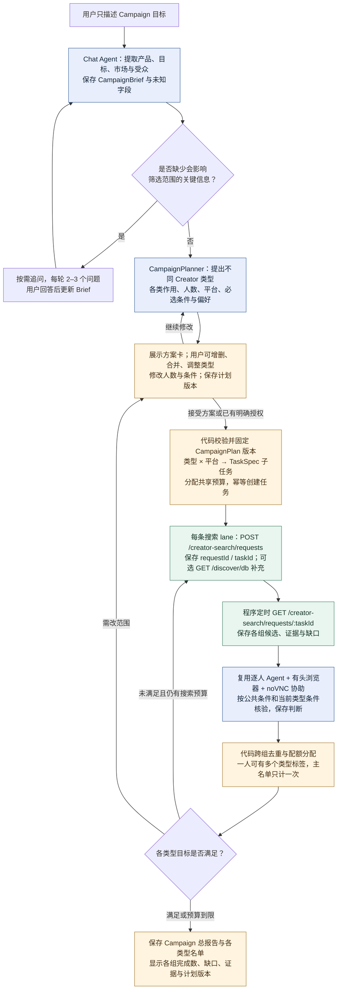

# Campaign 目标交互与多类型 Creator 筛选实现方案

> 本文保留为前期设计记录。当前实现、实际验收与功能边界以 [Creator Studio 交付报告](creator-studio-delivery-2026-10-10.md) 为准。

**此项纳入首版完整 P0。** 原报告功能表中的“Campaign 目标交互简版”只覆盖目标追问与类型建议；现在明确实现从目标理解、分组方案交互，到多组任务执行、跨组去重及总报告的完整闭环。用户不必先知道要找什么 Creator，AI 应帮助用户确定筛选范围。下述为应用的开发规格；当前工作区尚未建立应用运行代码，不能把方案修订视为功能已经运行。

### 用户体验与交互示例

聊天 Agent 先区分“直接找人”和“描述 Campaign 目标”。直接给出明确条件时沿用 TaskSpec 路径；只给出推广目标时进入 Campaign 模式，提取产品或服务、目标、目标受众、市场、渠道倾向和人数，保存已知事实与待澄清字段。商业预算、KPI 和时间可以保存为空，不应为了填满表格阻止初步规划。产品是什么、目标面向谁、目标国家或语言等会改变筛选范围的信息不明确时，每轮集中追问 2–3 个问题；已有明确输入不再重复询问。

CampaignPlanner 在同一个 ModelClient 上运行，提出通常 2–4 个互补的 Creator 类型。类型根据 Campaign 动态产生，不固定为一套行业分类，也不只是按粉丝数分档。每类说明服务哪个目标或使用场景、为什么适合、拟接触人数、平台、粉丝范围、内容主题、必选条件、偏好及证据要求。学生或职场等目标受众不能直接转换为从外貌推断身份的条件；要区分内容面向的人群、创作者自述身份与受众画像。

以下是交互示例，不是用户实际 Campaign，也不是平台效果或转化率的预测：

> 用户：我们想推广一款 AI 笔记应用，让更多大学生试用。
>
> AI：主要面向哪些国家和语言？产品更侧重课堂整理、考试复习还是日常效率？准备筛选多少位 Creator，有没有平台偏好？
>
> 用户：美国和英国，英文，课堂整理和复习；先筛 20 位，平台你可以建议。

AI 可以提出下列草案，并把平台及人数分配标为待接受的建议；粉丝范围、样本新鲜度、联系方式是否必需同样不能当作用户已明确给出的事实。

| Creator 类型 | 在此示例中的作用 | 示例配额与平台 | 需要转成可核验的筛选范围 |
| --- | --- | --- | --- |
| 学习方法与复习教程型 | 展示整理课堂资料、复习笔记的使用场景 | 8 位，YouTube | 近期有学习方法或复习内容；能清楚展示操作步骤；内容英文 |
| AI 工具与效率实测型 | 演示功能、比较工作流，解释产品适合什么任务 | 8 位，TikTok | 有实际工具演示而不只是新闻转载；能提供近期正文与视觉样本；内容英文 |
| 校园生活与学习场景型 | 在课堂、图书馆等学习场景中自然使用产品 | 4 位，Instagram | 近期有可核验的校园或学习场景内容；身份要求若存在，需本人明确自述 |

用户可以说“去掉校园生活型，把 AI 实测改为 12 位”“第二类不要新闻号”“改成只找 Instagram”“这类只作为偏好”，或在方案卡中编辑、增删、合并类型。AI 显示调整后的方案及变更；代码保存新 revision 并检查总数与子配额。用户接受方案、说“按这版开始”，或此前已明确授权 AI 决定范围并执行时，启动对应版本，避免重复要求同一授权。没有明确授权的推测字段以 assumptions 展示；对人数和硬条件等关键假设取得接受后再执行。

### 主流程

[Campaign 流程 SVG](</Users/shawn/coding/projects/wavesurge/wavesurge_testing/reports/creator-screening-campaign-planning-2026-10-10.svg>) · [PNG](</Users/shawn/coding/projects/wavesurge/wavesurge_testing/reports/creator-screening-campaign-planning-2026-10-10.png>) · [Mermaid 源码](</Users/shawn/coding/projects/wavesurge/wavesurge_testing/reports/creator-screening-campaign-planning-2026-10-10.mmd>)。



### 模块、结构与状态

| 模块 | 具体职责 |
| --- | --- |
| Chat Agent / CampaignPlanner | 提取 Brief、选择关键追问、提出和修改类型方案；共用现有 ModelClient、提示词版本、调用日志和压缩机制 |
| CampaignPlanValidator | 校验 Brief 引用、assumptions、总数与平台配额、公共及类型条件、类型 ID 唯一性和预算；模型 JSON 合法不等于可执行 |
| CampaignTaskCompiler | 按类型 × 平台创建搜索 lane；公共条件与类型条件合并成不可变 TaskSpec；生成本地任务绑定，不交给模型随意创建多批任务 |
| CampaignCoordinator | 调度子任务、原子扣减全局预算、恢复、取消和局部重试；子任务继续复用 WaveSurge、逐人分析和同一桌面队列 |
| CampaignAllocator / ReportBuilder | 对已通过的“Creator—类型”关系做跨组去重与配额分配；保存采用的分配版本、各组缺口和总报告 |

应用新增三个业务对象。CampaignBrief 是营销事实，CampaignPlan 是经交互形成的筛选方案，TaskSpec 是执行器实际处理的一个类型与平台的条件。Brief 与 Plan 使用不可变版本；推荐理由与业务事实分开保存。

```ts
type CampaignBrief = {
  id: string;
  revision: number;
  conversationId: string;
  product?: { name?: string; description: string; useCases: string[] };
  objective?: { goal: string; kpis?: string[] };
  targetAudience?: string;
  markets?: string[];
  language?: string;
  preferredPlatforms?: TaskSpec["platforms"];
  totalCreatorTarget?: number;
  commercialBudget?: { amount: number; currency: string };
  fieldStates: Record<string, {
    status: "user_provided" | "proposed" | "unknown";
    sourceEventIds: string[];
  }>;
  openQuestions: string[];
};

type ScreeningConstraints = Pick<TaskSpec,
  "followerRange" | "language" | "regions" |
  "evidenceFreshnessDays" | "requireEmail"
>;

type CreatorSegment = {
  segmentId: string;
  label: string;
  campaignRole: string;
  rationale: string;
  targetCount: number;
  platformScopes: {
    platform: TaskSpec["platforms"][number];
    targetCount: number;
    personaText: string;
  }[];
  constraints: Partial<ScreeningConstraints>;
  criteria: TaskSpec["criteria"];
};

type CampaignPlan = {
  id: string;
  revision: number;
  briefId: string;
  briefRevision: number;
  totalTarget: number;
  commonConstraints: ScreeningConstraints;
  commonCriteria: TaskSpec["criteria"];
  segments: CreatorSegment[];
  assumptions: {
    fieldPath: string;
    proposedValue: unknown;
    acceptedEventId?: string;
  }[];
  globalBudget: {
    maxSegments: number;
    maxLanes: number;
    maxSearchOperations: number;
    maxUniqueCandidates: number;
    maxModelCalls: number;
    maxDurationHours: number;
    deadlineAt?: string;
  };
  acceptedBy?: { sourceEventId: string; acceptedRevision: number };
};
```

完整 proposal 必须有可执行配额：总目标等于各类型目标之和，每类目标等于该类 platformScopes 配额之和，数值均为正整数。程序从 commonConstraints 和各类 constraints 读取数值及语言等字段，不依赖重新解析条件描述来构造 API 参数。共有硬条件不能被类型偏好覆盖；允许类型条件收紧粉丝范围等约束，不允许静默放宽或覆盖冲突值。不同条件 ID 不能重复或含义冲突。类型数量、lane 数和初始搜索次数必须在已配置预算内。请求搜索人数可以大于最终配额，例如先召回约 3 倍候选，但须预先分配候选预算并遵守接口 count=1–1000；召回人数不等于合格交付人数。

Campaign 状态为 `draft → needs_input → proposed → confirmed → executing → completed/partial/failed/cancelled`。修改方案形成新 proposal，而不是覆盖旧结果；正在运行的旧版本保留在历史。展示给用户的当前 Plan revision 与启动请求 expectedRevision 必须一致。最终状态按各组满足情况、执行失败和预算判断，不能因某一组已达标就显示整个 Campaign 完成。

### 子任务与 WaveSurge 的对应关系

本地 Campaign ID 与 WaveSurge Campaign ID 是不同命名空间。首版的 Campaign 是应用自己的父任务；免费直接搜索不会自动把结果写入 WaveSurge 的正式 Campaign 名单。这里不调用官方聊天 turn，也不依赖收费契约尚未澄清的 Strategy chat；无需为这项进阶目标先创建远端 Campaign。只有已经验证并明确关联的 remoteCampaignId 才能用于候选池查询的 campaignId。

每个类型的平台 scope 编译成一条 lane，首版每条 lane 使用单平台请求，避免把尚未实测的多平台配额行为作为正确分配的前提。子任务仍保留语言、创作者国家与受众市场的不同维度；受众市场不能直接映射成 API 的创作者地区参数。仅把受支持的粗筛字段传入请求，其余条件在本地取证及判断。

| 步骤 | WaveSurge 调用与本地处理 |
| --- | --- |
| 为一条 lane 发起候选召回 | `POST /creator-search/requests`；personaText 来自当前类型及公共条件，count 为本轮候选预算，platforms 只含当前平台；粉丝范围、语言等按契约映射；不要求邮箱时显式 false |
| 请求保存与重试 | search_operations 关联 localCampaignId、planRevision、segmentId、laneId、round；先存意图和稳定 requestId，再存 taskId；同一次重试保持 requestId 和 body，新一轮才换键 |
| 等待结果 | 程序约每 60 秒 `GET /creator-search/requests/:taskId`；保存 status、creators、alsoFound、summary、usage 和缺口；不重复调用模型来等待 |
| 补充召回 | 可选 `GET /discover/db?platform=...&limit=...&sort=...`；本地去重、基础过滤后只作为待复核候选 |
| 逐人复核 | 复用有头浏览器、noVNC 人工接管和逐人 Agent；加载固定公共条件、当前类型条件与必要证据，写 assessment / evidence / assets |
| 汇总 | 应用自己的代码跨组分配、写 Campaign 结果和 artifacts；不以 WaveSurge 返回的 tier 或 fit 作为用户全部条件已通过的证明 |

跨平台搜索的参数效果和有头桌面可用性仍需开发实测，之前已验证的非空直接搜索只覆盖 Instagram。本文的类型示例不意味着已经取得三平台名单。

### 去重、共享预算与变更恢复

一个 Creator 可以符合多种类型，保存所有已核验的适配关系和标签，但总目标与主分组名单采用唯一计数；仅依据相似姓名不跨平台合并真人。复用规范化 creatorKey 与已验证 alias；尚未确认跨平台身份时，报告说明唯一账号的口径。公共证据按新鲜度、出处与条件复用，同一人的页面不用为每组重复打开；不同类型的定性结论仍需各自满足条件，不能把 A 类型的 match 自动转给 B。

分配器以已通过的 Creator—类型/平台关系建立容量图：每个已确认身份最多占一个名额，各 lane 与类型受配额约束。使用最大流求可满足的最大唯一人数，避免先把“适合 A/B 两类的人”占到 A，导致只能适合 A 的另一人无法进入而错误报告缺口。偏好排序在硬条件通过的关系内使用；未填满的组显示真实缺口，不能从其他组挪用不符合条件的人。只有用户接受配额或条件变更后才改变目标。

建议初始默认值为最多 4 个类型、8 条 lane、8 个远端 search operation、200 个唯一候选、300 次应用模型调用；这是整个 Campaign 的共享上限。300 次包含规划、逐人、压缩和修复，规划调用初始上限 8 次；远端 WaveSurge 的内部 usage 不计作应用调用次数，也不受该上限控制。各 lane 领取剩余预算时在数据库事务中检查与预留，不能给每个子任务复制一份 300 次/200 人预算。首轮 lane 数必须不大于搜索预算；剩余预算允许时才能补搜。默认执行窗口可为 8 小时，在用户接受并启动父执行任务时持久化 startedAt / deadlineAt；若用户指定绝对截止时间，取两者更早值。Brief 草稿期间不消耗执行期限；执行开始后等待人工和重启不重置期限。

修改执行中的 Plan 时，先展示哪些组受影响。新版本仅为变更组创建新 TaskSpec 和任务绑定；条件散列相同的未变组可明确绑定复用原子任务及结果，证据按新鲜度校验。已不适用的旧子任务停止本地新增工作，远端搜索可能继续；旧判断只留在旧版本，除非在新条件下重新校验，不计入新版完成数。某组失败不终止其他组；整体取消则停止所有相关子任务及该 Campaign 的协助 continuation，不影响其他工作。重启恢复原远端 taskId、各组进度、预算与人工待办。

### 保存、工具与验收

新增持久实体为 `campaigns`、`campaign_brief_versions`、`campaign_plan_versions`、`campaign_plan_task_bindings`、`campaign_assignments` 与 `campaign_budget_usage`。保存 Brief 输入来源、推荐理由和 assumptions、用户接受的消息、计划 revision、类型/平台配额、子任务 ID 与条件散列、唯一主分配、分组计数和预算。现有 search_operations、task_creators、llm_calls、evidence、human_assistance 等继续关联子任务，并增加父 Campaign 与类型引用。

Chat 工具新增 `save_campaign_brief`、`propose_campaign_plan`、`get_campaign_plan`、`start_campaign_screening`。工具只提交受 schema 约束的语义数据；start 必须经过代码校验当前 revision、接受/授权记录、配额和预算。创建 Brief 或 proposal 不发起 WaveSurge 搜索。任务 compiler 在同一事务中建立绑定和启动事件，用唯一 `(planId, planRevision, segmentId, platform)` 防止重复点击或消息重放产生双份任务。

本地接口增加 `GET /api/campaigns/:id`、`PATCH /api/campaigns/:id/brief`、`PATCH /api/campaigns/:id/plan`、`POST /api/campaigns/:id/start`、`cancel` 和 `export`；写接口校验 expectedRevision，start 支持本地幂等键。方案卡与聊天自然语言都更新同一个 Plan，结果卡显示整体唯一数和逐类型、逐平台进度，支持下钻到证据与三态判断。总报告说明每类为何被选、为何每位 Creator 适合该类、哪个条件未满足以及还差多少人。

首版验收必须覆盖：

1. 只给 Campaign 目标能进入规划并逐轮补全关键事实，而不是要求用户先填 Creator 条件。
2. 两个不同产品目标能得到有不同依据的 Creator 类型与范围，不套固定三分类；建议条件、人数和业务事实可区分。
3. 自然语言增删类型、修改人数及必选/偏好后，方案卡、总数、平台配额与版本一致；不把不支持的地区维度直接传入 API。
4. 接受当前版本后创建对应 lane 子任务；重复启动不重复建任务；旧 revision 启动被拒绝且不会发起新搜索。
5. 同一人符合两组时主名单只计一次，配额分配能处理 A/B 重叠；没有证据的组适配不补造 match。
6. 全局搜索、候选、模型与期限上限在多子任务并发时成立；一个失败组、人工协助或重启不丢失其他组进度。
7. 修改执行中的某组只重建受影响任务，新版结果不混入旧条件判断；缺口补搜与变更方案是不同动作。
8. 端到端从目标消息、交互确认、各组 WaveSurge 召回、浏览器证据/人工接管到总报告均有可追溯数据；当前未进行真实 Planner 模型和完整应用 E2E，此项属于开发验收。
