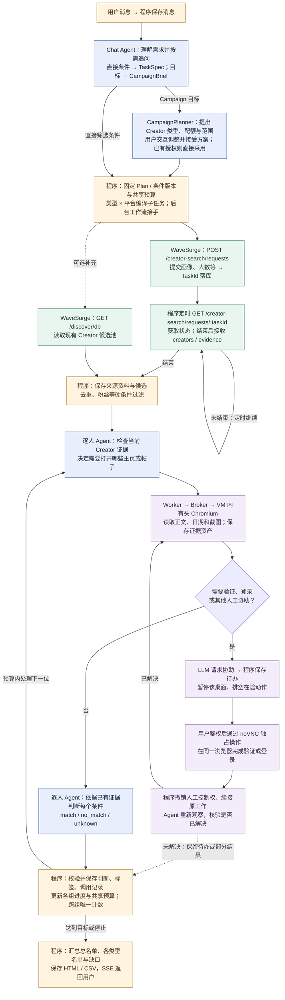

# 用户消息执行流程与有头浏览器方案

2026 年 10 月 10 日确定采用 **Linux 虚拟机 + 持久桌面容器 + 有头 Chromium + noVNC 人工接管**，浏览器与人工协助均为首版 P0。下图包含直接筛选与 Campaign 目标两种入口；后者先交互形成多类型 Plan，再按类型/平台创建子任务并复用采集及分析流程，详见 [Campaign 完整方案](</Users/shawn/coding/projects/wavesurge/wavesurge_testing/reports/creator-screening-campaign-planning-2026-10-10.md>)。搜索重试、上下文压缩、取消和恢复见 [完整报告](</Users/shawn/coding/projects/wavesurge/wavesurge_testing/reports/creator-screening-analysis-2026-10-09.html>)。普通聊天只由 Chat Agent 回复；关键条件不明确时先追问，范围接受或已授权后才启动任务。

[简图 SVG](</Users/shawn/coding/projects/wavesurge/wavesurge_testing/reports/creator-screening-message-flow-2026-10-10.svg>) · [PNG](</Users/shawn/coding/projects/wavesurge/wavesurge_testing/reports/creator-screening-message-flow-2026-10-10.png>) · [Mermaid 源码](</Users/shawn/coding/projects/wavesurge/wavesurge_testing/reports/creator-screening-message-flow-2026-10-10.mmd>)。

### 代码与 Agent 各自负责什么

程序负责鉴权、消息/Brief/Plan/任务落库、子任务编译、共享预算、WaveSurge 请求及轮询、候选去重、硬过滤、执行租约、桌面控制、证据资产、结果校验和分组报告。Agent 负责理解目标、追问、提出并修改 Creator 类型与范围、决定当前 Creator 的证据获取步骤、请求人工协助，以及依据证据进行定性判断。LLM 的工具请求必须经过代码的 schema、权限、工作归属和预算校验。

所有 WaveSurge 路径的前缀是 `https://wavesurge.ai/api/v1`，请求只由后端携带 Token。`POST /creator-search/requests` 提交 personaText、count、platforms 等，收到 taskId 后立即保存；没有邮箱要求时显式 `emailReadyRequired: false`。程序约每 60 秒调用 `GET /creator-search/requests/:taskId`，读取状态、creators、alsoFound、summary 与 usage；等待不触发新的模型调用。`GET /discover/db?platform=...&limit=...&sort=...` 作为可选补充，结果仍需本地过滤；不假设其分页可以穷尽全库。

直接搜索返回的 profileUrl、avatarUrl、evidence[].url / text / publishedAt 是证据入口。后续访问 Instagram 等网站是桌面浏览器直接访问外部页面，不是再次调用一个尚未验证的 WaveSurge 帖子抓取接口，也不向这些网站发送 WaveSurge Token。浏览器取得正文、发布时间及截图后保存 evidence 与 assets，模型只接收当前 Creator 所需的有限证据。若候选不足，工作流在预算内新建 search operation 继续召回；不能静默放宽已确认条件。

### 桌面与人工接管

部署链路为 Linux VM → Desktop Broker → Docker Desktop Cell。Cell 内有 Xvfb、Fluxbox、有头 Chromium、Playwright、x11vnc 与 noVNC；采用普通 Chromium，参考文档中的 CloakBrowser 不是必需依赖。VM 是宿主，容器是可替换的桌面运行实例。首版单 admin 工作区复用一个稳定桌面和 `/state/browser-profile` 持久卷，每位 Creator 保持独立分析上下文与工作关联，不为每人启动一台 VM。DOM 操作优先；坐标操作必须使用最新、一次性的 observationId。相同 profile 只允许一个浏览器实例写入，同桌面动作串行。

LLM 发现 login_required、challenge 或无法可靠操作时调用 `computer_request_human_assistance`，代码保存协助原因及原 conversationId、taskId、creatorKey、toolCallId、desktopWorkspaceId、runtimeGeneration。UI 显示协助卡，当前 run 持久暂停；等待人工期间不反复调用模型。协助状态为 `requested → draining → active → completed/cancelled/expired`：先禁止新的桌面动作，用户鉴权认领后等待在途动作结束，再把输入租约交给 human 并签发短期控制 Viewer。首版可采用 15 分钟协助租约、5 分钟 Viewer 授权，续签仍需检查当前租约和桌面代次。

用户通过 noVNC 操作 Agent 原来使用的同一个有头浏览器，完成验证码、登录或 MFA，然后点击“完成”。密码与验证码由人工直接输入，不交给 LLM。Agent 在此期间不能点击或输入；其他不使用这台桌面的工作可继续。noVNC 端口留在内部网络，外部访问经过应用鉴权与 Broker，协助链接本身不授予控制权。

完成、取消或租约到期时，程序撤销 Viewer、归还输入权，向**原工作**投递 continuation，并检查任务取消状态、预算、工作版本和桌面代次。Agent 先重新观察页面再决定是否继续，不能重放接管前的点击。到期或点击“完成”不等于网站验证已成功；仍受阻时保留 needs_input，或按用户选择跳过并交付部分结果。X 的 403、TikTok 的验证等是否解决，必须在目标部署环境实际确认。

### 保存与首版验收

SQLite 保存 TaskSpec、search_operations 与远端 taskId、原始 creator_snapshots、evidence / assets 引用、capability_jobs、human_assistance、逐条件 assessment、标签、llm_calls 和进度事件；截图保存在鉴权资产目录，浏览器 Cookie 与站点存储留在 profile 卷。经代码校验后才采用模型判断：全部必选条件为 match 才合格，证据不足为 unknown。事务提交进度事件后再发 SSE，报告从已采用的数据库版本生成 HTML / CSV。

新增桌面验收至少包括：一条真实帖子采集；同一浏览器人工登录后 Agent 续接原 Creator；接管前在途动作排空；旧 Viewer 与旧 observationId 失效；刷新及重启能恢复原 taskId 与待办；正常桌面重建保留 Cookie/localStorage。VM、容器和有头模式不能保证平台永久可读。本次交付是设计修订与图示，尚未部署 VM、Broker 或 noVNC，也没有完成有头环境的生产验证。
