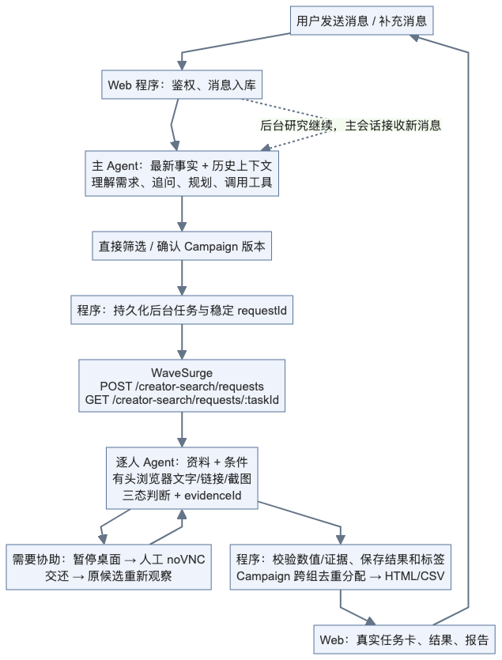
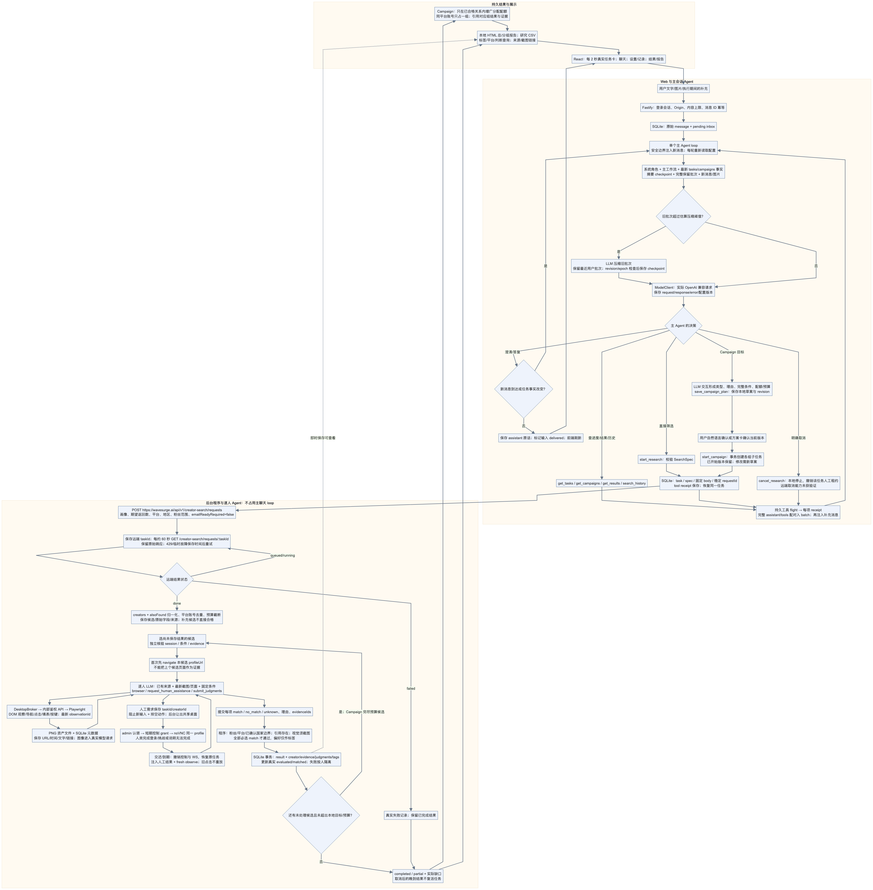

# 历史交付记录

本文保留初次交付的实现与当时验收记录，不能代表后续 QA 缺陷已不存在。请以 [QA 修复与验收报告](qa-fixes-2026-10-10.md) 及其最终验证记录为准，尤其不要将覆盖率或受控满额解读为原题真实 20 人名单已完成。


# Creator Studio：实现方案、执行逻辑与交付验证

本报告以当前代码和实际测试为准。系统采用 TypeScript 全栈，可通过 Docker Compose 在本机 Docker Desktop 部署。核心筛选、Campaign 目标交互、多组执行、逐人核验、有头浏览器与人工接管已纳入首版；测试使用配置中的真实模型与 WaveSurge Token，受控网站和候选夹具另行标明。

应用入口：[http://localhost:3000](http://localhost:3000)。初始管理员密码在持久卷中，通过 `docker compose exec -T app cat /app/data/admin-bootstrap.txt` 读取。报告不包含密码、API Key、Cookie 或 WaveSurge Token。

## 1. 功能清单与边界

| 功能 | 当前实现 | 可核验的依据 |
| --- | --- | --- |
| Web 聊天与图片 | admin 登录；文字/最多四张参考图；Markdown 答复；持久 inbox；刷新/重启保留 | 登录、连续输入、真实模型辨色、移动端与重启 E2E |
| 任务执行中继续聊天 | 主会话与后台研究分离；新消息在安全边界进入上下文；进度查询不取消原任务 | deferred 并发 UT；实际请求/工具批次；生产连续输入 E2E |
| 自然语言混合筛选 | LLM 整理数量、平台、国家、粉丝范围、必选条件/偏好；免费发现后独立逐人核验 | 真实免费搜索取得候选，本地模型判断与报告 |
| 有依据的三态结果 | 每个条件 match/no_match/unknown、理由和 evidenceId；数值由程序核验；视觉匹配必须有截图资产 | 条件边界、缺引用/假引用、单人失败、真实结果和截图测试 |
| 结果与标签 | 已通过条件形成标签；按任务、标签、平台、判断查询；HTML/CSV 导出；来源与截图链接 | API/组件 UT；实际结果筛选与报告/CSV E2E |
| Campaign 目标交互 | 只给产品/目标也能追问并提出不同 Creator 类型、理由和范围；保存草案；自然语言修订版本 | 真实降噪耳机目标→追问→两类型→自然语言修订→确认启动 |
| 多组与跨组去重 | 每类型复用 SearchSpec；总候选预算校验；同平台账号仅占一个配额；有重叠时增广分配 | 重叠/缺额 UT；受控候选经真实模型/浏览器处理后的总报告 E2E |
| 有头浏览器 | Xvfb、Fluxbox、Chromium、Playwright、持久 profile；Agent 读取文字、链接、截图并操作 DOM | 真实 Instagram 链接观察；受控帖子实际截图；profile 重启测试 |
| 人工协助 | 暂停并排空 Agent 桌面输入；admin 认领短期 noVNC 控制权；原 task/Creator 续接；重新观察 | 真正 noVNC 输入→验证→原候选完成；无法完成→unknown；互斥/租约/WS UT |
| 提示词与模型配置 | BASE_URL/API_KEY/MODEL_ID 初始配置；模型及四类提示词可热更新；保留已发调用版本 | 下一次真实请求采用新版本；密钥读接口/记录脱敏 |
| 上下文工程与调试 | 当前事实、旧摘要与保留批次；完整请求/返回/工具消息；备份/清空/载入/压缩；关键词历史检索 | 工具完整配对、epoch/CAS 保护、真实压缩及备份载入 E2E |
| Docker 部署与恢复 | app、桌面和一次性凭据初始化服务；持久数据库/profile；仅发布本机 3000 | 生产镜像、独立 Compose 项目全新卷、健康检查、登录及重启 |

Creator 所在国家与粉丝地域是两类信息。当前结构化 `regions` 指 Creator 国家，使用已确认的国家依据；受众约束可以作为条件交给逐人 Agent，但缺少可靠数据时保持 unknown。跨平台账号没有可靠关联时不猜测合并同一人。

首版是单管理员、单逻辑桌面的本地应用。Agent 使用观察后 DOM 操作；人类通过 noVNC 使用完整鼠标键盘。没有开放任意 shell、Docker 参数或模型坐标工具。图片可以用于聊天和需求参考；暂未提供“将补图绑定到某个历史候选后重新核验”的专门入口。已开始的 Campaign 保留执行版本，改范围创建新草案，原任务仅在用户明确要求时取消。

## 2. 一条用户消息的简图



[可缩放 SVG](creator-studio-message-flow-2026-10-10.svg) · [Mermaid 源码](creator-studio-message-flow-2026-10-10.mmd)。


## 3. 完整执行逻辑



[完整图 SVG](creator-studio-execution-2026-10-10.svg) · [完整图 Mermaid 源码](creator-studio-execution-2026-10-10.mmd)。HTML 阅读版支持放大、滚动和章节跳转。

1. **接收与保存。** `/api/messages` 验证登录会话、写请求来源、文本/媒体上限和稳定消息 ID，先把消息写入 SQLite。重复 ID 同内容重放不会重复入队，不同内容冲突返回 409。前端发送期间保留本地 outbox，避免失败重试生成另一条消息。
2. **主 Agent 组装上下文。** 每轮读取最新配置，组合系统角色、主会话工作流、数据库生成的 tasks/campaigns 事实、历史 checkpoint、完整保留批次和新文字/图片。LLM 判断应追问、规划、查状态、执行工具还是答复。代码只维护执行事实、预算和权限边界。
3. **执行中来的消息。** 已发模型调用的输入不可变；新消息继续入库，在完整工具批次之后、下一次调用之前注入。模型返回纯答复时若发现新消息或任务事实已改变，重新调用，避免直接发布过期进度。模型答复仍有推理误差的可能，页面上的数量和状态直接取自数据库。
4. **工具恢复。** 模型工具批次先保存为 flight；每项结果保存 receipt；只有完整 assistant/tool 配对批次才进入工作上下文。研究使用稳定调用 ID 推导本地任务 ID，再作为 WaveSurge `requestId`。重启继续原远端 `taskId`，不为同一次工具调用重建任务。同 ID 不同参数不执行。
5. **免费发现。** 后台向 `https://wavesurge.ai/api/v1/creator-search/requests` 提交。`personaText` 只写候选画像；最终合格数量、预算、跨组去重由结构字段和本地系统承担。`count` 是向 WaveSurge 请求希望返回的候选数，取自本地 candidateBudget；`emailReadyRequired=false`。本地预算限制我们最多核验多少返回候选，不能保证远端只搜索/尝试这么多账号。响应的远端 taskId 单独保存。约每 60 秒轮询；远端 queued/running 与本地 matched 分开显示。
6. **数据归一化。** 完成响应中的 `creators` 与 `alsoFound` 合并，以平台+规范账号去重；主结果优先于重复补充条目。保留 raw/audience/factorGrades 和来源文字；缺失数值不补成 0。补充条目仍须逐人核验，不能直接计为通过。
7. **逐人 Agent。** 使用独立 session，输入固定 SearchSpec、候选和证据。第一次核验先打开该候选主页，避免读取上一位候选的浏览器页面；其后由 LLM 在现有链接中选择帖子、导航和 DOM 操作。Broker 把截图登记为资产，页面 URL、时间、文字、链接返回给 Agent；实际图像进入模型请求。核验会话持久保存证据引用，冷启动也能恢复。
8. **人工接管。** 请求保存精确 taskId/creatorId 和原因。先阻止新输入、排空动作，再签发控制授权；后台立即让出共享桌面，其他研究保持队列，聊天仍可执行。noVNC 与 Agent 操作同一 profile。交还或到期撤销授权及 WebSocket，注入人工说明，再 fresh observe；人类说“无法完成/跳过”时不假定通过，也不重放旧点击。
9. **判断与保存。** LLM 用 `submit_judgments` 提交每项三态判断、理由、evidenceIds。程序检查条件编号、引用存在性、视觉截图、粉丝上下界、平台和已确认国家。所有必选项 match 才是最终 match；明确失败为 no_match，其余 unknown。SQLite 事务同时保存结果、证据/标签及 evaluated/matched。单人失败不抹掉其他结果，取消后的晚到结果不能复活任务。
10. **Campaign 与交付。** 各组在候选预算内继续核验，避免仅达到本组配额就丢掉跨组分配的替代账号。程序仅在已合格的账号→类型关系中增广匹配，确保同账号只占一组，并引用实际入选组的 resultId。React 定期读取事实，展示真实进度、结果和缺口；本地生成总/分组 HTML 报告、研究 CSV。

## 4. 技术方案与 OpenClaw 参考

| 层 | 选择与职责 | 主要实现 |
| --- | --- | --- |
| UI | React 19 / Vite；对话、真实任务卡、方案、结果、桌面、调试 | `src/client/App.tsx`、`Campaigns.tsx`、`Results.tsx`、`Desktop.tsx`、`Inspector.tsx` |
| HTTP | Fastify 5；admin Cookie、Origin、schema、静态资源 | `src/server/app.ts` 与各 `*-api.ts` |
| 数据 | Node 24 内置 SQLite / WAL；带类型 JSON 文档；事务 | `src/server/store.ts` |
| Agent | 轻量主循环、durable inbox/flight、最新事实、上下文投影 | `src/server/agent.ts`、`context.ts`、`task-facts.ts` |
| 模型 | OpenAI 兼容 HTTP；真实输入/返回记录；每次读取配置 | `src/server/model.ts`、`settings.ts`、`shared/prompts.ts` |
| 研究 | 免费 API、候选归一化、逐人核验、三态与恢复 | `wave.ts`、`research.ts`、`browser-verifier.ts`、`verdict.ts` |
| Campaign | 草案版本、幂等子任务、预算与唯一配额分配 | `campaign.ts`、`campaign-tools.ts` |
| 桌面 | 独立容器；内部 Token；持久 Chromium；短期 noVNC 代理 | `src/desktop/*`、`server/desktop.ts`、`desktop-api.ts` |

没有依赖 OpenClaw 私有 workspace/runtime 作为 SDK。参考其源码中的安全边界 steering/follow-up、完整工具批次、历史投影和压缩思想，保留本系统自己的少量接口：

- [OpenClaw agent-loop](</Users/shawn/coding/projects/wavesurge/openclaw-main/packages/agent-core/src/agent-loop.ts:214>)：新输入在循环检查点纳入，工具结果批次需完整。
- [OpenClaw Agent](</Users/shawn/coding/projects/wavesurge/openclaw-main/packages/agent-core/src/agent.ts>)：活动执行与消息队列的职责分离。
- [OpenClaw Session](</Users/shawn/coding/projects/wavesurge/openclaw-main/packages/agent-core/src/harness/session/session.ts>)：持久历史与工作上下文分开。
- [OpenClaw Compaction](</Users/shawn/coding/projects/wavesurge/openclaw-main/packages/agent-core/src/harness/compaction/compaction.ts>)：摘要边界、未完成请求与保留材料。
- [提供的容器桌面参考](../docs/container-computer-use.md)：同一 profile、输入互斥、短期 Viewer、截图资产。

当前 task 的 queued/running/needs_input/completed/partial/failed/cancelled 用于恢复与事实展示。意图理解、追问、类型选择和动作规划由 LLM 与上下文承担。没有为每种营销意图构建工程状态机，也没有引入 Redis、向量数据库、多租户容器调度或额外云 VM。Docker Desktop 已提供 Linux VM，首版用固定 Compose 桌面容器。

四类可编辑提示词分别定义系统身份/诚实规则、主会话规划流程、逐人证据核验、历史压缩。不可编辑的桌面协议明确实际工具能力、观察 ID、凭据/外联边界和调用预算，避免编辑工作流后把不存在的能力描述给模型。当前每次模型输出上限 4096，主循环最多 12 轮，逐人最多 10 轮；压缩阈值默认估算 32000 Token，可修改。估算器不等同于特定模型的精确 tokenizer。

上下文 reset 创建新 epoch，已有任务/结果保留；旧调用不能写入新 epoch。备份包含消息、图片、完整配对批次和 checkpoint；载入克隆调试上下文，不重放工具。实际主/核验/压缩调用、WaveSurge 调用、tool receipts 另在数据库及调试页保存。上下文备份不等同于整个应用数据库与浏览器 profile 的灾备。

## 5. WaveSurge 实际返回与澄清

真实免费直接搜索远端 `24b86cb6-354f-45ac-b5a6-d98c90e8a541` 返回一位候选。以下是实际响应的字段节选，字段没有改名；省略 audience/contact 的较长数据：

```json
{
  "status": "done",
  "creators": [{
    "platform": "instagram",
    "handle": "imthegeekjr",
    "displayName": "Tech tips | Tech support | IT Consultant",
    "profileUrl": "https://www.instagram.com/imthegeekjr/",
    "followerCount": 79634,
    "region": "United States",
    "factorGrades": {
      "role": "strong", "activity": "recent", "identity": "individual",
      "location": "confirmed_country", "followers": "in_range", "relevance": "strong"
    },
    "evidence": [{
      "url": "https://www.instagram.com/imthegeekjr/",
      "kind": "content",
      "text": "Fresh profile: About.country is United States; follower_count is 79,634; bio says “I’m The Geek” and “Daily #tech and #pc tips.”",
      "provider": "tikhub",
      "publishedAt": null
    }]
  }],
  "alsoFound": []
}
```

该例本地目标是 2，候选预算是 4，最终真实结果 **1/2，部分完成**。本地 LLM 使用来源判断科技内容，程序核验粉丝/平台/国家。国家比较已支持已确证的“城市, 国家”返回形式；真实 scorpiorisingmedia 返回 Philadelphia (Philly), United States，原有整串比较曾误判，修复后依据同一原始来源及原 LLM 内容判断重新计算为合格，完整前后证据保留。没有因为远端 done 或 factorGrades 好就计为最终通过。实际响应也有 avatarUrl、providers、providerUserId、searchMatchTier、overallTier、profileCompleteness、contact、audience。

同一候选的 `audience.view.location` 实际包含 25 人的 follower_sample、low confidence、BR 约 79.99%、CA 约 4.00%，但外层 countries 为空、share/passes 为 null、sampled=0。不能据外层空数组声称完全没有受众数据，也不能把这个低置信抽样当作确定的全体粉丝比例。Creator 国家为美国不代表受众主要在美国。

实际 contact 还混入了无关营销网站资源链接和第三方社交账号。首版保留 raw 供调试，但不把所有字符串视为本人的联系方式，也不自动发送邮件或外联。

两类 Campaign 的首轮真实搜索最终返回 0/2。实际 `summary.lanes[].shortfallReason` 一方面指出候选核验上限/legacy qualification bundle，另一方面显示画像中混入了“只筛 1 人”“另一组名单去重”等本地流程要求，与 API count=2 冲突。已在工具 schema 和工作流里把 `personaText` 限定为简短内容画像，另建草案使用 `technology and headphone reviewers` / `study and productivity creators` 重新实测。原始 0/2 报告保留，修订草案与新远端 taskId 独立记录。新一轮学习/效率组真实返回 2 位，经本地核验一位合格、一位 unknown；科技组返回 0 位，总结果 1/2。其 shortfallReason 报告搜索了 423 个唯一账号，并遇到 TikHub Reels 搜索 HTTP 400；这是远端执行事实，不能把 API count=2 解释为远端最多尝试 2 个账号。

首版业务实际调用两类免费接口：POST `/creator-search/requests`、GET `/creator-search/requests/:taskId`。GET `/discover/db` 已实现适配器并完成契约测试，可作为后续补充发现入口，当前业务不自动调用。这里的 Campaign 是我们的本地计划与报告，没有写入 WaveSurge 的正式 Campaign 名单，也没有调用收费发现、邮箱解锁、外联或正式交付确认接口。

## 6. 浏览器与人工接管的实测含义

真实 Instagram 主页曾在本机容器新 profile 中取得公开简介、粉丝信息和链接。修订 Campaign 后，一位真实候选 khushleenvirk 的帖子遇到注册弹窗；通过真实 noVNC 尝试关闭弹窗，交还后模型重新观察仍报告遮挡，最终保持 unknown 并完成原候选的部分交付。这次操作没有登录账号，也没有提交验证码。这个结果只证明该时点、该网络和该账号主页可读，不能推导全部 Instagram 帖子、Twitter/X、TikTok 或其他账号长期无需登录。

人工接管成功路径使用明确标注的受控网站：真实模型访问挑战页→请求协助→通过真实 noVNC 点击人工验证→交还→重新观察实际帖子及截图→提交三态判断→原候选 1/1 完成。无法完成路径通过同一生产界面说明“跳过”，模型重新观察后保存 unknown，任务部分完成，未再次请求人工。这验证接管机制，不能当成真实社交平台的验证码或账号登录成功。

浏览器 profile 的人工验证 Cookie 和当前页面在正常 Docker 重启后仍保留。测试发现并修复了 Xvfb 陈旧锁与 Chromium Singleton 锁的问题。Agent 的 observationId 短期有效，人工接管前先冻结/排空输入，Viewer 控制 grant 只在当前租约内有效，撤销后立即关闭对应 WS 并在每条输入前复查授权。

## 7. 分阶段与测试验收

设计先明确功能/契约/提示词与实施阶段，再形成 [测试方案](../docs/test-plan.md)，按阶段实现并保存集成和浏览器证据。各阶段覆盖率包含当时全部生产 TS/TSX；最终覆盖率包含前端、后端、共享、桌面及入口。

| 阶段 | 实现与集成验收 | 证据 |
| --- | --- | --- |
| 0 | 模型文本/工具/图片/JSON 能力、容器访问本机代理、API 契约 | 模型能力/容器网络探测 JSON 与前期 API 实测 |
| 1 | 登录、持久 inbox、基础 UI、刷新/重启与移动端 | `stage-1-acceptance.md` 与 foundation E2E |
| 2 | 主循环、连续输入、四类提示词热更新、记录、备份/reset/load/压缩 | `stage-2-acceptance.md`、实际模型 payload 与 agent E2E |
| 3 | 真免费搜索、独立本地核验、真实 1/2、来源/标签/HTML/CSV、重启幂等 | `stage-3-acceptance.md`、`stage-3-result-e2e.json` |
| 4 | 有头页面/资产、noVNC 认领/交还、成功/跳过、profile 恢复与互斥 | `stage-4-acceptance.md`、`stage-4-assistance-e2e.json`、`stage-4-human-skip.json` |
| 5 | 目标追问、两类修订/确认、真实空结果诚实交付、重叠配额分配 | 真实 Campaign 记录、短缺报告、`stage-5-dedup-e2e.json` |
| 6 | 逐文件双 100%、生产镜像、全新独立 Compose 卷、全量浏览器回归 | `stage-6-acceptance.md`、覆盖率和回归日志 |

最终 UT 为 93 个，44 个可执行文件逐文件行/分支/语句/函数全 100%；45 个源文件全部包含，另一个 env.d.ts 无可执行指标。最终验收汇总以 [stage-6-acceptance.md](../validation/2026-10-10/stage-6-acceptance.md) 为准。覆盖 include 完整 `src/**/*.{ts,tsx}`，逐文件 lines/branches/statements/functions 都要求 100%，没有忽略业务分支或把逻辑移到未统计目录。第三方包、CSS/HTML、构建产物和测试夹具不计运行覆盖；唯一纯声明文件无执行指标。100% 覆盖率证明这些代码路径执行过，不能消除外部平台、模型判断和长期运行的所有风险。

## 8. 部署和面试演示

```sh
docker compose up -d --build
docker compose ps
docker compose exec -T app cat /app/data/admin-bootstrap.txt
```

`.env` 四项为 BASE_URL、API_KEY、MODEL_ID、WAVESURGE_TOKEN。首次初始化保存到数据库，已有部署之后在设置页修改模型；单改 .env 不覆盖已保存配置。宿主 localhost 模型地址在容器内转为 host.docker.internal，并补齐 `/v1/chat/completions`。数据库、profile 和随机桌面凭据分别在命名卷中；只有 app 的本机 3000 对外发布。

建议按下列顺序演示，可查看既有真实结果并另发新的研究，提前说明外部搜索需要等待：

1. 登录；发送“寻找 2 位 Instagram 科技作者，Creator 在 Canada/United States，粉丝 1 万至 10 万，必选条件是公开资料有科技内容，最多发现 4 位候选，不需要邮箱”。确认可核验范围；显示稳定任务编号与真实进度。
2. 执行中再问“进度如何？”和补充要求，展示消息均入库、原任务仍存在、合格数量来自任务卡。查看已有真实 1/2 报告，解释短缺和证据。
3. 只描述“向大学生推广降噪耳机，希望兼顾认知和转化”，让 AI 追问并提出互补类型；自然语言修改第二组，确认当前版本后执行；打开独立分组与唯一总人数报告。
4. 打开受控人工协助验收证据，说明真实模型与真实 VNC 的完整续接；需要重演时运行专门夹具 E2E，明确该页是测试网站。真实平台登录由人类操作，不宣称所有验证码可自动通过。
5. 修改工作流提示词，展示下一次实际请求采用新版本；压缩旧上下文、导出备份、清空和载入，证明不重放工具、不删除任务。
6. 展示 Compose 服务、持久重启与完整逐文件覆盖报告，说明代码负责可靠性约束，LLM 负责理解和策略。

更多命令和可重复测试见 [README](../README.md)。真实新搜索 E2E 每次会创建新免费任务；验收复用既有搜索完成记录，避免把重复提交当作健康检查。短缺、待核实与第三方访问限制均保留真实记录，不把它们包装成已完成的配额。
