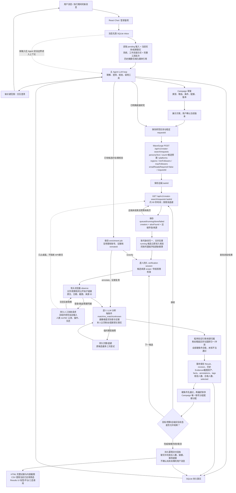

# Creator Studio · QA 问题修复与验收报告

2026-10-10，Asia/Shanghai。此报告对应 F01–F15，替代早期交付文档中范围过宽的“全部完成”表述。修复前后日志均保留，真实平台与受控验收分别列出。

## 判断与修复范围

三组 QA 报告总体可信。F08 是测试前提与验收表达问题；F12 的丢 Cookie 现象成立，但报告本身不能证明具体关闭函数是根因。其余问题经源码、历史真实数据或独立隔离回归得到支持。修复继续使用已有 Agent、上下文、SQLite、ResearchEngine 与持久浏览器，不新增营销意图的大型状态机。

| ID | 根因与最终改动 | 验证依据 |
| --- | --- | --- |
| F01 · P1 | handle 缺失/URL 别名生成不同身份。统一平台账号身份，保留 YouTube UC ID 大小写；候选、结果、Campaign 用同一规则，旧记录保留历史后合并。 | canonical / wave / repair / campaign 回归；跨组去重 E2E |
| F02 · P1 | pending 人工协助让整个研究 tick 提前退出。仅冻结共享桌面核验，API 提交、轮询与不占桌面的分析继续；原任务等待人工时也继续更新远端状态。 | research / enrichment / desktop 回归 |
| F03 · P2 | 临时模型故障被直接落为终态 unknown。区分执行故障与证据不足，429/5xx/超时保留原候选有限重试（最多三次）；已有结果可重核验。 | model / research / enrichment 故障与恢复回归 |
| F04 · P2 | 找到首个硬条件合格者即停止，偏好未参与选择。有偏好时在预算内核验，合格集合按已证实偏好排序；Campaign 分配兼顾唯一配额。 | research / campaign 回归；自然语言偏好 E2E |
| F05 · P2 | CSV 忽略页面筛选。结果 API 和 CSV 共用筛选器，导出已成功应用的查询；完整 HTML 报告保留独立入口。 | result-filter / Results / API；UI 查询下载 |
| F06 · P2 | 报告只有判定，没有完整可审计材料。HTML 输出原文、来源、捕获/发布时间、证据 ID，并内嵌 PNG；CSV 保存完整证据映射、画像与基础事实。 | reports / bootstrap 回归；离线截图与真实历史报告 |
| F07 · P2 | 仅依赖提示词约束浏览器。执行层限制公开地址、候选来源/最新观察链接，拒绝密码/OTP、提交表单及外联等动作；人工认领冻结并排空动作。 | policy / runtime / start / desktop-api 正反例 |
| F08 · P2 | 完成测试依赖硬编码历史 ID。增加每次新 Compose 项目、新卷的自然语言研究和 Campaign 验收；历史用例显式指定对象，缺前提明确跳过。 | pnpm e2e；历史用例配置审查 |
| F09 · P3 | Markdown 未启用 GFM。增加表格渲染与样式，保留 HTML、链接和图片安全处理。 | Markdown 组件回归；主部署页面核对 |
| F10 · P2 | 后台保存终态不发布对话成果。持久交付回执按结果版本幂等，提供真实人数、缺额、HTML/CSV；发布不确认任何尚未处理的用户消息。 | delivery / research / campaign / enrichment；聊天交付 E2E |
| F11 · P1 | US/GB 与英文国家名直接比较。统一 ISO 国家标识，保留原值和来源，重算已有错误结果，不新建搜索。 | canonical / verdict / repair；真实旧结果复验 |
| F12 · P1 | Playwright 默认信号处理与应用关闭并行，第二次关闭触发强杀 Chromium。关闭 Playwright 自动处理退出信号，由应用统一优雅关闭；Compose 等待 60 秒。 | 进程根因实验；实际 noVNC 写入后三次正常 Docker restart |
| F13 · P2 | 浏览器证据没有进入基础事实判定。新增本人主页事实协议、引用验证、粉丝显示精度区间与来源冲突检查；结果查询将基础事实一并传给主 Agent；不把 20.4K 伪造成精确 20400。 | assessment / browser-verifier / research；自然 E2E |
| F14 · P1 | 打标指令被当作条件标签。筛选判断与画像维度分离，supported 实际值才进入标签；新增持久补标/重核验工具、结果版本与审计。历史指令清理并标记待补标。 | assessment / enrichment / repair；自然补标、检索与 CSV E2E |
| F15 · P2 | 只处理 done，running 候选全部等待。独立轮询并增量合并候选，立即核验、身份去重；后续基础字段更新重算，远端尚在运行不错误宣告名单结束；远端失败后保留已取得候选，停止重复轮询并继续本地核验。 | research 增量/重复/更新/失败回归；running 阶段 E2E |

修复补充了提示词约束：personaText 只用于召回；用户明确的定性限制必须成为逐人核验的必选 criteria。偏好遵从用户的具体定义，不将 geek 自述扩大为任意科技主题。旧默认工作流/核验提示词精确匹配时升级；用户自定义提示词和模型配置保留。

## 系统功能与代码职责

主会话 LLM 负责理解、澄清、规划类型与条件、调用工具和解释结果。后台研究负责持久任务、幂等接口调用、逐人核验调度与恢复。逐人 LLM 依据文字/截图判断定性条件及画像；代码校验来源引用、数值和地区、三态合取、偏好排序及唯一配额。任务状态和数量来自数据库事实，不能凭聊天摘要猜测。

直接研究支持数量、平台、地区、粉丝区间、多个定性硬条件、偏好及画像。进阶 Campaign 支持仅提供产品/目标 → 交互澄清 → 不同 Creator 类型、理由、各自范围与配额 → 保存版本草案 → 用户确认 → 分组免费搜索 → 跨组唯一分配 → 总报告。既有候选支持补标或重新查看页面，不重新提交 WaveSurge 搜索。

有头 Chromium 在桌面容器运行，Xvfb 提供显示，noVNC 让人类操作同一浏览器/profile。登录、验证码和平台挑战交给人类；认领前暂停并排空自动输入，交还后重新观察。容器具有持久 profile；并不需要额外部署完整虚拟机操作系统。

## 完整执行逻辑



主业务实际调用 WaveSurge 的上述 POST/GET；`/discover/db` 有适配器，但没有作为此次主流程入口。Campaign 是本系统的本地多类型计划，不等同于 WaveSurge 官方 Campaign/Strategy 或付费工作流。取消仅停止本地工作，未验证远端取消接口，不声称远端已停止。

可单独打开并缩放查看：[完整执行图 SVG](qa-fixes-flow.svg)、[可编辑 Mermaid 源码](qa-fixes-flow.mmd)。

## 保存和恢复

应用数据库保存消息、上下文批次、settings、task、campaign、verification、result、result-history、enrichment、delivery 和脱敏接口/模型调用记录；图片资产保存到应用数据卷。桌面 profile 与内部随机凭据使用独立持久卷。容器重启读取原 taskId、远端状态和已有结果，不重放完成工具。

历史修复一次性记录迁移版本，原结果进入审计历史；重新计算账号、国家、选择及任务计数。旧打标指令不被猜测为实际画像值，保留 unknown，需补标取得新证据。完成消息按 subject + 结果版本摘要去重；结果后来更新可以交付新版本。

## 验收与实际外部边界

- TypeScript typecheck 通过，136 项测试 / 23 个测试文件全部通过。
- 52 个有执行代码的生产 TS/TSX 文件逐文件四项覆盖率均 100%；1 个纯类型空声明不产生执行指标。Statements 1937/1937、branches 1438/1438、functions 459/459、lines 908/908。没有使用覆盖率忽略指令。
- 第一次干净 Compose 自然语言验收 3/3 通过（6.1 分钟）；包括直接研究、Campaign、三轮新 Cookie/localStorage 重启恢复。最终版本重复验收另见下方结果。
- 主部署原卷升级、真实旧结果与生产 UI/noVNC 复验通过；没有删除用户数据库、profile、模型配置或其它 QA 会话部署。

覆盖率衡量执行路径，不证明语义准确率或真实配额一定满足。受控候选网页和 WaveSurge 夹具只证明可重复的应用闭环；真实模型、生产有头浏览器、noVNC 与容器重启仍参与执行。

| 实际主部署复验 | 结果 |
| --- | --- |
| 原美国科技研究 | 旧错误 0/1 修正为入选 1/1，2 人核验均地区 match，原分析保留历史；一人入选、一人合格备选 |
| 修正报告 | 一条幂等聊天交付；HTML 内嵌 5 张既有截图；当前判断筛选的 CSV 与 UI 一致 |
| 真实 YouTube 已有证据补标 | 两位完成并保存新版本，新增 WaveSurge POST=0；实际不同的内容/风格标签，不保存打标指令 |
| 订阅数基础事实 | colelangs：37.4K → 37350–37449；wesleyanna：91.3K → 91250–91349。精确 follower 原值仍为 null，地区无本人声明仍 unknown，整体不伪造通过 |
| Agent 查询基础事实 | 主部署自然查询通过：工具上下文携带事实区间，答复区分主页近似订阅数与原始 null、所在地仍待核实；不重新搜索或修改结果 |
| 原题 20 人任务 | 最后实时 GET 返回远端 failed。此前取得的 3 位唯一候选仍在本地保留；Instagram 登录弹窗遮挡视觉证据，本地停在 needs_input，并明确显示远端失败。交还桌面后可继续已有候选，最终如实交付缺额；尚无 20 位合格名单 |

最后重复验收还保留一次合理失败：受控 Alice 简介提及学习效率，但实际帖子只有科技教程，模型判 unknown。最终夹具增加明确的已发布学习效率教程，未放宽生产条件；该修正解释见 [夹具证据记录](../validation/2026-10-10/qa-fixes/fixture-evidence-correction.md)。第一次通过不能抹掉第二次的证据不足。

最终干净部署重复验收 **3/3 通过（6.1 分钟）**，包括实际配置模型驱动的自然研究/补标、两类型 Campaign 及三轮新浏览器状态重启。随后对基础事实查询透传、完成交付事务边界及人工暂停期间原任务轮询的收尾改动，另外执行完整 136 项回归、SQLite 故障注入及最新主部署真实 UI 集成复验；不把先前版本的 E2E 冒称为收尾改动后的新一轮干净部署。

F10 故障注入先复现“消息写入失败仍留下终态”，再验证修复：任务终态、聊天消息、上下文和回执一起提交；任一写入失败全部回滚；重复保存只交付一次，待处理用户消息保持 pending。研究保存与独立交付均加入当前事务或建立自己的事务。

真实 token 验证另存 [WaveSurge GET 记录](../validation/2026-10-10/qa-fixes/real-wave-current.json)。本轮只查询既有任务，未创建新的付费流程或外联；原题远端最后返回 failed，已有候选保留，但本地核验尚需人工解除登录弹窗，不能把夹具满额当作原题真实 20 人已完成。平台账号登录、OTP/验证码与真实条件的独立语义抽检仍有相应人工前提。

执行约束已加强，但没有经过独立安全审计；公开地址/DNS/动作校验不是完整的网络隔离或任意网站脚本安全证明。用户可编辑提示词；准确性还取决于证据和模型能力，未提供全平台成功率或条件判定准确率保证。


## 复验命令与证据

```sh
pnpm exec tsc --noEmit
pnpm exec vitest run --coverage
pnpm e2e
```

最后一项每次创建新 Compose 项目和卷，默认 3550/3551，可用 QA_APP_PORT/QA_PERSISTENCE_PORT 更改；执行后仅移除自己创建的临时容器与网络，保留卷便于审计。需要 Docker Desktop、可用模型配置和已安装的 Playwright 浏览器。历史快照测试通过环境变量明确指定任务，见 README，不再硬编码个人数据库中的 ID。

- [最终覆盖率日志](../validation/2026-10-10/qa-fixes/coverage-final.log) / [逐文件 HTML 覆盖](../coverage/index.html) / [typecheck](../validation/2026-10-10/qa-fixes/typecheck-final.log)
- [第一次干净闭环通过](../validation/2026-10-10/qa-fixes/acceptance-first-pass.log) / [最终版本重复验收](../validation/2026-10-10/qa-fixes/acceptance-release.log) / [浏览器验收报告](../validation/2026-10-10/qa-fixes/browser-reports/creator-studio-qa-1791607678605/index.html)
- [等待人工时原任务轮询：修复前失败](../validation/2026-10-10/qa-fixes/human-poll-before.log) / [当前本地原题状态](../validation/2026-10-10/qa-fixes/main-verified.json)
- [完成交付原子性：修复前失败](../validation/2026-10-10/qa-fixes/delivery-before.log) / [故障注入用例](../tests/delivery.test.ts)
- [Cookie 根因实验](../validation/2026-10-10/qa-fixes/signal-repro.log) / [三轮新状态重启记录](../validation/2026-10-10/qa-fixes/persistence-three-restarts.json)
- [部署源码一致性](../validation/2026-10-10/qa-fixes/source-check.json) / [主 Agent 自然查询事实](../validation/2026-10-10/qa-fixes/main-fact-query.json)
- [主部署真实 UI 验证](../validation/2026-10-10/qa-fixes/main-verified.json) / [真实已有证据补标与基础事实](../validation/2026-10-10/qa-fixes/main-real-enrichment.json) / [主部署健康](../validation/2026-10-10/qa-fixes/main-health.log)
- [干净自然筛选数据](../validation/2026-10-10/qa-fixes/natural-e2e.json) / [自然 Campaign 全链路](../validation/2026-10-10/qa-fixes/advanced-natural-e2e.json)

应用入口为 http://localhost:3000。此前更全面的功能/架构设计保留在历史实施报告，本报告说明 QA 修复及其实际验收范围。
