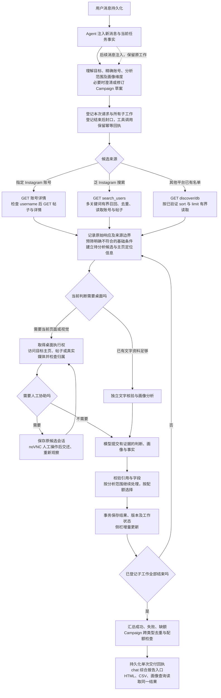

# R2 复测报告核对与修复方案

2026-10-10。依据 R2 报告及附件、当前业务源码、独立内存回放和实际 WaveSurge GET 请求分析。本次没有修改业务源码、生产数据库或运行中的部署。

结论：报告指出的 10 项问题均有修复依据，不能将现有 155 项测试、100% 覆盖率和 4 项受控 E2E 通过当作原题验收通过。已有实现可以保留，修复集中在召回、执行范围、证据归属、资源调度和交付边界；不需要重写为大型意图状态机。

原报告：[R2 复测](/Users/shawn/coding/projects/wavesurge/wavesurge_testing/.gstack/qa-reports/retest-2026-10-10-r2/report.md)。旧 15 项中“12 通过、3 部分”的结论只适用于报告列明的场景；原题 20 位合格创作者与真实 Campaign 配额仍未通过。

## 逐项判断

| 编号 | 判断与根因 | 修复要点 |
|---|---|---|
| F16 | 成立。`normalizeCreator` 接受只有 handle 的身份却保留空 URL；非 IG 核验没有成功定位候选前仍能观察当前空白页。实测 GET 的名单也缺少 profileUrl。 | 按平台与可靠身份解析主页，检查最终页面属于目标账号；YouTube 区分 channel ID 与 handle。定位失败作为来源问题记录。空白页、上一候选页面、错误页不能支持当前候选特征。 |
| F17 | 成立，但“扩大 limit 或分页”不能直接作为保证有效的方案。当前固定粉丝降序取 100 条，再直接截预算，完全没有按本次基础范围构建候选。 | 利用实际验证的读取能力获得有界来源集，再筛已确认的基础不匹配项，按任务相关性选候选。未知地区保留待核实。不同 Campaign 类型不能机械复用同一批最高粉丝账号。 |
| F18 | 成立，独立回放复现。普通研究仅在 Campaign 或存在偏好时全量分析；工具结构没有“分析全部候选”的表达能力。 | 分开入选配额、候选分析上限与是否全部分析。加入明确的 `analyzeAll` 等结构字段，由模型从用户要求填写；完成状态必须同时满足用户要求的分析范围。 |
| F19 | 成立，独立回放复现。先耗尽第一个关键词队列，再查询下一词；两条结果已耗尽预算，第二指定账号不再查询。 | 显式指定账号走精确身份列表，直接读取账号资料并检查返回身份。只计目标账号，相似用户名不能占位；泛关键词搜索单独采用有界、公平的多词召回。 |
| F20 | 成立。附件重计得到补标重试前 10 条报告：研究 5、补标 3、历史 Campaign 2；重试后另 2 条。源结果更新与终态交付绑在一起，按更新时间去重无法实现整批一次。 | 持久化用户请求与工作的关联；全部子工作登记完并结束后，统一交付成功、失败、缺额与报告入口。结果与侧栏继续增量更新；历史源报告更新不自动推送，Campaign 子任务不各自交付。明确重试形成新批次。 |
| F02 | 成立，独立回放中 API 资料齐全、文字条件仍 evaluated=0。`needsVerifier` 被当作“必须占用浏览器”；核验器开始就调用桌面 scope。 | 资料足够的纯文字核验独立执行；只在真实桌面动作处占用桌面。人工租约期间不改变原页面，保留原核验会话。已确定基础不匹配者无需为了入选再请求登录；用户要求所有人画像时仍按明确分析范围处理。 |
| F03 | 成立。HTTP 408 被判定不可重试。主聊天还存在更宽的缺口：当前 catch 对所有模型错误直接发布未完成并确认输入，不具备后台研究的有界恢复机制。 | 对可恢复的 408、连接失败、429、5xx 有界退避，统一适用于聊天、压缩和核验；保留输入、上下文、工具回执和任务身份。不能因为重试重新启动 Wave 搜索或重复执行已完成工具。 |
| F21 | 成立。源码明确在 annotate 模式也应用 facts、重算判定与选择。附件三组因果回放支持结论：无效国家补充会把既有 match 变 unknown。 | annotate 更新画像值、依据与版本，保留原基础事实、筛选判断和选择；明确 reverify 才更新核验结论。事实解析失败和有效来源互相矛盾应分开，不能让无效附加值自动推翻已确认值。 |
| F14 | 成立，独立回放复现。`resultTags` 直接混入已匹配 criterion.label，否定条件及分支指令因此被子串查询命中。 | 条件原文保留在匹配说明中；标签仅来自有证据的结构化实际值。若需要可搜索的正向条件标签，必须使用单独的规范化短值。修复历史派生 tags 时保留审计，不改原判断，不新增模型调用。 |
| F22 | 用户可见故障成立；同步大 JSON 重读的性能问题已独立确认。建议提升到 P1，因为它直接影响核心人工协助。尚不能声称定位了原 Docker 实例 10 秒延迟的全部耗时。 | 轻量任务状态与原始大资料分离；等待状态跳过无意义候选循环，按下一次 API/重试时间或人工交还事件唤醒。取消检查仍在关键 await/副作用边界执行。状态轮询与终态 Campaign 摘要也应避免全量反复解析原始结果。 |

定位依据：

- 召回与身份：[discovery.ts](/Users/shawn/coding/projects/wavesurge/wavesurge_testing/src/server/discovery.ts:12)、[wave.ts](/Users/shawn/coding/projects/wavesurge/wavesurge_testing/src/server/wave.ts:59)。
- 提前结束、浏览器阻塞与大任务重读：[research.ts](/Users/shawn/coding/projects/wavesurge/wavesurge_testing/src/server/research.ts:63)、[browser-verifier.ts](/Users/shawn/coding/projects/wavesurge/wavesurge_testing/src/server/browser-verifier.ts:25)。
- 补标与重复交付：[enrichment.ts](/Users/shawn/coding/projects/wavesurge/wavesurge_testing/src/server/enrichment.ts:42)、[campaign.ts](/Users/shawn/coding/projects/wavesurge/wavesurge_testing/src/server/campaign.ts:46)。
- 标签与国家事实：[assessment.ts](/Users/shawn/coding/projects/wavesurge/wavesurge_testing/src/server/assessment.ts:44)。
- 模型错误：[model.ts](/Users/shawn/coding/projects/wavesurge/wavesurge_testing/src/server/model.ts:12)、[agent.ts](/Users/shawn/coding/projects/wavesurge/wavesurge_testing/src/server/agent.ts:88)。
- 同步存储与唤醒：[store.ts](/Users/shawn/coding/projects/wavesurge/wavesurge_testing/src/server/store.ts:9)、[bootstrap.ts](/Users/shawn/coding/projects/wavesurge/wavesurge_testing/src/server/bootstrap.ts:48)、[task-facts.ts](/Users/shawn/coding/projects/wavesurge/wavesurge_testing/src/server/task-facts.ts:5)。

## 本次补充验证

独立回放使用实际业务函数与内存 SQLite，模型输出及候选为受控数据，没有写入生产数据库。

| 回放 | 当前实际行为 |
|---|---|
| 两个指定账号、预算 2 | 发出 targetone、targetone_similar；目标二没有发起查询。 |
| 选 1 人、读取 2 人、两人均可匹配 | 第一人生成结果后 completed；只有 1 条结果。 |
| 人工等待时新建纯文字核验 | 取得 2 个候选，但模型核验调用 0 次，结果 0 条。 |
| HTTP 408 | `retryable() === false`。 |
| 缺 URL 名单适配 | profileUrl 保持空字符串。 |
| 否定/分支标签 | “品牌”和“来源缺额”都会误命中。 |

回放脚本：[probe.mjs](/Users/shawn/coding/projects/wavesurge/wavesurge_testing/validation/2026-10-10/r2-analysis/probe.mjs)。记录：[local-replay.json](/Users/shawn/coding/projects/wavesurge/wavesurge_testing/validation/2026-10-10/r2-analysis/local-replay.json)。这些是现有缺陷的复现记录，不是修复后通过的测试。

性能回放创建 6 个研究任务、每个 20 候选，总任务 JSON 约 17.34 MB。它模拟报告中的资料体积，未复制真实个人资料。第二次运行未开启 CPU profiler：

| 状态 | 每轮读取完整 task 次数（不含 list） | 三次 tick 耗时 |
|---|---:|---|
| 大资料，等待人工 | 126 | 1.912 / 3.659 / 2.384 秒 |
| 小资料，同样候选与等待状态 | 126 | 12.1 / 11.8 / 12.1 毫秒 |
| 同样大资料，任务全部终态 | 0 | 199 / 214 / 181 毫秒 |

首次运行还采集了 V8 CPU profile：Store.get 路径采样约 5.14 秒，是主要热点。该 profile 同时包含初始化、其他回放和 GET 等待，因此不能把其百分比当作原部署负载比例。证据：[CPU 摘要](/Users/shawn/coding/projects/wavesurge/wavesurge_testing/validation/2026-10-10/r2-analysis/cpu-summary.json)。足以证明每秒调度与秒级同步处理之间的矛盾，但修复验收仍需在 Docker 中测状态接口和 noVNC。

实际 token 共调用 6 次 GET，覆盖两个平台与三个文档声明的 sort，没有创建平台搜索或外联。请求均 HTTP 200；`limit=1000` 每次只返回 500 条，没有返回分页字段：

| 平台 | 排序 | 返回数量 | 粉丝 1万–10万的数量 |
|---|---|---:|---:|
| TikTok | followers_asc | 500 | 0 |
| TikTok | followers_desc | 500 | 0 |
| TikTok | fit_desc | 500 | **176** |
| YouTube | followers_asc | 500 | 0 |
| YouTube | followers_desc | 500 | 0 |
| YouTube | fit_desc | 500 | 0 |

所有 6 次返回的记录都缺少 profileUrl。TikTok 的 176 条说明已有池中存在数值范围内的记录，当前最高粉丝前缀策略确实遗漏了这类候选；这些记录还未通过主页、地区和内容核验，不能宣称可交付 176 人。`fit_desc` 的 fit 也不能当成本次用户需求的匹配结论。YouTube 的这些有界样本没有目标区间，不证明整个平台无人选。

文档只有 platform、campaignId、limit、sort，没有可据此实现的任意 offset/cursor 或粉丝区间查询。不要虚构分页参数；完整读取覆盖不足时要记录已读范围与来源缺额。是否增加来源或使用收费平台搜索应另按实际能力与用户授权处理。

记录：[升降序 GET](/Users/shawn/coding/projects/wavesurge/wavesurge_testing/validation/2026-10-10/r2-analysis/live-pool-probe.json)、[fit_desc GET](/Users/shawn/coding/projects/wavesurge/wavesurge_testing/validation/2026-10-10/r2-analysis/live-fit-probe.json)。没有保存 token 或联系方式。

## 分阶段修复及验收

1. **先保证运行与结果完整性：F22、F02、F03。** 减少等待任务同步重读，拆分纯文字与桌面动作，保存并有界恢复模型失败。验收人工占用桌面时新文字任务能完成；原页面不变；连续输入不丢；408 重试不产生重复搜索。用约 20 MB 原始资料在 Docker 中测首页与状态接口，目标 p95 小于 500 ms；noVNC 在本地至少重复 3 次于 10 秒内连接。达不到时继续 profiling，不能以延长测试超时结案。
2. **修复召回、证据与执行范围：F16、F17、F18、F19。** 精确账号直接读取；已有池有界采样与基础预筛；明确全部分析字段；核验当前账号页面归属。验收同一请求中的 Tyler 与 Val 都取得结果，相似账号不占预算；无偏好时“选 1、分析 2”生成两人的画像；缺 URL/主页不可定位时不得引用 about:blank 或其他人的截图。真实池与受控夹具各跑一次，不把来源缺额当成功名单。
3. **修复画像一致性和整批交付：F21、F14、F20。** 分离 annotate 与 reverify；标签只索引实际值；加入最小的请求/工作关联与整批交付屏障。验收六人补标后事实、判定和入选集合保持；“品牌”“来源缺额”不误命中；一次多组补标或 Campaign 仅在整批结束后发一份综合报告，包含失败与缺额；重启不重发。后续明确重试只处理失败账号并形成新交付。

每阶段先增加能在当前代码复现缺陷的回归，再改代码，并执行类型检查、构建、全量单元/集成与相应浏览器 E2E。最后做自然语言实际任务回归，核对 chat、侧栏、HTML、CSV、画像查询与持久化一致。保留当前测试，但扩充真实响应缺 URL、多个精确账号、无偏好全候选、负向标签、408、批次消息数与大资料等待场景。

建议的新流程如下，**尚未实现**。请求与工作关系、工具回执和桌面租约属于最小执行元数据；需求理解、类型规划、内容判断与协商继续由模型结合上下文完成。

真实内容限制、缺乏可核实的特征和外部来源覆盖不足需要诚实交付 unknown 或缺额。修复上述执行缺陷后，也不能仅凭处理 20 个候选、截图数量或 HTTP 200 宣称取得 20 位全条件合格人选。
