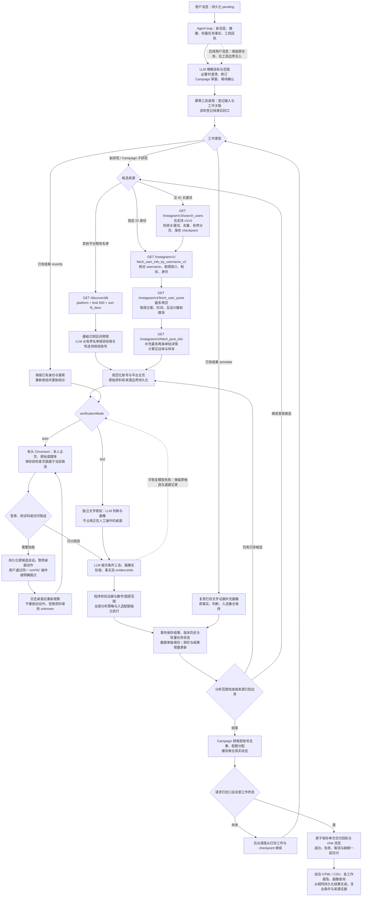

# R2 十项修复与回归记录

2026-10-10。修复基于 [R2 分析方案](retest-r2-analysis-2026-10-10.md)，采用 TypeScript 全栈和 Docker Compose。需求理解、Campaign 类型规划、范围协商、内容判断继续由 LLM 完成；代码负责数据校验、可恢复执行、资源租约、持久化和真实交付。

十项修复及分阶段执行验证已完成，主服务已更新。真实双类型 Campaign 入选 **2/2**，原题有界研究分析 20 人、合格 **0/20**，原题满额验收仍未通过。受控夹具满额不能代替真实来源结果。

## 修复范围

| 阶段 | 问题 | 实现与验证重点 |
|---|---|---|
| 1 | F22 大资料重复解析 | SQLite 保留原始任务资料，另建轻量任务投影与数据版本计数。调度与状态接口读取投影；等待人工且没有到期 API 工作时不解析候选。Campaign 摘要仅在相关数据变化时重算。事务回滚、旧库投影回填和取消边界有集成测试。 |
| 1 | F02 文字工作被桌面阻塞 | Agent 可明确选择 `verificationMode=text`，使用独立文字核验器，人工桌面租约期间仍处理新文字任务。默认 `auto` 保持有头浏览器能力。基础明确不符者可直接排除；明确要求分析所有人时仍保留其分析。 |
| 1 | F03 模型错误不恢复 | 408、429、连接失败及 5xx 为可重试错误。聊天、压缩、候选选择最多三次同上下文请求并有界退避；逐人核验/补标保留已有工作与尝试记录。已有工具回执和任务身份不重建。408 恢复通过故障注入验证；实际模型调用也保留单次审计。 |
| 2 | F16 空 URL 和空白截图 | 按可靠平台 handle 或 YouTube channel ID 生成主页，保留 channel ID 大小写。观察必须来自目标主页、其子路径或已有原帖/媒体来源；没有成功定位不能观察上一候选页面。空白页、异账号图像不进入候选证据。 |
| 2 | F17 基础区间遗漏 | 其他平台改为真实验证过的 `GET /discover/db?platform=…&limit=500&sort=fit_desc`，预筛明确的平台、粉丝和已确认国家冲突，再由模型按本次目标挑选分析对象。资料不足保留待核验。记录原始读取量、排除量及有界来源，不虚构分页或全站穷尽。 |
| 2 | F18 配额提前结束 | 新增 `analyzeAll`，分析范围与入选人数独立；“选 1、两个都分析”生成两人的完整结果与画像，最终只入选一位。 |
| 2 | F19 精确账号漏读 | Instagram `handles` 直接读指定身份，检查 API 返回身份，不查询相似用户名。泛关键词使用持久化轮转队列，按词公平取候选，去重并限制分页；重启可恢复查询位置。 |
| 3 | F21 补标污染事实与选择 | `annotate` 只更新画像及其依据、标签、版本，保留基础事实、原判断与入选集合；`reverify` 才重算结论。无效附加值进入 rejected 审计，不等同有效来源矛盾。对存在相邻审计版本、只有 facts 与基础判断漂移、没有重新核验的旧补标记录，可定向恢复原事实与结论；保留新画像与被恢复前版本，不推送旧报告。 |
| 3 | F14 指令被当成标签 | tags 仅由有证据的 `supported` 画像实际值派生。条件原文留在判断说明，不再成为可检索标签。历史标签迁移保存审计，不调用模型、不改变原判定与选择。 |
| 3 | F20 整批重复交付 | 持久化输入消息与工作关联；Agent 完成该轮登记后封口，全部工作进入终态才发送一次综合报告。Campaign 子任务与历史源结果更新不各自推送。失败、取消、缺额也进入综合报告；交付回执与消息原子保存，重启不重发；重复启动已执行 Campaign 不登记到新批次。 |

实际自然测试还暴露并修复了范围/协议问题：粉丝“不限”必须表示最大安全整数，不能表示 0；没有筛选条件时 `judgments=[]`，不允许模型提交占位条件；“个人 KOC”必须成为独立必选文字条件，不能只留在召回描述。候选总数不超过预算时保留全部候选，避免模型选人时再次缩小用户明确的分析范围。

主要实现：[任务与调度](../src/server/research.ts)、[轻量状态](../src/server/store.ts)、[候选发现](../src/server/discovery.ts)、[任务相关候选选择](../src/server/shortlist.ts)、[请求综合交付](../src/server/work-delivery.ts)、[补标隔离](../src/server/enrichment.ts)、[旧库审计恢复](../src/server/repair.ts)、[角色与工作流提示词](../src/shared/prompts.ts)。

## 当前完整执行流程

可单独打开 [SVG 流程图](retest-r2-fixes-flow.svg) 放大查看；[Mermaid 源码](retest-r2-fixes-flow.mmd) 可继续编辑。

这是工作元数据与工具执行约束，不是按用户意图分支的大型状态机。图片条件只允许引用实际观察资产；本人所在地与族裔必须有相应可靠依据，外观不能证明族裔。

## 分阶段实际验证

验证环境为独立 Compose 项目 `creator-studio-r2-fixes`，应用端口 3560，实际配置的模型、真实 WaveSurge token 与生产有头浏览器。只有性能等待资料采用明确标记的合成记录；六人补标中的四位 YouTube 账号复用主库已有公开证据，没有把它们伪称为本次新发现。

| 场景 | 实际结果 |
|---|---|
| 20 MB 人工等待资料、三次 noVNC 连接 | 状态接口 20 次采样 p95 **15.22 ms**；三次连接 **2.545 / 0.011 / 3.436 秒**，均低于 10 秒。 |
| 人工接管时新文字研究及连续追问 | 真实 YouTube 500 条名单、实际模型核验，最终 **completed 1/1**；原等待任务保持 needs_input，只有一个新任务；HTML/CSV 与刷新后结果一致。 |
| 两个精确 IG 账号，选一人、无偏好、全分析 | Tyler 与 Val 均得到结果和画像，**分析 2、入选 1**；10 次真实 GET，未发 search_users 或 POST，相似账号没有占预算。 |
| TikTok 真实池与公开主页 | 500 条中预筛排除 324，留下 176 条粉丝区间候选；按任务相关性选择 juanescalonafilms。真实主页显示身份与 23.8K 粉丝，实际帖子内容不足，最终 **unknown，0/1，有缺额**。截图来自该主页，没有 about:blank。 |
| 六人、三组补标 | 六人三维画像保存，三个工作全部结束后只交付 **1** 条综合报告；原 creator、judgments、verdict、selected 完全一致，没有新增 Wave 请求。 |
| 标签语义 | “来源缺额”命中本组六人 **0**；Notion 只命中 wesleyanna；所有 tags 均可追溯至 supported 画像的实际 values。 |
| 从营销目标交互到执行 | 先澄清智能生活 App 推广目标，再保存双类型草案，明确确认后才启动；Tyler 的家居自动化、Val 的手机技巧由本人简介及帖子支持。真实 API 去重入选 **2/2**，仅 **1** 条 Campaign 综合交付；重启不重发。 |
| 原题 20 人有界研究 | 3 个关键词轮转，78 次真实 GET 均返回 200；20 个唯一账号都生成结果与四维画像，一次人工访问跳过，一条综合报告，最终 **partial 0/20**。21 次有资产观察覆盖 15 个账号；截图数不等于合格视觉证据。 |
| 个人 KOC 真实反例 | 原题中粉丝区间内的 specsbymo、glasses_direct、framey_frames、ebb_glasses 重新作为独立身份检查：分析 4、入选 0，个人消费者型 KOC 条件明确为 required 文本条件。四者均被判断为商业眼镜账号并排除，未扩大搜索，只有一条报告。 |
| 新版原题完整范围 | 实际模型保存单组 20 人草案，个人 KOC、geek 风、本人佩戴眼镜、本人公开自述族裔四项均为独立硬条件；数量、分析预算、国家范围及全分析字段正确。草案没有创建任务或调用 Wave，明确等待确认。 |

阶段证据：

- [阶段一](../validation/2026-10-10/r2-fixes/stage1-browser.json)、[阶段二](../validation/2026-10-10/r2-fixes/stage2-browser.json)、[阶段三](../validation/2026-10-10/r2-fixes/stage3-browser.json)。
- [六人综合 HTML](../validation/2026-10-10/r2-fixes/stage3-six-account-report.html)、[CSV](../validation/2026-10-10/r2-fixes/stage3-six-account-report.csv)。
- [桌面连接截图](../output/playwright/r2-fixes/stage1-desktop-1.png)、[补标报告截图](../output/playwright/r2-fixes/stage3-six-report.png)、[真实 Campaign 报告截图](../output/playwright/r2-fixes/stage3-campaign-report.png)。
- [原题实际结果](../validation/2026-10-10/r2-fixes/original20-browser.json)、[原题 HTML](../validation/2026-10-10/r2-fixes/original20-report.html)、[CSV](../validation/2026-10-10/r2-fixes/original20-report.csv)。
- [KOC 身份反例](../validation/2026-10-10/r2-fixes/koc-browser.json)、[新版完整范围草案](../validation/2026-10-10/r2-fixes/scope-browser.json)。

## 最终回归与部署

最终代码类型检查、构建、**181 项单元/集成测试**通过，保持逐文件四项 **100%** 覆盖率阈值。最后一次完整 Docker 浏览器验收 **4/4 通过，用时 4.8 分钟**：自然筛选、偏好排序、画像查询/导出/补标、营销目标交互、IG 原始协议与真实 noVNC 操作后的三次重启持久化。这套验收采用明确的受控候选/接口夹具及实际模型、有头浏览器，不代表社交平台真实配额。[最终浏览器报告](../validation/2026-10-10/r2-fixes/browser-reports/creator-studio-qa-1791625987923/index.html)。

原始验证记录：[测试与覆盖率日志](../validation/2026-10-10/r2-fixes/final-coverage.log)、[类型检查日志](../validation/2026-10-10/r2-fixes/final-typecheck.log)、[构建日志](../validation/2026-10-10/r2-fixes/final-build.log)、[完整浏览器回归日志](../validation/2026-10-10/r2-fixes/final-docker-e2e.log)。分阶段真实调用和自然消息日志与对应 JSON 同目录保存。

原题缺额原因逐项重计：**16 人粉丝超出区间，4 人在区间内；20 人所在地均未确认，geek/本人眼镜及本人白人自述均为 unknown**。区间内四位实际是眼镜商业账号，新增个人 KOC 反例检查已将其排除。实际照片确实能被有头浏览器观察：人工抽查 specsbymo 的截图与 Agent 描述一致；但照片里有人或眼镜商品不证明该人物就是账号经营者，更不证明族裔或 geek 风。[抽查截图](../output/playwright/r2-fixes/original20-real-photo-specsbymo.png)。

原 20 人记录保留运行时的范围；个人 KOC 条件补齐后，通过四个真实账号反例和完整原题草案校准验证。没有改写旧结果，也没有把修订草案冒充新版条件下又完成了一轮 20 人研究。**20 位全条件合格名单仍未交付**。后续需要更精准或更广的个人创作者来源、更多可核实的本人信息，以及必要的人工页面协助；不能用增加截图数、推断族裔或把 unknown 算合格来满足数量。

主服务 **http://127.0.0.1:3000** 已更新，验证实例 **http://127.0.0.1:3560** 保留，方便查看真实 20 人、KOC 反例与双类型 Campaign。主库私有备份位于其 Docker 数据卷 `/app/data/backups/r2-before-fixes-20261010.sqlite`，权限 0600。旧库副本预演通过，新增画像保留、迁移重复执行无变化，旧漂移结果按审计恢复；主库与预演核心数据摘要一致。[迁移预演](../validation/2026-10-10/r2-fixes/migration-preview.json)。

升级前后历史消息均为 **200 条**，没有重新推送旧报告；随后只读自然查询准确回答两位账号的合格/入选状态，没有新任务或 Wave 请求，结果弹窗、报告与刷新验证通过。[主服务浏览器验收](../validation/2026-10-10/r2-fixes/main-browser.json)。应用与桌面容器的 **57 个 TS/TSX 文件**逐一与当前源码匹配。[部署源码核对](../validation/2026-10-10/r2-fixes/source-check.json)。原题完成后的最终版本重启验证也核对结果与交付回执不变。[重启记录](../validation/2026-10-10/r2-fixes/final-restart.json)。评审实例 3552/3400 未操作，浏览器验收临时容器已移除、数据卷保留。

## 保留的失败与纠正

- 实际模型将“不限”填为 0、无条件场景提交占位判断，已通过结构化 schema 与角色说明修正；第一次失败资料保留于 `stage2-first-attempt.json`。
- 六人补标业务断言通过，但脚本错误地等待主标签页而不是报告新标签页；修正 popup 等待后整场重跑通过，保留 `stage3-first-attempt.json`。
- 旧浏览器断言在请求尚未封口时检查交付；改为等待登记结束，并严格验证只有一条交付、其时间不早于工作结束，以及补标前后原事实与选择不变。
- 性能夹具曾在服务运行时用另一进程写入大 SQLite 记录，造成写锁并中断准备；改成停服注入资料后启动，再执行性能、租约与自然文字研究验证。应用正常运行仍为单进程同步事务写入。
- 原题首次范围把个人 KOC 留在 personaText，已补成默认提示词中的明确硬条件规则；另跑真实账号身份反例与原题完整草案，不把旧范围静默改写成新范围。
- 20 人超长报告的全页截图耗时过大，改为截图可见报告区域；HTML、CSV 的完整内容仍全部保存和验证，没有延长性能目标。

这些失败没有从最终记录中抹去，也没有通过放宽候选数量、延长性能目标或修改覆盖率阈值处理。
