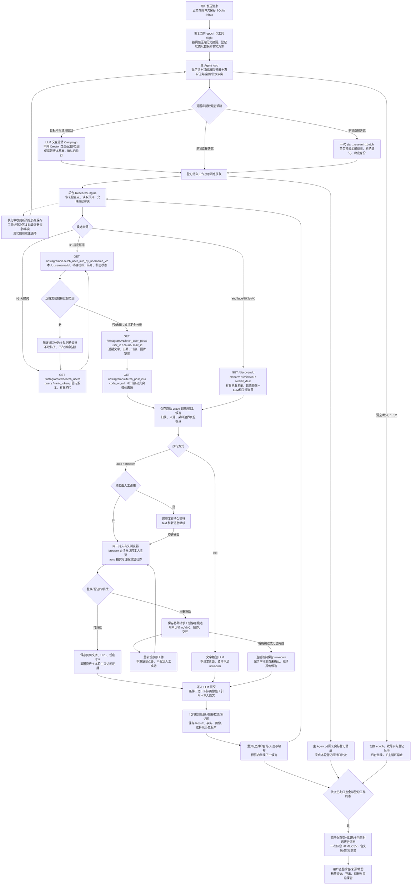

# R3 缺陷分析、修复方案与验收记录

依据 `.gstack/qa-reports/retest-2026-10-10-r3/report.md`，核对实际消息、工具回执、保存的真实来源和当前执行代码。以下五项成立，原题缺额本身不作为缺陷判据。

| 阶段 | 缺陷与根因 | 修复方案 | 必须验证的场景 |
|---|---|---|---|
| A | F24：把缩写一律按四舍五入解析；39667 与 39.6K 误冲突，旧标记无法恢复 | 覆盖缩写截断与四舍五入的保守区间；保留精确来源及矛盾审计；一致的新本人事实可解除旧数值冲突；边界与实质范围矛盾仍未知 | 实际 Val 来源因果回放、新真实核验、范围边界和相反来源 |
| A | F25：IG 搜索预算按所有已读账号计数，已知超范围者先取帖子并进入定性分析 | 泛搜索先读取本人基础资料，明确数值不符者不取帖子、不占分析配额；基础资料读取上限与逐人分析预算分别保存；精确指定全分析保持原语义 | 实际关键词召回、被排除账号无帖子读取、未读队列继续、预算耗尽/来源耗尽、指定账号全分析 |
| B | F20/F02：主 Agent 不知道真实桌面租约及排队能力，先登记文字而把网页留在口头待办；批次只等已登记工作 | 主上下文注入桌面与已登记工作事实；明确授权范围可在人工期间启动，网页由后台自动等桌面；提供一次原子登记多项研究的工具，多项已授权范围不得只口头延后或退回未执行草案 | 用报告原始自然语言在人工接管期间请求两项；文字完成、网页保留且未核验；无提前交付；交还后只一份包含两项的报告 |
| B | F23：reset/load 更换 epoch 并结束 pending，旧批次没有封口职责 | 上下文切换收尾已登记批次；迟到登记识别原消息已结束；启动时恢复可确认中断的批次。报告明确中断登记边界，原任务继续且工具不重放 | 任务已登记、主 Agent 正在回复时分别 reset/load；最终文档自动交付、刷新/重启不重复；原输入仍待处理时不误封口 |

实现继续由 LLM 理解目标、授权及条件，由代码约束幂等登记、资源互斥、数值和证据校验、交付与持久化。没有按用户意图建立大型状态机。各阶段先保存失败回归，再修复；最终回归包含类型检查、完整测试、现有 Docker 浏览器验收和实际模型/WaveSurge 的自然语言用例。

五项根因已确认并分阶段修复，最终代码已部署到主服务 `http://127.0.0.1:3000`。随后真实验证发现的“允许浏览器不等于必须访问本人主页”、登录阻塞信息没有送入 LLM，以及报告列宽问题也一并修正。完整测试 **226/226**、Docker 浏览器验收 **4/4** 通过；另外通过真实模型执行自然语言研究、上下文中断和重新核验，累计 **91 次真实 WaveSurge GET**。以下分别说明程序验证结果、实际平台限制和保存的证据。

## 判断与实现

F20/F02 成立，问题发生在主 Agent 的决策层：后台已有文字与桌面隔离能力，但对话上下文没有准确表达能力和实际租约，LLM 把网页工作留在口头待办。新增 `start_research_batch` 在一次 SQLite 事务中校验并登记全部 2–10 项研究，任何项错误整批回滚；工具编号和项索引形成稳定身份，重试不重复启动。登记完成后才唤醒执行器。主上下文包含实际桌面所有者、登记能力、未交付批次及工作清单，提示词明确已授权直接研究不应退回待确认 Campaign。Campaign 目标尚未清楚时的交互规划仍保留。

F23 成立，任务数据没有丢，丢的是请求交付收尾。reset/load 先更新 epoch、结束旧 pending，再封口已登记工作并删除旧主 Agent flight；在途工具返回发现 epoch 已变化后不能再写回旧 flight 或执行后续动作。迟到登记及启动恢复同样识别已结束的输入。后台任务继续，报告送入当前对话，并说明“只汇总实际已登记工作，尚未登记事项没有执行”；交付回执与消息原子保存，刷新和重启不重发。

F24 成立。`39.6K` 兼容截断和四舍五入的保守整数区间为 **39550–39699**，原 R3 精确 **39667** 在其中。本人原文和精确来源仍保存，只有经归属、字面引用及数值兼容确认后才解除那条历史精度冲突。真正的跨范围矛盾保持 unknown；若两个数值虽不同但对同一宽范围均有明确相同判断，则保留矛盾审计并采用共同范围结论。国家等其它冲突不随粉丝修正而解除。历史迁移只用已保存的本人证据和最后一次提交事实，不调用模型/API，不伪称新页面核验，不重发报告。

F25 成立。泛关键词账号先获取 `edge_followed_by.count`，明确超范围者不取帖子、不进入 candidates、不递增定性 delivered；轮转队列继续读取后续账号。`candidateBudget` 是基础范围可行者的逐人分析预算，`instagram.profileBudget` 单独约束基础账号读取，默认 `min(500,max(20,candidateBudget*5))`。未知数值保留待核验，来源/预算结束如实报告。指定 `handles` 的“全部分析”保留全名单，包括数值不符者。

实际验证另发现一个需要闭合的访问语义：Instagram `auto` 可以直接采用已有文字。第一轮真实双任务证明登记和调度正确，但没有产生新页面截图，不能当作本人页面访问证明。现提供三种执行方式：`text` 明确不浏览；`auto` 按证据需要浏览；`browser` 用于明确要求打开本人主页。后者先实际导航本人主页，记录本轮起点及证据，代码单独产生“本轮本人主页访问”判断：旧截图、其他账号、非浏览器来源及没有截图均不能通过；失败保持 unknown。重新核验已有结果也使用此约束，缺失本轮页面时显示 partial 和实际访问人数。相同画面的新观察保留新时间及证据编号，旧版本仍可审计。

严格访问实测中，两位 Instagram 账号都被重定向到登录页。归属校验正确拒绝将其作为 Creator 证据，但原先只把通用错误交给 LLM，缺少请求人工协助所需的页面信息。现在单独提供有界的访问阻塞上下文（URL、标题、最多 3000 字页面文字和观察编号），不给 Creator 证据编号、不算主页已访问。最终真实重新核验中，LLM 分别为两位账号发起协助请求；用户通过实际 UI 认领桌面并明确跳过后，没有重复请求。两个结果都保存第二版本，主页访问如实为 **0/2**，任务 partial，最终只交付一份综合报告，未调用新的 Wave 接口。[实际原话、两次请求与版本](../validation/2026-10-10/r3-fixes/reverify-browser.json)。

报告长理由曾挤压“判断”列，亦确认是可读性问题。固定表格布局与判断列宽、保持判断词不换行，长来源和理由在其各自列内换行；1440、768、375 宽度没有横向溢出。[排版证据](../validation/2026-10-10/r3-fixes/report-layout.json)。

## 一次用户消息的完整执行流程

[打开可放大的完整流程图 SVG](retest-r3-fixes-flow.svg)；HTML 报告内提供缩放按钮，可在图内滚动查看。

接口路径均为 `/api/v1` 下的相对路径。IG 搜索版本可选 v1/v2/v3，默认 v3，不自动切换；每词最多 3 页，每人最多 2 页近期帖子及 2 条详情。图片链接本身不能支持视觉条件。读取 Creator pool 不代表全站覆盖；本轮没有 POST 付费搜索、策略或外联。

已保存结果的补标/重新核验从数据库读取 Creator、来源和旧判断，不重新搜索。补标保存具体画像值；重新核验强制本轮主页访问，写入旧版本后更新当前结果、标签和研究计数，再走同一批次交付。数据存入 Compose 的 `studio-data` 卷，截图保存为资产；浏览器用户目录在 `desktop-state` 卷，应用重启后不会把旧截图当成本轮访问。

## 分阶段自测与实际证据

阶段 A 先保存失败回归，再执行数值及发现链路的集成和真实 UI/API 验证。阶段 B 使用报告原始自然语言，验证批量登记与上下文中断收尾。阶段 C 补齐真实访问语义后重新验证同样原话及已有结果复核，最后完整回归。各阶段使用独立 Compose 数据卷，主部署迁移先预演。

| 场景 | 实际验证结果 | 证据 |
| --- | --- | --- |
| 原 R3 Val 误判 | 读取原复测已存本人39.6K来源及API39667；新算法回放和副本迁移恢复 match，原复测实例不变 | [A阶段回放](../validation/2026-10-10/r3-fixes/phase-a-browser.json)、[实际旧库演练](../validation/2026-10-10/r3-fixes/migration-rehearsal.json) |
| 新真实 IG 泛搜索 | 读取6个本人资料，排除3个已知超范围者，另3个进入文字分析；被排除者没有帖子请求。21次真实GET；个人/数码硬条件不符的品牌账号正确排除，partial 0/1 | [真实原话与记录](../validation/2026-10-10/r3-fixes/phase-a-browser.json) |
| 新真实指定两人 | 无相似账号搜索；Tyler/Val全部分析2人，粉丝条件均match，选1；10次真实GET。该阶段采用API文字，不冒充新主页观察 | [A阶段真实记录](../validation/2026-10-10/r3-fixes/phase-a-browser.json) |
| 原话双任务与明确授权变体 | 实际noVNC接管＋真实模型＋受控YouTube；两次均一次登记2项，文字2人完成、网页0人；交还后各取本轮本人页截图，全部结束只1条综合通知 | [严格访问重跑](../validation/2026-10-10/r3-fixes/phase-b-fixture-required.json) |
| 真实IG双任务 | 第一轮20次GET只证明调度；严格访问重跑另20次GET：文字任务分析2人、入选1人，网页任务分析2人、入选0人，因两人均跳转登录页而 partial。实际主页访问0/2，合并交付1次，不把API资料或登录页冒充网页成功 | [第一轮调度记录](../validation/2026-10-10/r3-fixes/phase-b-real.json)、[严格访问重跑](../validation/2026-10-10/r3-fixes/phase-b-real-required.json) |
| 最终真实重新核验 | 两位账号各请求1次人工协助；实际UI认领并明确跳过，无重复请求。本轮主页0/2、两条结果v1→v2、旧版本保留、partial，1份报告，0新Wave调用 | [重新核验记录](../validation/2026-10-10/r3-fixes/reverify-browser.json)、[实际结果HTML](../validation/2026-10-10/r3-fixes/reverify-browser.html) |
| 受控与真实 reset/load | 两种来源都实际捕获active、pending、已登记且sealed=false，再UI切换上下文；每项处理2人，在新epoch各交付1次。真实来源共20次GET，重启后0重放、0重复报告 | [受控时序](../validation/2026-10-10/r3-fixes/context-browser.json)、[真实API时序](../validation/2026-10-10/r3-fixes/context-real-browser.json) |
| 历史迁移 | R3实际副本30条结果/8任务，只有Val精度误判改为match，画像/标签/历史保留，0远端调用、0新消息。主库3条历史精度修正仍因其它条件unknown，不强行入选 | [R3旧库演练](../validation/2026-10-10/r3-fixes/migration-rehearsal.json)、[主库预演](../validation/2026-10-10/r3-fixes/main-preview.json) |

仅使用默认后端模型与真实 `.env` Wave token；控制租约测试是通过生产 DesktopBroker 明确建立的测试协助请求，再由真实 UI 认领/交还，不把它描述成社交登录成功。页面访问需要的人工凭据未提供时明确跳过并保留未确认，没有绕过验证码。

## 最终回归、部署与留存

| 检查 | 结果与范围 | 证据 |
| --- | --- | --- |
| 完整代码检查 | TypeScript 检查、生产构建、应用及桌面 Docker 构建均通过。226个测试、28个测试文件通过；每个纳入统计的源码文件四项覆盖率均100%。覆盖率只用于补充，业务结论由下面的真实验证支持 | [类型检查](../validation/2026-10-10/r3-fixes/final-typecheck.log)、[生产构建](../validation/2026-10-10/r3-fixes/final-build.log)、[完整测试](../validation/2026-10-10/r3-fixes/final-coverage.log)、[逐文件覆盖检查](../validation/2026-10-10/r3-fixes/coverage-per-file.json)、[镜像构建](../validation/2026-10-10/r3-fixes/final-docker-build.log) |
| 完整Docker浏览器回归 | 最终代码4/4通过，4.9分钟：Campaign目标交互与执行、持续聊天与上下文/设置、画像补标与结果筛选/CSV/报告、Instagram发现与视觉证据、noVNC认领交还和Cookie/localStorage三次普通重启。使用真实模型及生产有头浏览器；候选和Wave响应是受控夹具 | [执行日志](../validation/2026-10-10/r3-fixes/full-docker-e2e.log)、[浏览器报告](../validation/2026-10-10/r3-fixes/browser-reports/creator-studio-r3-complete/index.html) |
| 真实API与自然语言 | 独立真实实例共有8项研究＋1项重新核验，17条结果、7个请求批次及7份交付通知，所有任务已 completed/partial，无待处理协助；91次实际GET均HTTP200，没有POST。预筛、结果条件、引用、排队及交付另按上述断言验证，HTTP200不代表条件合格 | [最终真实数据摘要](../validation/2026-10-10/r3-fixes/final-real-state.json) |
| 主部署升级与历史保留 | 数据库备份权限0600；迁移结果与副本预演一致，3条旧精度误判修正，其它条件仍unknown。升级前后207条消息、43份历史交付记录、20条结果保留，无历史报告重发。主应用/桌面及真实验证应用/桌面共4个容器的57个源码文件与工作区一致 | [升级前备份核对](../validation/2026-10-10/r3-fixes/final-before-up.json)、[实际源码及数据库核对](../validation/2026-10-10/r3-fixes/source-check.json) |
| 主服务实际UI | 升级后以自然语言查询3位旧账号粉丝范围、未知条件及未入选状态；模型如实回答。没有新增任务、Wave调用或改动结果；结果弹窗、报告打开及刷新通过，无页面错误 | [主服务浏览器自测](../validation/2026-10-10/r3-fixes/main-browser.json) |
| 最终真实实例普通重启 | 实际重启应用后，9任务、17结果、2历史版本、7报告以及91次已有Wave记录摘要完全不变；保存的本轮访问标记与unknown判断相同，源码仍一致；真实报告UI可打开，无重放或重复交付 | [重启及报告验证](../validation/2026-10-10/r3-fixes/final-restart.json) |

保留主服务3000和真实验证实例3580，可直接复查结果。阶段受控实例3581及完整回归临时容器已停止，数据卷保留。其他复测实例3572、3552、3400以及此前修复实例3560没有改动。原R3库只读取并制作私有副本，迁移验证没有写回原复测库。数据库备份含配置，保存在受限目录，不作为公开验收附件。

## 验证边界

本次修的是报告确认的程序缺陷，并不宣称原题20位全部条件合格名单已经交付。缺少可靠本人所在地/公开族裔自述或有效视觉依据时继续unknown，不从姓名、国家或外貌推断族裔。IG关键词仍可能召回商业账号或不相关者；新预筛解决已知数值浪费，不能保证内容和个人身份满足。已有Creator池及分页/预算都是有界来源，不能据此断言全站没有候选。

真实平台登录、OTP/验证码实际完成和长期登录会话没有在本次自测中完成；noVNC接管、交还和受控Cookie/localStorage三次重启有实际浏览器验收。全部测试记录区分API文字、旧证据回放、新页面观察、控制夹具及实际模型调用，HTTP200和任务终态不单独代表全条件通过。
