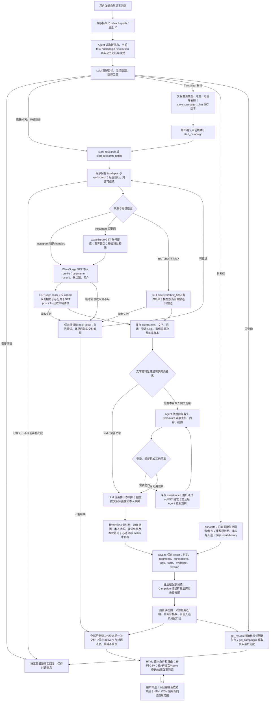

# R4 报告与结果链路修复、自测报告

开始于 2026-10-10，回归持续至 2026-10-11。依据 `.gstack/qa-reports/retest-2026-10-10-r4/` 的报告、七条反例、实际页面和保存数据。

本轮七项问题均已修复并部署至 `http://localhost:3000`。240 项自动化测试、4 项完整 Docker 浏览器场景及 50 次实际 WaveSurge GET 调用支持的自然语言验收通过。

本轮重点是把已生成的 HTML/CSV 变成口径一致、逐人可解释、逐条有归属的交付物。七条反例均确认有根因；F27 属于字面包含查询的产品不足，其余六项为缺陷。修复沿用现有 LLM 判断与 Campaign 去重算法，新增报告读视图，没有增加大型业务状态机。

## 统计口径

| 字段/概念 | 实际含义 | 示例 |
|---|---|---|
| 合格候选 | 所有必选条件均为 match，尚不受入选名额限制 | 两位都合格、目标一位：合格候选 2 人 |
| 实际入选 | 合格集合中按配额及偏好入选的账号 | 上例入选 1 人，另一个为合格备选，缺额 0 人 |
| 核验记录 | 在特定来源研究、条件范围内保存的一条判断 | 同两位分属三组时有 6 条记录 |
| 去重创作者 | 按平台账号规范身份去重，跨平台没有可靠关联时不猜测合并 | 上述 6 条记录对应 2 位创作者 |
| 多组入选记录 | 各组适用条件和配额下的入选记录，不直接等于去重人数 | 本轮三组各入选 1 条：3 条入选记录，实际去重入选 1 个账号 |
| Campaign 最终入选 | 同平台账号只占一个类型配额后的最终分配 | 两组各 1 个名额，最终入选 2 个不同账号 |
| 补标数量 | 本轮更新的记录数，与新增入选人数无关 | 同一账号在三个来源研究的记录分别更新 |

`task.matched` 的内部协议兼容保留，Agent 当前事实补充 `matchedMeaning`；独立研究、Campaign 子研究和补标任务分别解释。合格候选数由实际保存的 verdict 计算，入选数由对应口径的 selected 计算。筛选 HTML 显示研究整体统计和当前展示子集，CSV 导出同一成功查询范围；筛选不重写原名单。

## 分阶段修复

| 阶段 | 问题 | 根因与最终处理 |
|---|---|---|
| A | F30 合格/入选混淆 | 报告不能拿 matched 代替合格数。单组分别显示目标、合格、入选、缺额、核验；多组区分记录和账号人数。 |
| A | F31 多组缺归属、单位混杂 | HTML 按来源组组织，每张卡片带来源任务及分组；CSV 追加来源任务 ID/标题、分组 ID/名称、入选口径及分配信息。补标进度用记录单位，各组分别统计。 |
| B | F29 总/子报告名单矛盾 | 原子研究的独立预选与最终跨组分配不同。抽出已有纯分配计算；总/子/综合报告、结果 API、Agent 查询和弹窗都使用同一读视图。原预选留在数据库及 CSV 审计列。 |
| B | F32 总报告缺逐人匹配说明 | 总 HTML 直接交付每位入选者的逐条件状态、理由、标签、画像及来源，不要求读者自行推断帖子内容。完整来源可展开；分组说明范围、偏好、人数和缺额。总 CSV 仅导出最终入选名单。 |
| C | F26 粉丝行引用膨胀 | 删除“全部非浏览器资料都是粉丝证据”的逻辑，仅引用相应本人事实和含该数值的资料/字段。原始帖子、媒体、截图仍完整保存；明确保存的 API 数值字段独立标明提供方和原捕获时间。 |
| C | F28 旧请求覆盖新查询 | 请求序号只允许最新响应提交页面结果、错误和已应用筛选；切换任务或卸载作废旧响应。HTML/CSV 链接跟随最后成功的查询。 |
| C | F27 肯定标签误中否定标签 | UI 默认精确实际标签值；新增 `tagMode=exact/contains`，明确文字包含可能包括否定标签。Agent 查询支持相同模式，API 未指定模式时兼容已有包含行为。未知画像不成为正向标签。 |

CSV 原 14 列的顺序保留，追加 11 列，共 25 列。未知、不合格及合格备选仍保留在所属研究，不能通过删除记录或改变判断来统一人数。已分配其他 Campaign 类型的账号，在本组明确显示“本组未入选（已分配其他组）”。

## 执行逻辑与保存位置

Instagram 实际 v3 路径为 `GET /instagram/v1/fetch_user_info_by_username_v2`、`GET /instagram/v1/fetch_user_posts` 和 `GET /instagram/v2/fetch_post_info`；泛搜索路径由已选择的版本映射，不自动切换。每人帖子/单帖与关键词分页边界保持现有文档规定。调用日志保存在 `wave-call`；模型/工具记录保存在 `call`；网页截图落在资产目录并由 `asset` 映射。单纯补标不会重新发现候选或请求 WaveSurge。

后台任务与对话循环独立：用户追加消息不会取消已登记研究。上下文告诉 LLM 当前状态与字段含义，代码负责持久性、引用约束、配额和读视图一致性。

## 已完成的阶段验证

| 验证 | 使用的数据及方式 | 已观察结果 |
|---|---|---|
| 修复前反例 | 先写针对 R4 的集成和 UI 用例 | 8 个用例均失败，证明原行为可复现 |
| A 集成/浏览器 | R4 实际 SQLite 在线快照，当前生产 HTTP 报告路由，浏览器打开/下载，Python CSV 标准解析 | 单组 2 合格、1 入选；三组 6 记录/2 账号/5 合格记录/3 入选记录（去重入选 1 人）；每条归属及 HTML/CSV 一致 |
| B 集成/浏览器 | R4 实际 Campaign；浏览器打开总报告并点击子报告；同时核对结果 API 与 Agent 工具 | 两组最终分配 2 个不同账号；其中子组原预选不同，投影后总/子/API/Agent/CSV 一致；原保存记录不改 |
| C 集成/浏览器 | 延迟真实 HTTP 响应至新查询完成，不伪造返回；在私有快照执行定向引用迁移 | 初始请求及旧查询均不能覆盖新结果/导出；精确“戴眼镜”不返回“不戴眼镜”，显式包含可返回；一条历史粉丝引用 287→1，288 条原资料完整保留 |
| 尺寸 | 报告 1440、768、375 宽度 | 正向、分组、Campaign 和数值条件行可读，无正文横向溢出 |
| 自动化 | 完整单元/集成/UI 回归；保持现有每文件覆盖率门槛 | 240/240 通过；语句、分支、函数、行均满足原有 100% 门槛；类型检查通过 |
| 历史迁移预演 | 主部署私有在线备份，引用修复幂等验证 | 20 条结果中 19 条引用需要调整；29 任务、199 Wave 调用、209 消息和 43 交付记录均保留，无外部调用、重核验或重发 |

## 新的真实 API 与自然语言验收

实际调用目标为 `https://wavesurge.ai/api/v1`，使用用户配置的 token、模型和生产任务执行代码。共 **50 次 GET，均为 HTTP 200**；**29 次实际模型调用，无调用错误**。没有使用伪造候选、判断或 Wave 返回。三个研究、一次全记录补标及一个交互式 Campaign 共产生 8 个后台任务、10 条结果、3 次综合交付。

| 场景 | 实际过程 | 结果 |
|---|---|---|
| 单次消息下发三组 | 用户明确 Instagram 两个账号、三种文字条件、每组目标 1 人且两人全部分析；任务执行中再查询进度 | 三项都真实登记且没有重启或丢失。6 条记录对应 2 个账号；6 条合格记录、去重 2 人；3 条入选记录、去重入选 1 人。每组 2 合格、1 入选、缺额 0。 |
| 六条记录全部补标 | 自然语言要求每组的备选及同账号跨组记录都更新，新增内容使用场景 | 六条均增加一个审计版本；原判断、事实、入选及原画像保留。新增 Wave 调用为 0；只交付一次补标综合报告。 |
| 目标 → 交互 → 确认 → Campaign | 从提高智能生活设备认知的目标开始，交互确定两类、范围和配额，保存 v1，确认后启动 | 两组各完整分析两位。4 条组内合格记录、去重 2 人；最终入选 2 人、缺额 0。Val 分配至实用数码体验组，Tyler 分配至生活效率工具组，各只占一个配额。 |
| 自然语言只读查询 | 要求逐组分别说明合格、入选、缺额和最终分配，不启动新工作 | 实际模型答复与 API/HTML/CSV 一致：三项独立组每组 2/1/0，Campaign 每组 2/1/0，并明确 6 条记录不等于 6 位创作者。任务和 Wave 调用数均不增加。 |

实际 Campaign 为 `campaign-ba7c0826d241bf69f9d7798a`。原独立研究的 Tyler 预选仍在保存数据中；最终分配需要将 Val 放入另一组。总/子报告、CSV、弹窗及实际 Agent 查询都按这一最终分配显示，而不是改掉原研究判断来使文档看起来一致。

原 R4 数据中第三组有一条 unknown，本轮保留其结论。上述新测试使用新用户消息明确的文字条件，不能把它与原 R4 第三组的条件合并，或宣称原 unknown 已经通过。

验收脚本初次出现过消息 ID 前缀、认证浏览器上下文及 API `started` 字段假设错误；核对实际接口后按 `report-`、已登录上下文、`status/childTaskIds` 修正，并继续同一批已完成工作。没有为脚本通过重开研究、重复补标或伪造结果。受控浏览器首轮对旧文案的断言也已更新为分别核对新统计及每位入选者的条件/理由，随后重新进行全新部署的完整回归。

## 完整回归、部署与重启

- 最新代码的完整自动化回归 **240/240**；类型检查和 Vite 构建通过，既有覆盖率门槛保持不变。
- 全新 Compose 项目完整浏览器回归 **4/4**：目标交互与 Campaign、研究/增量核验/画像/交付/筛选导出、Instagram GET/分页/单帖/视觉核验、真实 noVNC 操作及 Cookie/localStorage 三次正常容器重启恢复。实际配置模型参与；Wave 与候选页面在这四项中明确使用受控夹具。
- **12 组 HTML/CSV** 经浏览器 DOM 和 Python 标准 CSV 解析器逐条比对：记录 ID、来源任务、分组、入选标记一致；每行 25 列。含原 R4、新真实研究/补标/Campaign 和主服务已存记录。
- 主服务和真实验收实例的 app/desktop 共四个容器，**58 个源码文件**均与工作区一致。
- 主服务在线备份权限为 **0600**。定向迁移只修引用、保留旧版本：20 条已有结果中 19 条需要调整，原任务、判断、事实、标签、选择和历史交付保留；实际迁移与预演一致。
- 主服务浏览器验证了已存的 2 合格、1 入选记录，当前实际模型也明确说明两者不同并识别这些账号是测试夹具；结果、CSV、报告和刷新一致，没有新研究或 Wave 请求，没有重发历史报告。
- 真实验收实例一次普通 app 重启后，**8 任务、10 结果、50 Wave 调用、3 次综合报告**及审计记录的内容哈希保持一致；再次打开 Campaign 两个结果弹窗、子报告、总报告及刷新，入选身份一致，没有重复执行或交付。

`localhost:3000` 为已更新主服务；`localhost:3600` 保留本轮纯真实 Wave 数据的验收实例。原复测实例 `3592` 保持原样，便于对照修复前行为。临时受控回归容器和网络已清理，数据卷保留。

## 可复核资料

- [修复前方案与验收标准](retest-r4-fix-plan-2026-10-10.md)
- [汇总与源码变更清单](../validation/2026-10-10/r4-fixes/summary.json)
- [阶段 A 浏览器记录](../validation/2026-10-10/r4-fixes/phase-a-browser.json)、[阶段 B](../validation/2026-10-10/r4-fixes/phase-b-browser.json)、[阶段 C](../validation/2026-10-10/r4-fixes/phase-c-browser.json)
- [真实输入、模型/工具记录、最终自然语言答复和分配](../validation/2026-10-10/r4-fixes/real-workflows.json)
- [真实三组报告](../validation/2026-10-10/r4-fixes/real-three-groups.html)、[六条补标报告](../validation/2026-10-10/r4-fixes/real-six-retag.html)、[真实 Campaign 总报告](../validation/2026-10-10/r4-fixes/real-campaign.html)、[最终名单 CSV](../validation/2026-10-10/r4-fixes/real-campaign.csv)
- [12 组文档的逐条验证](../validation/2026-10-10/r4-fixes/report-validation.json)、[源码与主迁移核对](../validation/2026-10-10/r4-fixes/source-check.json)、[重启验证](../validation/2026-10-10/r4-fixes/final-restart.json)
- [最新完整浏览器回归日志](../validation/2026-10-10/r4-fixes/complete-e2e.log)、[自动化测试与覆盖率](../validation/2026-10-10/r4-fixes/coverage.log)、[主服务浏览器及实际模型查询](../validation/2026-10-10/r4-fixes/main-browser.json)

报告正文附执行图，另保存可编辑 Mermaid 源与独立 SVG。私有数据库备份、管理员密码及模型配置不作为公开验证附件。

## 验证边界

R4 快照验证针对实际原数据和当前生产代码，不能被说成一次新的社交网页访问。完整 Docker 验收使用真实配置模型和有头浏览器，但其 Wave 返回及候选网页明确为受控夹具；新的自然语言场景另外使用实际 Wave token。

本轮不把“来源预算用完”“国家/外观证据缺失”当成自动通过；没有人工登录凭据时，页面不可用仍保持 unknown。原题 20 位同时满足全部硬条件的真实正例，必须依据实际候选和证据，不能用本轮小样本、覆盖率或受控夹具宣称已证明。
