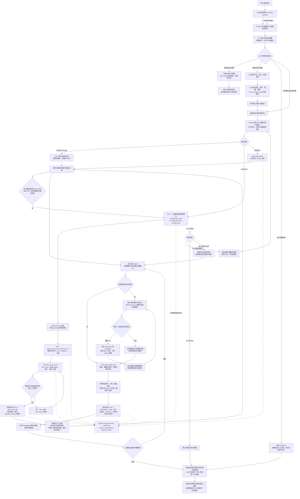

# WaveSurge 新版 API 与 Agent 流程更新报告

依据：用户提供的 `docs/api.md`、`docs/guide.md`、`docs/SKILL.md`，更新日期 2026-10-10。以下区分官方契约、真实 Token 调用和受控端到端验收，不把候选获取成功等同于筛选通过。

## 1. 这次改变了什么

Instagram 新任务改为同步 GET 原始数据获取，不再 POST `/creator-search/requests`。搜索只按关键词召回账号，不负责地区、粉丝、职业、外观等筛选；这些约束仍由本地程序与 LLM 逐人核验。原异步任务已经保存的 `remoteId` 继续 GET 查询，保留原候选、人工协助与历史结果，避免升级时丢失工作。

| 阶段 | 当前接口或处理 | 返回内容和本地用途 |
| --- | --- | --- |
| Token 自检 | GET `/auth/me` | 确认凭据有效，不把身份凭据发送给 LLM |
| Instagram 搜索 V1 | GET `/instagram/v1/fetch_search?query=…&select=users` | 仅取 `data.users[].user`；无分页 |
| Instagram 搜索 V2 | GET `/instagram/v2/search_users?keyword=…` | 仅取 `data.data.items[]`；无分页 |
| Instagram 搜索 V3（默认） | GET `/instagram/v3/search_users?query=…&rank_token=…` | 仅取 `data.users[]`，不重复合并 `items`；非空新 token 才继续，query 保持不变 |
| 单人详情 | GET `/instagram/v1/fetch_user_info_by_username_v2?username=…` | `data.id`、biography、edge_followed_by.count、头像、私密/认证字段；字符串 ID 用于下一步 |
| 帖子列表 | GET `/instagram/v1/fetch_user_posts?user_id=…&count=12&max_id=…` | items、caption、taken_at、图片资源、计数；more_available=true 且非空新 next_max_id 才翻页 |
| 单帖详情 | GET `/instagram/v2/fetch_post_info?code_or_url=…` | `data.data` 中的 caption、metrics.like_count/comment_count、image_versions.items 和轮播资源；不沿用列表字段路径 |
| YouTube/TikTok/X | GET `/discover/db?platform=…&limit=100&sort=followers_desc` | 读取已有 Creator 名单并本地核验；不能声称进行了新全站关键词搜索 |
| 历史任务恢复 | GET `/creator-search/requests/:taskId` | 仅用于已经有 remoteId 的旧任务；新生产任务不使用该 POST |

搜索版本固定，不自动切换。Agent 用 `instagram.queries` 生成 1–5 个简短关键词，可显式选择 v1/v2/v3；未提供时使用 personaText 和 v3。每个关键词最多 3 页，每个账号最多 2 页帖子、每页 12 条，再补最多 2 条有短码帖子的详情。这些是控制调用量的读取边界，不是“已搜索全站”的承诺。候选预算和目标人数仍分别保存；达到边界但没有足够合格者，交付缺额报告。

没有扩展未经授权的付费功能。新版文档不再支持我们对旧异步搜索的“所有搜索免费”承诺，相关工具说明、提示词和按钮已更正。平台内策略/付费搜索/外联需要正式 credits 报价、付款人和逐次明确确认；目前工具只执行资料读取与本地研究。我们的 Campaign 是本地营销研究计划，不会暗中创建平台 Campaign、生成付费策略或联系 Creator。

## 2. 数据与判定规则

- 原始响应及 Content-Type、HTTP 状态、调用时间保存在 `wave-call`；Token 脱敏。超出 JavaScript 安全整数的整数使用 JSON 原文保留为字符串，避免 ID 精度丢失。
- 搜索按 username 去重，帖子按字符串 ID 去重，重复游标停止。账号详情 username 或单帖发布者/短码不一致时，不能污染当前候选。
- 粉丝只采用本次账号详情的明确计数；搜索没有粉丝或地区时不补猜。所在地必须有本人明确声明，不能把语言、账号主题或受众国家当作本人国家。
- 列表与详情分别解析。单张照片的多种尺寸只取一个合适资源；轮播逐项读取；视频封面单独标识，不计为照片帖。头像不能替代实际帖子照片。
- 互动率保存比例值：近期采样帖子的平均（点赞数＋评论数）/粉丝数，显示时乘 100%。同时保存样本数和公式；任一计数缺失、粉丝无效或样本为空时为未知。真实零计数与缺失计数区分。
- LLM 从简介与帖子文字输出逐条件三态判断、具体画像标签和证据引用。图片 URL 只是资源地址：视觉条件必须由有头浏览器真实观察像素，并保存截图资产后才可通过。
- 原始完整响应留在存储和审计中，核验输入仅传递有来源的文字、事实和资源证据，避免重复塞入完整大响应。Instagram 的文字核验不强制打开登录页；视觉核验优先定位实际照片。定位当前候选之前不能把浏览器停留的上一个候选页当作新候选观察。
- 账号/帖子读取失败保存来源错误及已有资料；认证/402 直接停止。发现阶段限流/网络异常按当前读取位置退避，最多三次后明确结束，不无限重试或另开版本。

核心实现：`src/server/instagram.ts`（原始字段与本地指标）、`discovery.ts`（读取游标与候选队列）、`wave.ts`（鉴权/HTTP/无损 JSON）、`research.ts`（持久任务与核验），以及 `browser-verifier.ts`、`assessment.ts`、`reports.ts`。上下文和 Agent loop 沿用现有实现；新增状态只是分页/恢复检查点，没有把用户意图编码为大型状态机。

## 3. 一次消息的完整执行逻辑



浏览器需要人工协助时，只暂停依赖浏览器的核验；只读 API 资料获取可以继续。现有原任务、原候选和主对话各自持久化，用户后续消息不会隐式取消它们。人工在 API await 期间交还桌面后，Worker 保存数据前重读最新任务状态，避免旧快照覆盖为 needs_input。后台任务完成后主动报告；主 Agent 对话回执等待本轮回复稳定，不能把“后台完成”和“模型已回复”当作同一同步事件。

## 4. 真实 Token 调用验证

生产域 `https://wavesurge.ai/api/v1`：

| 调用 | 真实结果 |
| --- | --- |
| auth/me | 200，凭据有效 |
| V1 搜索 natgeo（带 select=users；另测省略 select） | 两次均 HTTP 400，上游正文含 detail；不能声称 V1 可用，不自动切换掩盖错误 |
| V2 搜索 natgeo | 200，用户确实位于 data.data.items |
| V3 搜索 natgeo | 200，data.users 与 data.items 有重复列表，只取 users |
| natgeo 账号详情 | 200，字符串 ID 787132，粉丝计数可读 |
| 帖子列表及 next_max_id 第二页 | 200；真实帖子包含大整数 pk、字符串 id、图片和计数 |
| 单帖 DdG4RIxIPyf 详情 | 200；真实 metrics 和 image_versions 结构与列表不同 |
| discover/db（已有名单） | 200，返回已保存 Creator 资料 |
| credits/balance 前后 | 均 2058；本次未观察到 credits 变化，不推导为永久免费 |

通过生产 `WaveClient → discover → instagramCreator` 再完整调用一次 natgeo 的实际结果：

```json
{
  "handle": "natgeo",
  "followers": 268409939,
  "region": null,
  "recentSamplePosts": 24,
  "engagementRateRatio": 0.0003085050935216424,
  "engagementRatePercent": 0.03085050935216424,
  "photoUrls": 25,
  "evidenceRecords": 64,
  "httpCalls": 6,
  "sourceErrors": []
}
```

这是本次 API 快照，不是长期固定计数。region=null 正是正确的未知处理；未将 NatGeo 主题或观众地点当作账号所在地。互动率使用本次取得的列表采样，可能含置顶内容，不声称覆盖全部近期内容或全站历史。这里只证明真实获取与本地适配，不声称该账号满足原题 20 位候选的全部条件。

脱敏原始响应与执行日志位于 `validation/2026-10-10/api-update/`。验证没有平台内付费搜索、外联或付款动作。

## 5. 回归与部署结果

最终代码回归结果：

| 验证 | 结果 |
| --- | --- |
| TypeScript 检查 | `pnpm typecheck` 通过 |
| 全部自动测试与 SQLite/API/组件集成 | 24 个测试文件、155 项测试全部通过 |
| 每文件覆盖率 | 54 个生产 TS/TSX 文件全部 100%；1 个空类型声明文件无可执行代码。Statements 2112/2112、Branches 1620/1620、Functions 488/488、Lines 993/993；没有 coverage ignore |
| 干净 Docker 完整浏览器验收 | 最终项目 creator-studio-qa-1791611818923，4/4 通过，4.5 分钟 |
| 进阶目标 | 自然营销目标→交互澄清→两类型草案→具体版本确认→跨组去重 2/2→chat 报告 |
| 持续对话及结果补标 | 研究过程中继续发消息、不重复来源请求；偏好排序、实际画像保存、筛选导出、已有结果补标和更新报告通过 |
| 新 Instagram 流程 | 5 次 GET，正确字符串 user_id 与 max_id；API 文字＋真实有头图片观察；美国声明、视觉条件、标签、0.69% 互动率（样本 1）、报告与 CSV 通过 |
| 浏览器持久化 | 真正通过 noVNC 操作受控页面写 Cookie/localStorage，连续 3 次正常容器重启保留 |
| 真实服务 | Token 自检、V2/V3、账号、帖子、第二页、详情、名单 GET，以及生产适配器实际 6 次 GET 链路验证 |
| 主部署 | 已更新 http://127.0.0.1:3000；55 份 TS/TSX 源文件与 app 镜像逐份 hash 一致，desktop 执行源码一致 |
| 已有数据 | 21 个任务、16 条结果保留；既有国家判断、筛选导出、5 张嵌入截图、唯一 chat 报告回执和真实 noVNC 页面复验通过。历史人工协助任务仍 needs_input，没有被升级伪装为完成 |

完整浏览器验收使用 `.env` 的真实配置模型、生产 UI/Worker/SQLite/有头 Chromium/noVNC；Wave 响应和图片/候选页是明确标注的受控夹具。真实 WaveSurge API 验证另存，不把夹具照片称为真实 Instagram 内容，也不把受控持久化验证称为真实社交平台账号登录成功。

第一次完整验收发现并修复了 SVG/XML 没有 HTML body 的采集错误、所在地原文句末标点解析问题；对应测试先复现再修复。还补充复现并修复了人工在 API await 期间交还桌面被旧状态覆盖的问题。聊天回执测试改为等待实际回复，而非研究 Worker 提前完成的瞬间。最终完整浏览器验收使用包含这些修复的全新镜像运行。

证据目录 `validation/2026-10-10/api-update/`：`coverage.log`、`typecheck.log`、`e2e.log`、`live-*.json`、`live-adapter.json`、`instagram-e2e.json`、`advanced-natural-e2e.json`、`natural-e2e.json`、`main-verified.json`、`main-runtime.json`、`source-check.json`，以及最终项目的 browser-reports/artifacts。测试临时容器和网络已清理，命名卷保留；没有改动其它会话的部署。

部署沿用原 Compose 数据卷；完整数据库快照保存在 app 数据卷内，权限 0600，位置记录于 `before-final-upgrade.json`。默认提示词可精确升级旧默认值，用户定制文本与模型凭据保留。`docs/test-plan.md`、README 和根目录官方文档副本已同步；历史外部新建研究测试需显式 `LIVE_WAVESURGE=1`，默认完整验收可独立重复执行。

## 6. 已知边界

共享浏览器等待人工时，依赖其核验器的研究仍需等待；只读资料获取和已有证据的文本补标可继续。原始 20 人历史任务尚未完成，本次不将其标为通过，也没有代替用户处理真实登录验证。

V1 当前上游对实测请求返回 400。V2/V3 原始搜索仍是账号关键词搜索，用户复杂条件必须本地核验，有限采样不保证凑齐所有配额。YouTube/TikTok/X 目前只查询已有名单；如果未来需要新增平台付费搜索，应另行实现官方报价确认协议，不能恢复未经确认的旧 POST。

媒体 URL 可能过期，私密账号与平台挑战仍可能需要人工；资料不够会保持 unknown 并报告缺额。有头浏览器和 noVNC 保留，API 数据可减少不必要登录，但不能保证所有社交页面始终可读。
