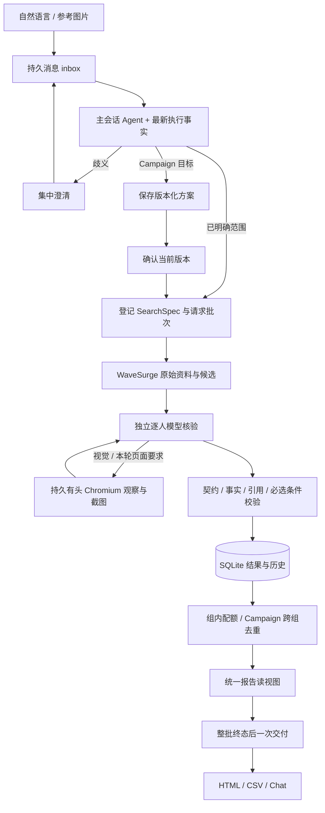

# 架构与 Agent 设计

本文说明当前生产代码的职责和数据路径。历史取舍与阶段计划保留在 [implementation-plan.md](implementation-plan.md)，桌面协议详见 [container-computer-use.md](container-computer-use.md)。

## 1. 系统边界

Creator Studio 是面向创作者研究的本地、单管理员应用。前端对话收集目标与约束，后端连接 WaveSurge 和 OpenAI 兼容模型服务，桌面容器提供持久有头 Chromium。SQLite 是执行事实、上下文与交付记录的持久来源。

Compose 包含 `app`、`desktop` 两个长期服务及 `secret-init` 一次性内部凭据初始化服务。`app` 向本机公开 3000；桌面、VNC 与内部命令服务通过容器网络访问。模型 Key、WaveSurge Token、桌面凭据留在后端。

## 2. 为什么将对话与后台研究分开

筛选包含远端获取、多位候选分析、证据补充及不同来源可用性。它的耗时与聊天回复不同。主 Agent 理解和登记工作后即可继续接收消息；研究执行器推进持久任务，侧栏展示实际进度。进度查询复用已有任务，不重新发起搜索。

模型负责语义理解和定性推理；程序负责可验证的约束与可靠执行。没有为每种自然语言意图编写大型状态机，但工具、持久性、引用、预算和交付时机由代码明确控制。

## 3. 四类模型上下文

| 上下文 | 输入与权限 | 输出 |
|---|---|---|
| 主会话 | 用户消息、系统与工作流提示词、当前任务/Campaign/execution 事实、历史摘要；受限研究/查询/方案工具 | 澄清、研究登记、方案、进度与结果答复 |
| 候选排序 | 本次范围、基础候选与剩余分析预算；只提交核验顺序 | 待核验的候选集合；不代替合格判定 |
| 逐人核验 | 固定 `SearchSpec`、当前候选、实际来源及可用截图；文字模式仅提交判断，浏览器模式增加观察与协助工具 | `judgments`、`annotations`、`facts` |
| 历史压缩 | 程序选定的旧对话与上一份摘要；没有研究工具 | 保留约束、纠正、任务引用、未完成事项的文字摘要 |

默认提示词位于 `src/shared/prompts.ts`。模型与提示词每次调用重新读取设置，保存后下次生效。旧默认值按精确匹配升级，已定制内容保留。

每次主会话的输入依次包含：系统身份、主工作流、当前数据库事实、可用历史摘要、完整保留的消息批次。摘要不能替代当前任务数量与状态。网页和工具返回是证据资料，没有修改权限或筛选要求的权力。`context-projection.ts` 只缩减模型读视图中的重复原始结果与旧图片字节；完整业务记录不变。按完整批次摘要，保留未完成输入和最新纠正，普通轮询时间变化不使回复无休止失效。

## 4. 从需求到可执行范围

`SearchSpec` 主要字段：

| 字段 | 含义 |
|---|---|
| `count` | 入选目标名额 |
| `candidateBudget` | 逐人分析预算，不能小于入选目标 |
| `platforms`、`regions`、`minFollowers/maxFollowers` | 基础硬条件；粉丝不限用 0 至最大安全整数 |
| `criteria` | 独立条件，包含 ID、标签、`required` 及 `basis=text/visual` |
| `annotations` | 要分析的实际画像维度，可限定允许值 |
| `instagram.queries/handles/version/profileBudget` | 关键词或精确账号、接口版本及基础资料预算 |
| `analyzeAll` | 已指定候选全部分析，达到入选配额后仍继续 |
| `verificationMode` | `text` 仅文字、`browser` 本轮主页观察、`auto` 按证据需要选择 |
| `allowHumanAssistance` | 默认true；false仅用于用户明确要求本任务只使用无需登录的公开资料 |

范围经 Ajv 校验；冲突预算、重复条件/账号及不支持的平台不能变成已启动任务。KOC/个人消费者身份作为独立条件核验，不能仅因为主题是数码就把官方品牌账号判为个人创作者。

Instagram 支持 1–5 个短关键词、每词最多 3 页。泛搜索先读取本人基础资料，排除明确不符粉丝范围者，再读取帖子并占用分析名额；基础资料预算独立记录。精确指定账号可以全量分析。每人最多 2 页帖子、2 条单帖详情。YouTube/TikTok/X 从已有有界 Creator pool 读取，再用本次目标排序。

ResearchEngine 分开文字核验和单浏览器调度；浏览器等待时新到文字任务可以热唤醒，重复wake不重复处理。共享桌面只允许一条研究浏览器通道；enrichment 在研究通道结束后执行，避免更新同一来源记录时互相覆盖。基础资料每步最多连读四个粉丝不符者，再继续下一步，读取预算、队列及游标持久保存。

## 5. 三态判断、事实与标签

逐条件结果为 `match`、`no_match`、`unknown`。存在必选不符合则整体不符合；全部必选通过才合格；其余待核实。偏好参与排序，不决定合格。

程序检查：条件 ID 和判断格式有效、引用存在、数值区间与平台一致、所在地确实指向本人、视觉判断引用实际截图。缩写粉丝数保留原显示精度与保守区间；来源冲突保存审计信息。粉丝行只引用本人事实及相应数值来源，不拼入无关帖子。近期互动率根据平均赞评/粉丝计算，并保存样本数；计数缺失不构造数值。

筛选判断与画像分开：`judgments` 回答条件是否成立；`annotations` 保存本人的实际内容方向、呈现风格或其他维度。支持的画像值形成可查询 `tags`，未知值不成为肯定标签。

新研究将族裔要求单列为 `reviewOnly` 核对项，保留原始要求。明确记载本人族裔的可靠文字资料可以作为来源，不限定本人亲口自述，不从照片、肤色、姓名或所在地推断。资料不足标为待人工确认，不阻断其他条件通过者的候选交付；明确资料证明不符合要求者仍排除。个人身份、内容、所在地、粉丝和视觉等其他必选条件照常核验；族裔项不参与偏好排序，也不迫使已满足配额的研究处理完整预算。混合在同一条中的要求须拆开，比赛中的英文 race 不作为族裔条件。

页面、聊天、HTML及CSV分别展示已核实条件和待人工确认信息。新规则不重写历史任务或结论；已有研究的重新核验沿用其原范围。默认提示词按完整旧默认精确升级，保留自定义设置。

`text` 不为资料缺失请求登录；`browser` 必须取得本轮本人主页观察，旧截图不代替新访问；`auto` 按需要使用现有资料与页面。截图由桌面服务保存为资产，报告以证据 ID 映射：在线通过鉴权资产接口按需加载 PNG，选择 `view=offline` 时内嵌 PNG，保留可离线审阅的版本。

## 6. 配额、Campaign 与报告投影

独立研究先保存全部核验记录，再从合格集合按偏好排序选择 `count` 位。合格备选保留，不能把它改为不合格以统一人数。

Campaign 保存目标、受众、多个类型的理由/范围/配额及版本。确认当前版本才启动。各组可以分析同一候选；最终分配按平台账号规范身份跨组去重，同账号只占一个类型配额。缺额明确保留，不猜测跨平台真实身份。

原子研究的独立预选与 Campaign 全局分配可能不同。`report-scope.ts` 生成统一读视图，附 `reportContext`：来源任务、分组、入选口径、Campaign 分配与原研究预选。总报告、子报告、结果 API、Agent 查询及 CSV 都用这一视图；保存的原判断和预选不因展示而改写。

HTML 直接展示每位入选者的条件、状态、理由、标签、画像和来源。多组文档区分记录数、去重账号人数和各组名额。CSV 的 25 列支持逐条追踪原研究及当前分配。

## 7. 一批完成后交付

`tool-owner` 将实际工具调用关联到用户请求。`work-batch` 保存登记项、封口和交付状态。主会话完成回复或上下文切换时封口；只有所有已登记项处于完成、部分完成、失败或取消终态时，`deliverWorkBatches` 才生成一次综合交付。

交付记录、聊天报告、上下文批次和已交付标志在 SQLite 事务中写入。交付 ID 根据主题及版本生成；刷新和正常重启不会重复推送。终态报告也包含失败、取消与缺额。

上下文切换前未登记的口头计划不当成已执行事项。清空/载入只影响后续模型上下文，保留已登记后台工作，并在新上下文交付实际完成范围。

## 8. 增量操作与恢复

补标 `annotate` 仅复用已有证据，保留基础事实、原条件判断和入选，更新画像及版本历史。重新核验 `reverify` 会重新访问本人主页与原条件，不重新发现候选或调用 WaveSurge 搜索。原有派生country先按同一原文和证据重算，修正旧解析代码；保存旧结果与revision，不要求模型重复提交事实。不同所在地声明仍保存冲突。

用户消息先持久化，消息 ID 支持相同内容幂等及不同内容冲突拒绝。工具回执保存完整结果；重复调用同 ID 不重复执行。活动模型输入保持不可变，追加消息在下一次模型调用及完整工具结果边界注入。明确取消后不接收该任务的迟到结果。

临时网络/服务错误有界重试并保存当前位置；格式错误或不可恢复错误如实结束。启动时修复兼容历史数据、恢复待处理消息与批次。持久浏览器中断后的旧输入动作不会直接重放，恢复需要重新观察。

## 9. 存储与主要入口

SQLite `documents` 按 `kind/id` 保存 JSON 业务对象；`task_states` 保存轻量任务投影；`document_versions` 支持变化检测。WAL 和事务保护多项原子提交。数据包括消息、模型调用、工具回执、任务、结果/历史、证据资产、配置、方案、执行批次、协助与交付。

| 入口 | 职责 |
|---|---|
| `src/server/bootstrap.ts` | 依赖组装、API 注册、启动恢复、后台定时推进 |
| `src/server/agent.ts`、`context.ts` | 主 Agent、完整工具批次、消息注入、摘要与 epoch |
| `src/server/research.ts`、`discovery.ts`、`instagram.ts` | 研究调度、来源获取、预算与分页 |
| `src/server/verify.ts`、`browser-verifier.ts` | 独立核验和实际页面/图像观察 |
| `src/server/assessment.ts`、`verdict.ts`、`selection.ts` | 画像、事实、条件校验和排序 |
| `src/server/enrichment.ts`、`campaign.ts` | 增量工作和 Campaign 分配 |
| `src/server/report-scope.ts`、`reports.ts`、`work-delivery.ts` | 同源报告视图、结构化文档和批次交付 |
| `src/server/app.ts`、`auth.ts`、各 `*-api.ts` | HTTP、会话、参数验证、导出与资产服务 |
| `src/desktop/`、`src/server/desktop.ts` | 持久 Chromium、观察协议与桌面授权 |

## 10. 验证入口

[总体测试方案](test-plan.md) 分层覆盖纯逻辑、集成、React 与完整 Docker 浏览器场景。[提交前最终验收](testing/final-2026-10-11/report.md) 将真实模型/实际 Wave 数据、明确受控来源、历史反例重放分别记录，核对浏览器 DOM、聊天交付、CSV 和持久数据。

[最新公网多场景验收](testing/public-scenarios-2026-10-13/report.md) 验证了主Agent自主生成检索词、跑步3/3、家用咖啡2/2、运行中续聊、实际画像查询、逐条分组与报告下载。默认人工接管流程通过独立受控登录挑战、真实模型和有头浏览器验证；第三方账号的登录与验证码仍由用户确认后操作，Agent交还后重新观察。每个场景按实际范围、读取预算、来源证据与入选结果复核。
