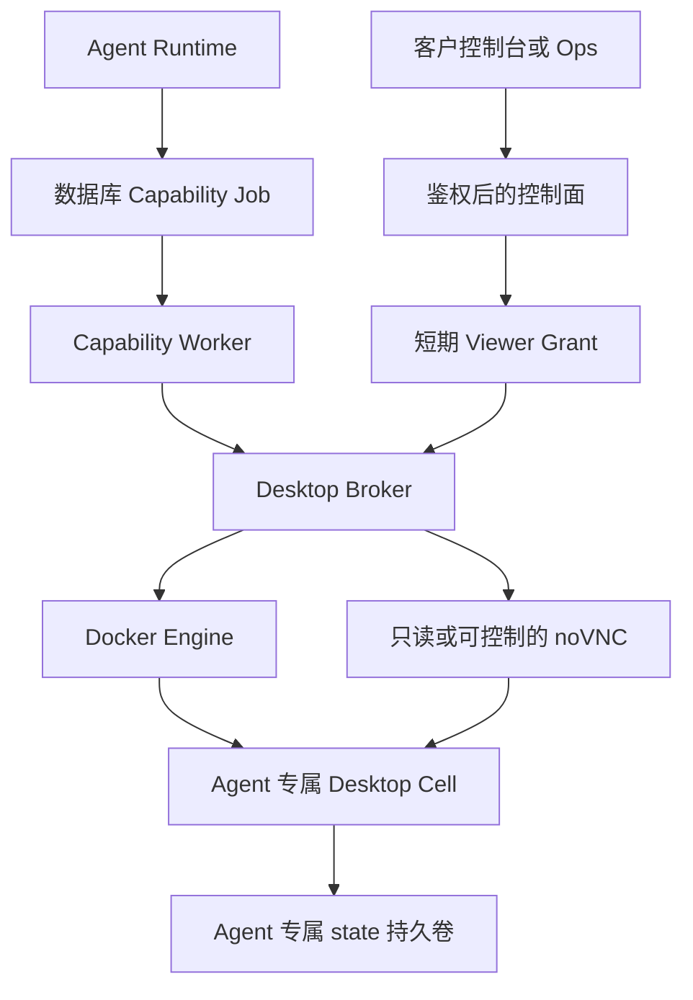

# 容器 Computer Use 与有头浏览器实现

本项目为每个 SaaS Agent 建立一个持久的逻辑桌面，再按需启动对应的图形容器。容器内运行 Xvfb、Fluxbox、有头 CloakBrowser Chromium 和 Playwright；DOM 工具与鼠标键盘工具操作同一环境，用户可以通过受控的 noVNC 页面观察或接管。

新项目最值得复用的部分是桌面数据与容器生命周期分离、平台代理统一管理 Docker、观察后才能执行坐标动作，以及把截图登记为资产后交给消息渠道。仅设置 `headless: false` 无法完成服务器上的图形桌面、持久登录和人工接管。

## 1 实现范围与组件

本文以 `src/saas/desktop` 为主。仓库中的 `src/localOperator/computerTool.ts` 是另一条本地操作路径，不是本文的容器桌面实现；未配置 Desktop Broker 时，`SaasBrowserCapabilityExecutor` 还保留普通浏览器执行路径，也不具备本文全部桌面语义。



| 组件 | 职责 | 主要源码 |
| --- | --- | --- |
| Desktop Workspace | 保存桌面身份、期望与实际状态、运行代次、输入所有者和审计 | [workspaceRepository.ts](../../src/saas/desktop/workspaceRepository.ts) |
| Capability Worker 执行器 | 校验所属 Agent、调用 Broker、把截图注册到资产存储 | [browserExecutor.ts](../../src/saas/capabilities/browserExecutor.ts) |
| Desktop Broker | 校验内部调用凭据，管理容器、Viewer 和接管动作入口 | [brokerServiceProcess.ts](../../src/saas/desktop/brokerServiceProcess.ts) |
| Sandbox Provider | 定义启动、执行、停止、重建、删除的抽象接口 | [sandboxProvider.ts](../../src/saas/desktop/sandboxProvider.ts) |
| Docker Engine Client | 用固定结构的 Docker HTTP API 创建和管理容器 | [dockerEngine.ts](../../src/saas/desktop/dockerEngine.ts) |
| Desktop Cell | 管理持久浏览器上下文、标签页、截图和桌面输入 | [cellServiceProcess.ts](../../src/saas/desktop/cellServiceProcess.ts) |

只有 Broker 访问 Docker socket。模型提供 URL、selector 或受限鼠标键盘动作，不能提供镜像、容器命令、挂载路径、网络或 Docker 参数。

## 2 容器里的图形环境

镜像由 [desktop-cell.Dockerfile](../../deploy/saas/desktop-cell.Dockerfile) 构建，基于已有 Capability 镜像，复用其中的 Node、Playwright 和 CloakBrowser 可执行文件；迁移 Dockerfile 时还要移植这些基础依赖，不能只复制这一层。

| 依赖 | 用途 |
| --- | --- |
| Xvfb | 提供 `DISPLAY=:99` 的虚拟 X11 显示器，默认 1440 × 900 × 24 |
| Fluxbox | 管理窗口，使浏览器和 GUI 操作有一致的桌面环境 |
| CloakBrowser Chromium | 项目选用的浏览器可执行文件，以有头模式运行 |
| Playwright | 导航、DOM 查询、点击、填表、执行页面表达式和页面截图 |
| scrot | 截取整个 X11 桌面 |
| xdotool | 执行鼠标移动、点击、拖动、文字输入和快捷键 |
| x11vnc | 将同一个 X11 桌面暴露为只读或可控制的 VNC 服务 |
| noVNC 与 websockify | 在网页里显示桌面，并代理 WebSocket 到 VNC |
| Noto CJK 字体 | 支持中文页面和文档显示 |

[desktop-cell-entrypoint.sh](../../deploy/docker/desktop-cell-entrypoint.sh) 按以下顺序启动：创建目录 → 启动 Xvfb → 用 `xdpyinfo` 等待显示器可用 → 启动 Fluxbox → 启动两个 x11vnc 实例 → 启动两个 websockify → 启动 Node Cell 服务。

| Cell 内端口 | 服务 | 暴露方式 |
| --- | --- | --- |
| 8810 | Cell HTTP API | 供 Broker 内部访问，执行接口需要 Cell token |
| 5900 | 只读 VNC | 仅监听容器 localhost，带 `-viewonly` |
| 5901 | 可控制 VNC | 仅监听容器 localhost |
| 6080 | 只读 noVNC 网关 | 容器网络内可访问，经 Broker 的短期授权代理 |
| 6081 | 可控制 noVNC 网关 | 仅经接管授权路径代理 |

Cell 不发布宿主机端口。VNC 使用 `-nopw`，因此访问边界依赖隔离网络与 Broker，迁移时不能把 6080 或 6081 直接发布到公网。

## 3 持久浏览器与数据目录

Cell 使用 `chromium.launchPersistentContext`，而不是为每次任务创建临时浏览器上下文。该 API 以 user data directory 保存浏览器会话数据，同一目录不能同时由多个浏览器实例写入。[Playwright 官方说明](https://playwright.dev/docs/api/class-browsertype#browser-type-launch-persistent-context)

以下代码是当前实现的关键参数摘录，省略了启动恢复和错误处理：

```ts
const context = await chromium.launchPersistentContext(
  "/state/browser-profile",
  {
    headless: false,
    executablePath: configuredBrowserExecutablePath,
    acceptDownloads: true,
    downloadsPath: "/state/downloads",
    viewport: { width: 1440, height: 900 },
    args: [
      "--no-sandbox",
      "--disable-dev-shm-usage",
      "--disable-background-networking",
      "--disable-component-update",
      "--window-size=1440,900",
    ],
  },
);
```

`--no-sandbox` 是本项目当前的浏览器启动参数，不能据此认为 Chromium 自身还提供完整沙箱保护；这里依赖外层执行环境，公开多租户还需要更强的隔离基座。

```text
/state/
  browser-profile/       Chromium profile、Cookie 和站点存储
  downloads/             浏览器下载目录
  home/.config/          桌面程序配置
  home/.cache/           桌面程序缓存
  workspace.json         标签页 sessionId、URL 和活动标签页
```

容器名称为 `sa-desktop-<desktopWorkspaceId>`，卷名称为 `sa-desktop-state-<desktopWorkspaceId>`。Workspace 属于 `(tenantId, workspaceId, agentId)`，与可替换的容器一一对应。当前基础镜像还声明了 `/opt/data` 卷，因此同一命名卷同时挂到 `/state` 与 `/opt/data`，避免产生不受管理的匿名卷；新基础镜像没有该声明时可去掉后一挂载。

标签页清单采用串行、原子文件写入，包含稳定 `sessionId` 与 URL。启动时先恢复活动标签，后台标签在 HTTP 服务就绪后以有界并发恢复；无法访问的网站保留待恢复 URL，避免把原 URL 覆盖成 `about:blank`。清单最多恢复 20 个标签。

恢复保证包括 profile 数据、下载目录和可恢复的标签 URL；页面 JavaScript 内存、未提交表单、精确像素帧以及网站永不过期的授权不在保证范围内。Playwright 下载本身也有生命周期规则，长期保存的业务文件宜进一步注册到资产存储，不仅依赖浏览器临时下载文件。

## 4 工具调用与任务关联

Agent 的工具调用先写入持久 Capability Job，Worker 再执行。Worker 从数据库获得桌面所有者，校验输入租约及 Workspace revision，然后将命令发给 Broker。

Broker 的内部命令格式如下。`owner` 全部由可信代码生成，模型只提供受工具 schema 限制的 `input`。

```json
{
  "owner": {
    "tenantId": "11111111-1111-4111-8111-111111111111",
    "workspaceId": "22222222-2222-4222-8222-222222222222",
    "agentId": "33333333-3333-4333-8333-333333333333",
    "desktopWorkspaceId": "44444444-4444-4444-8444-444444444444",
    "runtimeGeneration": 7
  },
  "toolName": "browser_open",
  "input": { "url": "https://example.com", "keepOpen": true }
}
```

工具与 Owner 的 schema 位于 [contracts.ts](../../src/saas/desktop/contracts.ts)。当前 Cell 支持：

| 工具 | 行为 |
| --- | --- |
| `browser_open` | 新建标签、打开 URL、提取文字并自动截图；`keepOpen` 默认 false |
| `browser_session_start` | 建立连续操作用的标签，返回 sessionId |
| `browser_goto`、`browser_extract` | 导航或读取当前 DOM 文本 |
| `browser_click`、`browser_type` | 用 selector 点击或填充；先检查目标是否存在及可操作 |
| `browser_evaluate` | 通过共享表达式执行边界获取页面结果 |
| `browser_screenshot` | 页面截图；可选择 fullPage 和截图后是否关闭标签 |
| `browser_close`、`browser_sessions` | 关闭标签或列出会话；关闭标签不会停止 Cell 或清空 profile |
| `computer_observe` | 获取整个桌面的画面、窗口标题、页面信息和有界可读文本 |
| `computer_action` | 消费最新 observationId，执行受限输入并再次观察 |

业务调用还要保留原 work item、autonomy session 或 v2 work binding。桌面归属确定“操作哪台电脑”，工作关联确定“为何操作以及完成后回复谁”；两者不能相互替代。异步完成必须回到原工作，不根据当前焦点选择新接收人。

## 5 Computer Use 的观察与输入协议

`computer_observe` 优先通过 scrot 截取整个桌面，失败时退回活动页面截图；同时提取最多 12000 字符的页面文字，返回坐标空间与观察标识。

以下是 Worker 处理后的精简返回示例，省略了页面和交付提示字段：

```json
{
  "observationId": "55555555-5555-4555-8555-555555555555",
  "observationRevision": 3,
  "observedAt": "2026-10-08T02:00:00.000Z",
  "coordinateSpace": {
    "origin": "top_left", "unit": "css_pixel", "width": 1440, "height": 900
  },
  "activeWindow": "Example Domain",
  "visibleText": "Example Domain",
  "screenshot": {
    "assetHandle": "asset:66666666-6666-4666-8666-666666666666",
    "mediaType": "image/png", "width": 1440, "height": 900
  }
}
```

对应的输入示例：

```json
{
  "observationId": "55555555-5555-4555-8555-555555555555",
  "actions": [{ "type": "left_click", "x": 400, "y": 300 }],
  "observeAfter": true
}
```

可执行动作包括 `left_click`、`double_click`、`right_click`、`drag`、`type`、`key`、`scroll` 和 `wait`。每批 1 至 3 个动作，坐标必须在桌面范围内；文字输入通过 `execFile` 和固定 xdotool argv 传递，不能拼接 shell 命令。`observeAfter` 只能为 true。

[observationGuard.ts](../../src/saas/desktop/observationGuard.ts) 为每次观察生成一次性凭据。同一个 observationId 只能消费一次；其他会改变浏览器或桌面状态的命令会使旧观察失效，旧值返回 `DESKTOP_OBSERVATION_STALE`。新动作后的截图生成下一次观察凭据。

这一机制防止重复使用旧截图坐标，但当前没有观察有效期，也不能捕获页面所有自主变化。新项目建议补充观察超时及布局变化检测；全桌面截图退回页面截图时还应显式标注截图范围，避免把页面坐标当成窗口坐标。

Computer Use 工具提供的是执行能力。让模型准确判断按钮位置仍需要视觉模型或 GUI grounding 能力；有头浏览器本身不会产生可靠的视觉规划。DOM 可用时优先使用 DOM 工具，无法定位或需要处理桌面级交互时再使用坐标工具。

## 6 截图如何交付

Cell 在内部 HTTP 响应中暂时返回 `screenshotBase64`。Worker 校验图像大小，写入当前 Agent 的隔离输出目录并登记资产，然后移除 base64，持久结果只保留 `screenshot.assetHandle`、尺寸、媒体类型与可发送的 `messageBlock`。

```text
Cell 截图
  → 内部 HTTP 临时传输
  → Worker 注册资产
  → Capability Job 保存句柄和有界文字
  → Agent 调 message_reply 或 message_send
  → 原飞书等渠道上传并发送图片
```

`browser_open` 自动捕获最终视口；连续 DOM 操作在最后一次改变页面后补一次 `browser_screenshot`；Computer Use 在动作后自动观察。项目的工具结果和提示词要求任务完成时交付一张安全的最终结果图，邮件则使用附件。该要求是工具和运行时协议约束，并不等于截图自动通过消息渠道发出。

密码、验证码、MFA、密钥、支付信息以及无关个人敏感数据不能进入外发截图。无法切换到安全结果页时，用文字说明结果和截图限制。

## 7 人工接管与恢复

逻辑桌面的 `inputOwner` 为 `agent` 或 `human`。Worker 检查数据库状态；Broker 另检查控制 Viewer 和接管 gate，形成两层输入互斥。

1. Agent 用 `computer_request_human_assistance` 创建持久协助请求，冻结原工作关联与桌面代次。
2. 工具返回客户产品深链，Agent 通过来源渠道发送链接与最小操作说明。
3. 用户登录并通过工作区权限检查后认领请求；数据库把输入租约转给 human，通常为 15 分钟。
4. Broker 先禁止新 Agent 动作，再检查已在执行的动作；尚未排空时返回 `DESKTOP_AGENT_ACTION_IN_FLIGHT`，不能立即签发控制 Viewer。
5. 控制 Viewer 生效期间，Agent 桌面命令返回 `DESKTOP_HUMAN_TAKEOVER_ACTIVE`，并明确 `executionState: not_started`。
6. 用户完成、取消或租约到期后撤销 Viewer，归还输入，写入精确关联原工作的 continuation。
7. Agent 重新 `computer_observe`，确认实际画面后继续原任务。

详细状态机在 [assistanceRepository.ts](../../src/saas/desktop/assistanceRepository.ts)，架构说明在 [Agent Desktop Workspace](../architecture/agent-desktop-workspace.md)。Ops Viewer 始终只读；不能用跨租户运维身份绕过客户侧的接管认领。

Viewer Grant 保存在 Broker 进程内，默认有效期 300 秒，允许范围 30 至 900 秒。重启 Broker 会丢失这些 grant；浏览器需要经控制面重新申请。链接或协助 request ID 本身不授予控制权。

## 8 容器生命周期与隔离

| 动作 | 容器行为 | 数据行为 |
| --- | --- | --- |
| start | 不存在则创建，停止则启动 | 使用原命名卷 |
| stop | 先 quiesce，再停止 | 保留 profile 与文件 |
| rebuild | 移除旧容器，用当前镜像重新创建 | 默认保留命名卷 |
| resetProfile | 移除容器并删除旧卷，再创建 | 清空原桌面数据 |
| Agent 删除 | 编排撤销 Viewer、移除 Cell 和卷 | 保留 append-only 生命周期审计 |

运行代次 `runtimeGeneration` 是防止旧执行提交新状态的栅栏。Cell token 由 Broker secret 对 `cell:<desktopWorkspaceId>:<generation>` 做 HMAC 派生；容器标签记录所属租户、工作区、Agent、桌面和代次。代次变化时保留卷、替换容器及 token。

正常停止先调用 `/internal/v1/quiesce`，保存清单并关闭浏览器上下文，让最近写入的 Cookie 和站点数据落盘；入口脚本也先将 TERM 转给 Node，再关闭 X11/VNC。Docker 停止等待为 20 秒。崩溃或失联时 quiesce 是 best effort，恢复以最后成功写入的数据为准，不能承诺任意强杀都无损。

当前 Docker 创建约束包括 UID/GID 10000、只读根文件系统、删除全部 Linux capabilities、`no-new-privileges`、固定网络、内存/CPU/PID 限额、512 MiB shm，以及受限的 `/tmp`、`/run` tmpfs。默认 Cell 资源为 2 GiB 内存、2 CPU、512 PID。

Broker 的同桌面操作锁目前在单进程内。新项目若运行多个 Broker，必须增加共享租约或分布式锁，维持每个 profile 单写者；不能仅增加 Broker 副本数。普通 URL 预检也不能代替网络出口隔离，重定向、页面子资源及 GUI 导航仍需要网络层策略。

当前 Docker 基座面向本地、可信客户和内测。公开不可信多租户场景应保留 `DesktopSandboxProvider` 接口，替换为 gVisor、Kata 或 microVM 等执行基座，并完善网络出口策略。

## 9 新项目迁移顺序

1. 建立 Cell 镜像：Node、Playwright、浏览器可执行文件、中文字体、X11 与输入截图工具；先验证有头页面和全桌面截图。
2. 移植 `PersistentDesktopRuntime`，明确 profile、下载和标签页清单目录；验证重建后 Cookie 与 localStorage 可读。
3. 引入稳定逻辑 Desktop Workspace、独立命名卷和单写者锁；区分 stop、rebuild、reset、delete。
4. 建立 Broker 与固定 Docker Provider；主应用和 Worker 不获得 Docker socket。
5. 接入持久任务队列、租约、代次及原工作关联；副作用失败后先区分未开始、已失败和结果未知。
6. 引入 AssetStore，把所有模型可见截图转换为句柄；通过原渠道工具交付。
7. 最后接入只读 Viewer、持久人工协助、输入互斥和原工作续接。

若先做单用户原型，可以暂不移植完整租户管理和数据库工作调度，但保留单 profile 单写者、固定容器配置、观察凭据和原回复路由。CloakBrowser 是本项目的浏览器选型，可以替换；X11、Playwright 和 Broker 的分工仍成立。

## 10 复用验收与源码入口

| 验收项 | 应看到的结果 |
| --- | --- |
| 两个 Agent 同时使用 | 获得不同卷、Cell 和资产权限，无法读取对方 profile |
| 保存登录后正常重建 | Cookie/localStorage 保留，登录状态由目标站点实际验证 |
| 重复 computer_action | 第二次使用同一 observationId 被拒绝 |
| 人工接管碰到在途动作 | 新动作先被阻止，旧动作排空后才提供控制 Viewer |
| stop 后重新使用 | 使用原卷重新启动，未调用时停止的 Cell 不占运行资源 |
| 查看持久 Job 结果 | 有截图资产句柄，没有 base64 或宿主机路径 |
| 原工作完成 | 最终结果回到原消息会话，包含安全截图或明确的截图限制 |

数据库参考 [0060 桌面 Workspace](../../src/db/migrations/0060_agent_desktop_workspaces.sql)、[0061 删除与截图交付](../../src/db/migrations/0061_desktop_cleanup_and_screenshot_delivery.sql)、[0062 人工协助](../../src/db/migrations/0062_desktop_human_assistance.sql)。部署参考 [compose.test.yaml](../../deploy/saas/compose.test.yaml) 的 `desktop-cell-image`、`desktop-broker` 与 `saas-desktop-plane`。

可借鉴 [desktopCellPersistence.test.ts](../../tests/saas/desktopCellPersistence.test.ts)、[desktopObservationGuard.test.ts](../../tests/saas/desktopObservationGuard.test.ts)、[desktopDockerEngine.test.ts](../../tests/saas/desktopDockerEngine.test.ts) 和 [desktopWorkspace.postgres.test.ts](../../tests/saas/postgres/desktopWorkspace.postgres.test.ts)；真实容器验证入口为 [saasDesktopWorkspaceCanary.ts](../../scripts/saasDesktopWorkspaceCanary.ts)。这些是验证设计的参考，不表示新项目已经通过相同验收。
