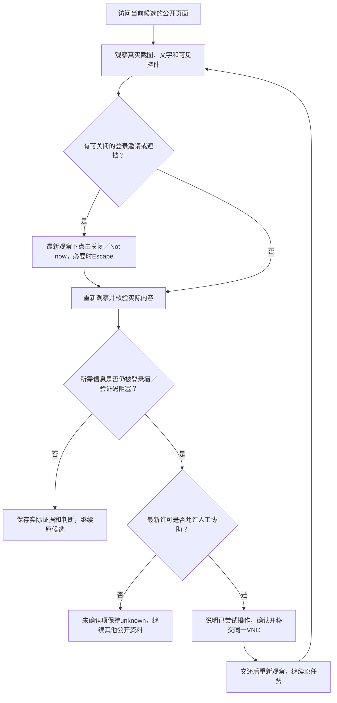

# 浏览器登录弹窗自主处理验证

日期：2026-10-15，Asia/Shanghai。发布入口：[公网工作室](http://101.201.237.219:33332/)。

**可关闭的登录邀请现在由 Agent 自行关闭，重新观察后继续原候选；实际无法关闭的登录墙或验证码才请求用户通过同一 VNC 协助。** app 与浏览器容器已更新，保留现有数据卷、账号密码及模型连接配置。

## 修复内容

- 页面观察返回真实可见控件的标签和选择器，包括 SVG 图标及中文关闭按钮。Agent 使用最新观察点击 Close、关闭、Not now 等入口，必要时使用 Escape。
- 普通关闭按钮可以位于登录表单中；原生提交按钮、关联外部表单的默认提交按钮、登录凭据和互动操作仍受执行层限制。
- 模型过早请求人工时，程序先刷新页面，尝试可安全关闭的入口。关闭后重新读取截图和文字，确认实际状态，不把一次点击当作核验成功。
- 同一入口的自动尝试有边界；明确未执行的过期观察错误不消耗尝试次数。刷新期间取消任务或撤回协助许可，不会发起晚到的动作或人工请求。
- 主会话和逐人核验默认提示词均说明自主处理顺序；已部署的定制提示词同步补充本次规则，其他角色及工具说明保留。发布沿用可靠文字资料核对、资料不足待人工确认的族裔口径。

## 实际网站与模型验证

| 场景 | 实际结果 |
|---|---|
| Instagram 账号主页登录邀请 | 实际出现 Close，点击后对话框数量由1变0，公开主页继续显示 |
| Instagram 帖子注册／登录邀请 | 实际出现 Close，点击后对话框数量由1变0，原帖作者和正文继续显示 |
| Instagram 未登录首页 | 此次为完整登录页面，无关闭入口；与可关闭邀请区分处理 |
| Docker 有头浏览器中的受控登录弹窗 | 实际配置模型自行调用关闭操作，重新取得公开内容，再提交有依据的判断；人工请求0次 |
| Docker 有头浏览器访问真实 Instagram | 本次实际观察未出现弹窗，公开主页可读；模型未因顶部 Log In／Sign Up 按钮请求人工，也未声称执行过关闭 |

真实网站由实际 Instagram 加载；受控弹窗明确使用测试网页。两类来源分别记录。此次验证没有自动输入登录凭据或解决验证码。

[真实 Instagram 访问记录](evidence/actual-instagram.json) · [有头容器实际模型关闭记录](evidence/headed-fixture.json) · [有头容器真实 Instagram 记录](evidence/headed-instagram.json)。

关闭前后截图：[主页之前](evidence/instagram-profile-before.png)、[主页之后](evidence/instagram-profile-after.png)、[帖子之前](evidence/instagram-post-before.png)、[帖子之后](evidence/instagram-post-after.png)、[有头弹窗之前](evidence/headed-popup-before.png)、[有头弹窗之后](evidence/headed-popup-after.png)。

## 回归与发布核对

完整单元及集成回归 **312/312** 通过，共37个测试文件；类型检查和生产构建通过。浏览器专项 **8/8** 通过，覆盖 SVG／中文／Not now、Escape、表单提交保护、过早人工请求、真实阻塞、禁止协助及实际配置模型。任务取消、许可变化、过期观察、失败访问和其他账号证据隔离均有回归。[自动化摘要](evidence/automation.json)。

在公网 HTTP 地址实际登录后，通过聊天界面发送“如果 Instagram 出现可关闭的登录弹窗，你会怎么处理”。发送接口返回201，模型回复先自行关闭、重新观察，只有无法继续时才按许可请求同一 VNC 协助；未新增任务，页面无运行错误。此次页面处于非安全上下文，`crypto.randomUUID` 不可用，仍成功发送并收到回复。该次消息交互耗时69.358秒，此项验证确认交付入口和处理规则可用。[公网界面记录](evidence/public-ui.json)。

发布后63个运行源码文件与工作区一致；原有784条记录编号均存在，已结束任务和账号设置核对未改写，模型地址、模型ID和密钥配置保持。提示词修订由25升至26。数据库已备份，数据卷保留。[发布证据](evidence/release.json)。

一个尚未认领的旧协助请求已交回原任务重新观察；没有记作人工登录完成，也没有替换原任务。已被用户接管的请求不自动交还。

复测入口：`tests/e2e/browser-popups.spec.ts`、`validation/2026-10-15/browser-popups/verify-instagram.mjs` 和 `verify-headed-container.mjs`。部署脚本具有互斥锁；`deploy.mjs --audit-only` 只核对已部署状态，不重复切换容器。
