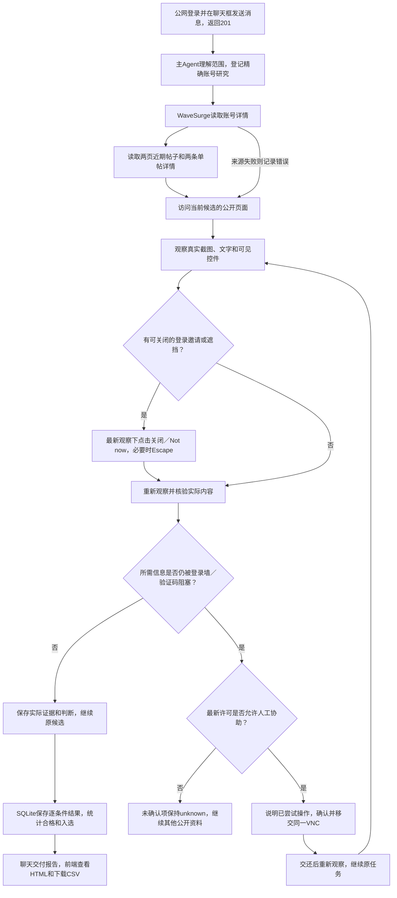

# 浏览器登录弹窗自主处理验证

日期：2026-10-15，Asia/Shanghai。发布入口：[公网工作室](http://101.201.237.219:33332/)。

**可关闭的登录邀请现在由 Agent 自行关闭，重新观察后继续原候选；实际无法关闭的登录墙或验证码才请求用户通过同一 VNC 协助。** app 与浏览器容器已更新，保留现有数据卷、账号密码及模型连接配置。

## 修复内容

- 页面观察返回真实可见控件的标签和选择器，包括 SVG 图标及中文关闭按钮。Agent 使用最新观察点击 Close、关闭、Not now 等入口，必要时使用 Escape。
- 普通关闭按钮可以位于登录表单中；原生提交按钮、关联外部表单的默认提交按钮、登录凭据和互动操作仍受执行层限制。
- 模型过早请求人工时，程序先刷新页面，尝试可安全关闭的入口。关闭后重新读取截图和文字，确认实际状态，不把一次点击当作核验成功。
- 同一入口的自动尝试有边界；明确未执行的过期观察错误不消耗尝试次数。刷新期间取消任务或撤回协助许可，不会发起晚到的动作或人工请求。
- 主会话和逐人核验默认提示词均说明自主处理顺序；已部署的定制提示词同步补充本次规则，其他角色及工具说明保留。发布沿用可靠文字资料核对、资料不足待人工确认的族裔口径。

## 实际网站与模型验证

| 场景 | 实际结果 |
|---|---|
| Instagram 账号主页登录邀请 | 实际出现 Close，点击后对话框数量由1变0，公开主页继续显示 |
| Instagram 帖子注册／登录邀请 | 实际出现 Close，点击后对话框数量由1变0，原帖作者和正文继续显示 |
| Instagram 未登录首页 | 此次为完整登录页面，无关闭入口；与可关闭邀请区分处理 |
| Docker 有头浏览器中的受控登录弹窗 | 实际配置模型自行调用关闭操作，重新取得公开内容，再提交有依据的判断；人工请求0次 |
| Docker 有头浏览器访问真实 Instagram | 本次实际观察未出现弹窗，公开主页可读；模型未因顶部 Log In／Sign Up 按钮请求人工，也未声称执行过关闭 |

真实网站由实际 Instagram 加载；受控弹窗明确使用测试网页。两类来源分别记录。此次验证没有自动输入登录凭据或解决验证码。

[真实 Instagram 访问记录](evidence/actual-instagram.json) · [有头容器实际模型关闭记录](evidence/headed-fixture.json) · [有头容器真实 Instagram 记录](evidence/headed-instagram.json)。

关闭前后截图：[主页之前](evidence/instagram-profile-before.png)、[主页之后](evidence/instagram-profile-after.png)、[帖子之前](evidence/instagram-post-before.png)、[帖子之后](evidence/instagram-post-after.png)、[有头弹窗之前](evidence/headed-popup-before.png)、[有头弹窗之后](evidence/headed-popup-after.png)。

## 公网完整任务端到端验证

入口固定为 **http://101.201.237.219:33332/**。通过实际浏览器登录，在聊天框自然语言下发新的 Adafruit 精确账号研究，未直接向数据库或研究接口插入任务。范围为1个账号、不限粉丝和地区，本轮必须实际打开主页、看到账号名及公开简介或帖子；任务执行期间再从聊天框查询进度。

最终任务为 `research-f43a778f97034963308dc62d`，于2026-10-15 16:29发送，16:31完成报告交付；16:35补验VNC实际画面加载。结果如下：

| 环节 | 实际结果 |
|---|---|
| 公网登录、聊天发送 | 原密码登录成功；页面 `isSecureContext=false`、`crypto.randomUUID` 不可用，两条消息仍均返回201 |
| 主 Agent 登记 | 只登记1项研究；`handles=[adafruit]`，候选上限1，`verificationMode=browser` |
| WaveSurge 原始资料 | 账号详情1次、帖子列表2页、单帖详情2次，共5次真实请求，全部HTTP200；具体路径和时间保存在证据中 |
| 实际网页核验 | 部署的有头浏览器取得本轮 `https://www.instagram.com/adafruit/` 的新截图和文字，主页可读；本次没有登录弹窗，人工请求0次 |
| 结果保存和展示 | 已核验1、合格1、入选1；结果面板、HTML和CSV一致，并保留本轮截图证据 |
| 执行期间续聊 | 没有创建重复任务。旧状态回执仍是running，但最终模型调用取得completed新事实；实际回复为“已完成，已完成核验1/1，合格并入选1/1” |
| 报告交付 | 对话中自动交付报告链接；通过界面打开HTML、下载CSV，均可读到adafruit结果 |
| 公网 VNC | 从“浏览器桌面”通过同一公网地址连接成功，真实画布1440×900；此次仅查看，没有人工接管或输入凭据 |
| 存量工作和页面 | 原有57项任务保留；本轮只新增1项，页面运行错误0个，消息时间显示正常 |

从用户消息发送到任务完成为62.462秒，到聊天交付为76.212秒。这里记录实际耗时，不将此单例解释为所有研究的固定时延。

本轮发现并修复了并发进度答复问题：历史`get_tasks`回执可能晚于系统事实出现在上下文中，模型误用旧状态。最新数据库事实现在放在历史回执之后，并明确优先级；保留原始记录、工具配对和已有的生成期间状态变化检查，不重启研究。新增竞态回归，并通过两轮公网实际模型验证延迟答复中的完成状态及人数。

其中一轮真实请求发生临时网络失败，系统保留`source_error`，通过本轮实际主页补充事实后完成核验；没有把失败请求记作API成功。最终复测的5次请求均为200，两种路径分别保留。[公网任务完整记录](evidence/public-task.json) · [来源失败与状态更新记录](evidence/public-fallback-and-status.json)。

[公网实际HTML报告](http://101.201.237.219:33332/api/reports/research-f43a778f97034963308dc62d) · [公网CSV](http://101.201.237.219:33332/api/reports/research-f43a778f97034963308dc62d?format=csv)。截图：[任务卡片](evidence/public-task-card.png)、[结果面板](evidence/public-results.png)、[HTML报告](evidence/public-report.png)、[VNC](evidence/public-vnc.png)、[本轮真实主页](evidence/public-creator-profile.png)。

## 回归与发布核对

完整单元及集成回归 **313/313** 通过，共37个测试文件；类型检查和生产构建通过。浏览器专项 **8/8** 通过，覆盖 SVG／中文／Not now、Escape、表单提交保护、过早人工请求、真实阻塞、禁止协助及实际配置模型。任务取消、许可变化、过期观察、失败访问和其他账号证据隔离均有回归。[自动化摘要](evidence/automation.json)。

在公网 HTTP 地址实际登录后，通过聊天界面发送“如果 Instagram 出现可关闭的登录弹窗，你会怎么处理”。发送接口返回201，模型回复先自行关闭、重新观察，只有无法继续时才按许可请求同一 VNC 协助；未新增任务，页面无运行错误。此次页面处于非安全上下文，`crypto.randomUUID` 不可用，仍成功发送并收到回复。该次消息交互耗时69.358秒，此项验证确认交付入口和处理规则可用。[公网界面记录](evidence/public-ui.json)。

发布后63个运行源码文件与工作区一致；原有784条记录编号均存在，已结束任务和账号设置核对未改写，模型地址、模型ID和密钥配置保持。提示词修订由25升至26。数据库已备份，数据卷保留。[发布证据](evidence/release.json)。

状态答复修复已更新到现有app容器，浏览器容器保留；运行源码一致，数据及配置检查通过，公网健康检查200。[最新发布核对](evidence/public-release.json)。

一个尚未认领的旧协助请求已交回原任务重新观察；没有记作人工登录完成，也没有替换原任务。已被用户接管的请求不自动交还。

复测入口：`tests/e2e/browser-popups.spec.ts`、`validation/2026-10-15/browser-popups/verify-instagram.mjs`、`verify-headed-container.mjs` 和 `verify-public-task.mjs`。公网脚本固定访问上述FRP地址，会通过聊天新建1项真实研究；`--review-only` 仅复核已保存的实际续聊回复，不再发起任务。部署脚本具有互斥锁；`deploy.mjs --audit-only` 只核对已部署状态，不重复切换容器。
