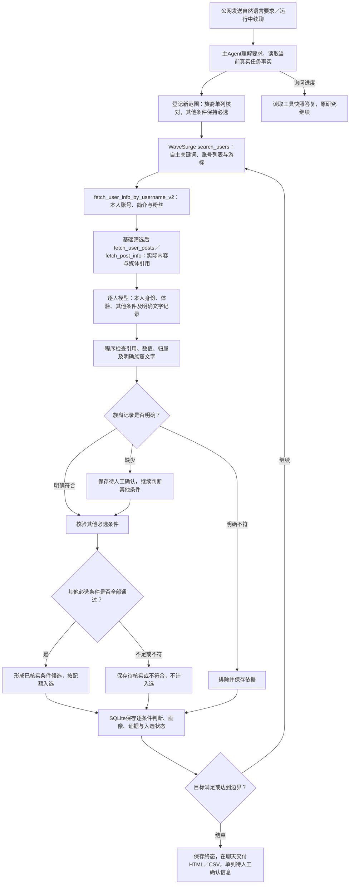

# 族裔资料核对与候选交付验证报告

日期：2026-10-13，Asia/Shanghai。访问入口：[公网工作室](http://101.201.237.219:33332/)。

**修复已生效，公网自然语言开放搜索交付2位可审核候选，达到本轮用例目标。** 明确记载本人族裔的可靠文字资料可以作为核对来源，不限定必须本人亲口自述。资料不足者单列待人工确认，明确不符者排除；其他必选条件仍须通过。页面、聊天、HTML及CSV保留这一核验范围。

## 实际公网验证

通过公网HTTP浏览器发送包含“白人个人跑者”的自然语言需求，由主Agent自行生成 `runner / marathon / trailrunner` 检索词。条件为Instagram、粉丝1万–10万、地区不限、个人分享身份及本人第一人称跑步训练或参赛体验，使用已有公开文字。完整输入和验收规则见[测试方案](test-plan.md)。

| 检查项 | 实际结果 |
|---|---|
| 范围理解 | 白人要求单列核对；个人身份、本人体验仍为必选；粉丝和地区范围按输入保存 |
| 自主检索 | 未指定账号或关键词；3个检索词由Agent生成 |
| 资料与逐人核验 | 读取13个基础账号，基础排除7个，逐人核验6个 |
| 候选交付 | 2位符合已核实条件并入选，4位不符合；两位的族裔项均保留待人工确认 |
| 任务与报告 | 任务completed，聊天自动交付单组报告、综合报告及CSV |
| 页面及实际下载 | 结果筛选、在线报告、CSV和离线HTML的记录ID与入选状态一致 |
| 刷新与公网HTTP | 刷新后结果保留；`isSecureContext=false`且无`crypto.randomUUID`时发送正常；浏览器未处理异常0 |

研究用时365.364秒，约6分5秒；保存终态时间为2026-10-13 11:08:47。达到2位目标后结束，未继续处理剩余分析预算。[完整场景断言](evidence/public-case.json)。

| 候选 | 粉丝 | 已核实匹配依据 | 族裔资料 |
|---|---:|---|---|
| [runswithmal](https://www.instagram.com/runswithmal/) | 51,737 | 简介为个人超马／铁三运动者；[Grindstone 50K复盘](https://www.instagram.com/p/Ddhf9JBJY7u/)以第一人称记录退赛后的重新参赛、爬升及家人陪伴冲线 | 待人工确认 |
| [runners_highest](https://www.instagram.com/runners_highest/) | 86,866 | 简介注明作者`@chrisflanell`；[骑行帽与首次半马体验](https://www.instagram.com/p/DePfTNfAleR/)明确叙述本人佩戴骑行帽完成首次半马 | 待人工确认 |

入选者的简介、原帖文字和逐条件依据已人工复核。商业合作单独记录为实际画像，不与品牌官方身份混同。源文及WaveSurge返回的发表时间保留在应用报告中。

[已核实条件候选报告](http://101.201.237.219:33332/api/reports/research-4ef77bf1a7e34d5930e92a20?verdict=match) · [综合报告](http://101.201.237.219:33332/api/work-batches/93700b7ff7ac1068542a56ca1ae64e50/report)。接口需要先登录工作室。

## 运行中交互与交付

运行中通过浏览器询问进度及“是否必须博主亲口声明自己是白人”。助手答复“不必须”，说明可靠公开文字资料可作为来源，资料不足待确认。任务继续执行，未新增或取消研究。此次回复耗时95.962秒，进度数字对应工具读取时的快照。[续聊记录](evidence/follow-up.json)。

最终自动聊天交付显示“已入选2/2人，已查看6人”，并附核验范围和报告链接；未将内部基础读取、分析上限直接拼进最终交付文案。筛选后的实际CSV为424,885字节、离线HTML为325,862字节，两者均保存逐人族裔核对状态与其他条件依据。

截图：[入选候选](evidence/selected.png)、[在线报告](evidence/report.png)、[自动交付](evidence/delivered.png)、[运行中交互](evidence/follow-up.png)。

## 明确文字资料与回归验证

使用实际配置的模型服务，对3份受控文字资料进行协议验证；这些是测试资料，与上面的真实开放搜索分开记录。

| 模型输入 | 族裔核对 | 最终处理 |
|---|---|---|
| 有归属标记的第三方目录明确记载`Ethnicity: Caucasian` | match | 可以采用该明确记录，不要求第一人称自述 |
| 明确记载`Ethnicity: Asian`，请求为白人 | no_match | 排除 |
| 仅所在地、眼镜信息 | unknown | 待人工确认，不阻断其他条件筛选 |

[实际模型验证记录](evidence/model-records.json)。后端还检查明确记录及引用，照片、所在地、白色衣物、读取错误和赛事名不能被模型猜测转换为族裔事实。

完整单元及集成回归303/303通过，37个测试文件；类型检查与生产构建通过。最终界面相关回归26/26通过。隔离Docker中的5/5浏览器场景通过，覆盖默认人工确认与VNC接管、Campaign交互和去重、自然筛选与补标导出、Instagram协议及视觉核验、三次重启后的浏览器数据保留。此层使用受控WaveSurge与候选网页、实际模型及有头浏览器。[自动化摘要](evidence/automation.json)。

专项回归覆盖复合条件不被整体降级、比赛中的race不误分类、中英文明确记录、Black Canyon与White Mountains赛事名、不存在或失败来源、两条非批次交付说明及默认提示词升级。

## 本轮真实接口与发布核对

| WaveSurge接口，前缀`/api/v1`，均为GET | 调用 | HTTP200 | 错误 |
|---|---:|---:|---:|
| `/instagram/v3/search_users` | 3 | 3 | 0 |
| `/instagram/v1/fetch_user_info_by_username_v2` | 13 | 13 | 0 |
| `/instagram/v1/fetch_user_posts` | 12 | 12 | 0 |
| `/instagram/v2/fetch_post_info` | 12 | 0 | 12 |

共40次实际调用。单帖详情本轮返回400；程序保存来源错误，保留实际获取的本人资料与帖子列表文字，入选判断引用这些已取得的来源。失败请求没有被计作成功或族裔证据。

本地Docker已更新，公网健康接口200。63个运行源码文件与提交工作区一致；发布前568条任务、结果、审计版本和消息记录核对无丢失或改写，模型配置保留。默认提示词版本由18升级到19，“必须本人自述”旧门槛移除，默认人工确认及交还后重新观察规则保留。[发布与接口证据](evidence/release.json)。

## 执行流程

本轮真实研究使用公开文字模式。需要浏览器且遇登录、验证挑战时，仍按原协议向用户说明原因，移交同一VNC浏览器，交还后重新观察；该流程由上述隔离浏览器回归验证。
