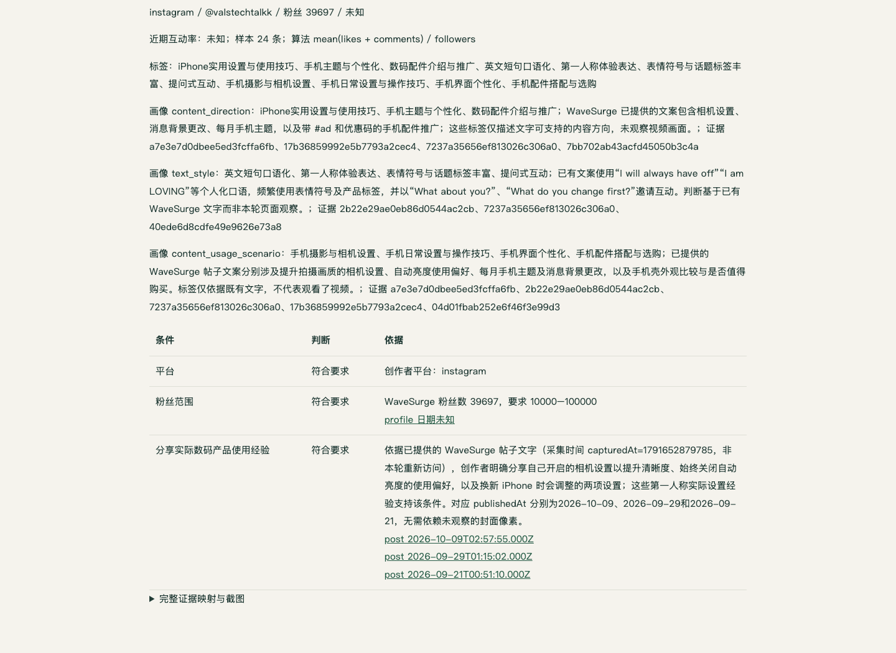

# Creator Studio 提交前验收报告

日期：2026-10-11（Asia/Shanghai）  
对象：当前工作区代码及由其重新构建的应用、桌面容器  
范围：无需人工接管的业务功能、F26–F32 修复回归与相关基础功能

## 验收结论

本轮通过实际浏览器操作，跑通了「自然语言描述 → WaveSurge 获取候选与资料 → 大模型逐人核验及画像标签 → 整批结束 → 聊天交付结构化 HTML/CSV」的完整流程，也跑通了从 Campaign 目标交互制定不同 Creator 类型、修订确认方案、跨组去重分配及最终交付的流程。

上一轮 F26–F32 七项问题全部复测通过。37 项验收用例中，36 项通过，1 项未通过：重新核验改变入选结果后，原任务说明保留旧人数（F33，P2）。该问题影响扩展功能的进度文案；实际名单、判断、合格/入选统计和 CSV 已更新。新研究和 Campaign 的上述核心流程未出现该问题。

本轮没有验证人工接管、验证码或平台账号登录。原题的 20 人混合条件已验证解析、澄清和缺证交付；由于限定了两位真实账号，未取得 20 位同时满足全部特征的真实正向名单。下文分别说明真实服务验证、受控资料验证和这一供给边界。

| 验证层 | 执行结果 |
|---|---|
| 业务及回归用例 | 37 项：36 通过、1 项 P2 文案问题；[逐项用例](test-cases.md) |
| 单元/集成/React 测试 | 32 个测试文件，242/242 通过 |
| 覆盖率 | 语句、分支、函数、行均 100%；57 个可执行 TS 文件及 1 个空声明文件 |
| 类型与构建 | TypeScript 检查、Vite 构建、隔离 Docker 部署通过 |
| 完整非人工浏览器场景 | 3/3 通过：研究/补标、Campaign、Instagram 原始数据与视觉核验 |
| 新的真实服务调用 | WaveSurge 64 次 GET，全部 HTTP 200；真实配置模型 69 次调用，无服务错误 |
| 文档专项 | 11 份文档完成 320 项字段/统计/归属比对；另一个真实空候选文档通过，共 12 份成功样例 |
| 保留材料 | 83 张截图；13 组 HTML/CSV（12 组成功样例、1 组 F33 反例）；用例 JSON 和结构化断言摘要 |

自动化摘要见 [automation-summary.json](evidence/automation-summary.json)。真实测试部署最终保存 13 项终态任务、15 条结果、6 次最终交付；正常重启后内容哈希、调用数和报告消息均保持不变，见 [restart-final.json](evidence/restart-final.json)。

## 环境与验证方法

主部署为 `localhost:3000`。真实验收使用独立新部署 `localhost:3612`，受控边界验证使用独立新部署 `localhost:3613`；两者使用实际配置模型、当前默认提示词及生产任务/文档代码。测试通过 Chrome/Playwright 实际输入消息、点击方案和结果、打开 Chat 报告链接并下载 CSV，同时检查后端保存的结果、工具回执、时间和调用记录。

| 数据层 | 本轮用途 | 证据解释 |
|---|---|---|
| 实际 WaveSurge + 实际模型 | 新的 Instagram 多组研究、补标、Campaign、原题缺证、YouTube/TikTok/X、真实空候选 | 验证真实 API 和资料链路；具体账号供给以当时服务返回为准 |
| 明确受控 Wave/网页/图片 + 实际模型 + 生产有头浏览器 | 可重复的视觉、偏好、分页、大整数、重新核验、错误注入及上下文边界 | 核验发生在实际模型和浏览器中；受控账号不作为真实合作人选 |
| 历史实际反例的私有副本 + 当前生产路由/UI | 数值证据、肯定/否定标签、HTTP 响应乱序 | 用同一反例检查修复，不将旧快照描述为本轮新社交页面观察 |

59 个应用源码文件在本轮无修改。主部署、真实验收、受控验收的应用容器均与工作区源码一致；三个桌面容器的执行文件也一致，见 [source-final.json](evidence/source-final.json)。本轮整理了文档、提交脚本、忽略规则，并将 Vitest 默认并发上限设为 4：未限制并发时同一 React 用例两次超过原有 5 秒超时，限制后默认覆盖率命令通过。单用例超时、断言及逐文件覆盖率门槛均保留。

## 题目功能与实际结果

| 题目功能 | 实际验证 | 结论与证据 |
|---|---|---|
| 1. 自然语言混合条件 | 原题数量/平台/粉丝/geek/眼镜/公开自述；澄清后保存条件；一条消息启动三组独立研究；目标与分析预算分开 | 通过。[业务记录](evidence/business-workflows.json)、T01–T02 |
| 2. 召回、逐人定性分析、标签化 | 实际 GET 资料链路；每人独立判断、理由与证据；内容方向/表达风格画像转为真实标签；未知与不符合分开 | 通过。新真实来源保存 15 条核验结果；[正向 HTML](evidence/doc-positive.html)、[CSV](evidence/doc-positive.csv)，T03–T11 |
| 3. 结构化结果文档 | Chat 直接打开 HTML、下载 CSV；清单逐人包含条件状态、匹配说明、画像、标签和引用；分组与入选可追踪 | 通过。12 份成功文档及 320 项显式比对；[专项摘要](evidence/document-validation.json)，T12–T18 |
| 4. Campaign 目标交互 | 营销目标 → 两种类型/理由/范围/配额 → v1 草案 → v2 修订 → 页面确认 → 去重分配 → 总/子文档 | 通过。[Campaign HTML](evidence/doc-campaign.html)、[CSV](evidence/doc-campaign.csv)，T18、T22–T23 |

### 实际业务流程

| 场景 | 实际执行与结果 |
|---|---|
| 三项独立 Instagram 研究 | `tylerlcrawford`、`valstechtalkk`，粉丝 1–10 万；每组完整分析 2 人、选 1 人。三组共 6 条判断记录、2 个去重账号；每组 2 合格/1 入选/0 缺额。全部结束后交付 1 份综合报告。 |
| 全部记录补标 | 对三组全部 6 条记录（含备选和同账号跨组记录）补「内容使用场景」。全部版本 1→2；旧事实、判断、入选及原画像逐项保持一致；新增 Wave 调用 0；整批交付 1 次。 |
| 智能生活设备认知 Campaign | 从目标交互形成「实用数码体验」「生活效率工具」两类，修订至 v2。确认前没有新 Wave 调用/子任务；旧版启动返回 409；当前版重复启动复用同两项任务。四条核验均合格，最终分配 Val/Tyler 两个不同账号，各组 1 位。 |
| 原题 20 人混合条件 | 原始输入先澄清。保留目标 20、预算 20，明确仅使用两个指定真实账号的现有文字。实际两人全部分析，外观/自述等缺证条件为 `unknown`，0 入选、缺额 20；没有填造其他账号或肯定标签。 |
| YouTube/TikTok/X 文字研究 | 每个平台读取 `/discover/db?platform=…&limit=500&sort=fit_desc` 的有界名单，再实际模型排序/核验。分别取得 `mrwhosetheboss`、`realswish`、`geekyranjit`，各 1 位合格入选，保存「科技数码」「游戏/科技」「科技」画像标签；三项结束后综合交付 1 次。 |
| 真实空候选 | TikTok 科技个人博主，粉丝 1–2 亿。500 条资料全部在基础粉丝条件排除，0 核验/0 入选/缺额 1。Chat、结果界面、HTML、CSV 均交付真实空集，CSV 保留 25 列表头。 |

[实际业务记录](evidence/business-workflows.json) 保存输入、任务、标签及最终交付。对「已完成」的判断采用本地核验结果，而非仅以 Wave HTTP 成功或候选名单返回作为完成依据。

新 Instagram 研究走当前同步 GET：`/instagram/v1/fetch_user_info_by_username_v2`、`/instagram/v1/fetch_user_posts`、`/instagram/v2/fetch_post_info`。可重复关键词场景另外验证 `/instagram/v3/search_users`、两页帖子及大整数身份信息。这些新工作没有提交旧的 `POST /creator-search/requests`。

### 逐人标签与证据

两位实际候选均保存本人的条件核验和不同画像值。例如，Tyler 的现有文字支持「智能家居与公寓自动化」「消费数码产品推荐」「第一人称体验叙述」「实用教程与清单」；Val 支持「iPhone 实用设置与使用技巧」「手机主题与个性化」「英文短句口语化」「提问式互动」。补标后又分别增加「公寓智能家居自动化/桌面办公与显示器选购」及「手机摄影与相机设置/手机界面个性化」等使用场景。

这些值由实际模型逐条提交并持久化，不只是将用户目标或召回关键词抄到每人身上。每个画像保存说明和证据引用。文字研究明确说明使用已有帖文，没有宣称观察视频像素；视觉专项则使用实际有头 Chromium 观察受控耳机照片，保存图片引用并在 HTML 中嵌入 PNG。

## 结构化文档专项（DOC04）

从聊天实际点击报告、在产品中点击 CSV 下载，再把导出与存储结果逐条比对。验收项包括：

- 文档有范围、目标、合格候选、实际入选和缺额，区分记录数与去重账号人数。
- 每位有账号/平台/粉丝/链接、来源任务与分组、入选状态、逐条件三态判断、匹配理由、实际画像/标签、引用与可用截图。
- CSV 每行 25 列，记录 ID、来源、分组、判断、标签、画像和入选口径能与 HTML/API 对应；中文及结构字段可解析。
- 多组、补标、Campaign、子报告、筛选空集、待核实、无候选和视觉文档保持结构；空集仍有表头和真实缺额。
- 实际打开 1440/768/375 宽度，正文无横向溢出；有截图的报告离线保留图片。

11 个文档变体、320 项显式比对全部通过。独立真实空候选文档另外通过，见 [empty-document-validation.json](evidence/empty-document-validation.json)。第 13 组文件保存 F33 反例，不计入成功文档数。

综合样例：[三组研究 HTML](evidence/doc-three-groups.html) / [CSV](evidence/doc-three-groups.csv)、[六条补标 HTML](evidence/doc-six-retag.html) / [CSV](evidence/doc-six-retag.csv)、[Campaign HTML](evidence/doc-campaign.html) / [CSV](evidence/doc-campaign.csv)、[真实无候选 HTML](evidence/doc-no-candidates.html) / [CSV](evidence/doc-no-candidates.csv)。离线样例保留内容与嵌入截图；回到应用的导航链接仍需要运行服务。

## F26–F32 修复回归

| 编号 | 原问题 | 本轮检查 | 结论 |
|---|---|---|---|
| F26 | 粉丝条件展开大量无关证据 | 同一历史反例 287 引用缩到对应数值来源 1 条；原始 288 条资料保留；结论不变；实际报告数值行可读 | 通过 |
| F27 | 「戴眼镜」命中「不戴眼镜」 | 默认完整标签匹配 0 条；显式「文字包含」1 条且界面说明。真实自然查询「科技」完整匹配 2 条、包含 11 条，Agent 工具模式对应 | 通过 |
| F28 | 迟到响应覆盖新过滤/CSV | 延迟初始请求、延迟旧查询两种顺序；新结果完成后放行原 HTTP 响应，界面和 CSV 都保留新范围 1 行 | 通过 |
| F29 | Campaign 总/子结果分配不一致 | 两个重叠候选跨两组；API、总/子 HTML、弹窗、CSV、实际 Agent 查询均采用同一两人去重分配；旧独立预选仍供审计 | 通过 |
| F30 | 把入选数当合格总数 | 两位合格、配额一位：各界面/文档显示 2 合格、1 入选、0 缺额，备选保留 | 通过 |
| F31 | 综合文档缺组归属/人数口径错误 | 三组同两人、六条补标逐条有来源/分组，6 条记录与 2 个去重账号分开统计 | 通过 |
| F32 | Campaign 总文档缺逐人匹配说明 | 总文档直接显示每位条件、状态、理由、画像标签与证据，无需仅从原始帖子自行推断 | 通过 |

F26–F28 见 [regression-c-browser.json](evidence/regression-c-browser.json)；自然查询见 [natural-tag-query.json](evidence/natural-tag-query.json)；其余见文档专项及实际业务记录。

## 其他回归

补标、重新核验版本与新页面证据、偏好排序、执行中消息/取消/请求幂等、登记未封口时清空/载入上下文、有效/非法备份、真实模型历史压缩、参考图片、设置提示词立即生效、认证/Origin/输入契约、消息原时间和响应布局均执行，详见 T09–T11、T24–T34。

会话、候选排序、逐人核验三条模型链路分别注入一次 HTTP 408，均重试原工作后 200 成功；永久 HTTP 400 仅尝试一次并显示错误，最终恢复原模型地址。三组研究、全部补标和 Campaign 均只在末项结束/结果写入后产生一次最终交付，见 [delivery-timing.json](evidence/delivery-timing.json)。

真实与受控部署都在终态后普通重启应用和桌面；结果、历史、分配、交付及消息哈希不变，新增 Wave/模型调用为 0，没有重放或重复报告。这项结论限于正常重启，不等同于断电恢复测试。

## 未通过项 F33

**P2：重新核验后，源任务说明没有刷新入选人数。**

复现步骤：以现有文字完成两位均待核实、0/1 入选的研究；要求重新打开两位本人主页按原条件复核；核验取得新证据，两位合格、最终入选一位后，打开原任务卡和更新报告。

实际状态为 `completed`、`qualifying=2`、`matched=1`；报告头部与 CSV 均为 2 合格/1 入选/0 缺额，判断、标签、截图和版本也正确。但任务卡和报告正文仍显示旧的「已选合格 0/1」。

原因定位到 [src/server/enrichment.ts](../../../src/server/enrichment.ts) 第 46 行：重新核验后重算源任务人数并更新状态，再保存任务，未同步重建源任务的 `detail`。建议复用研究说明的生成逻辑刷新描述，并补充「待核实→合格」和「合格→不符合」两种方向的一致性回归。本轮按验收范围记录该缺陷，未修改业务源码。

证据：[reverify-description.json](evidence/reverify-description.json)、[反例 HTML](evidence/doc-reverify-stale-description.html)、[CSV](evidence/doc-reverify-stale-description.csv)、[任务卡截图](screenshots/reverify-stale-description-card.png)、[报告截图](screenshots/reverify-stale-description-report.png)。

## 验证边界

- 原题的 20 人最终正向供给未完成验证。限定两账号的实测证明条件保留、逐人判断和缺额交付，不能据此声称找到 20 位同时具备所有特征的真实创作者。
- geek/眼镜等外观依赖可访问图像；族裔只依据本人公开明确自述。缺证保持 `unknown`，不同于 `no_match`。
- YouTube/TikTok/X 本轮验证的是已有 500 条名单内的排序与核验；不是全站穷尽。真实 HTTP 200 也不保证未来服务可用性或任意条件的候选规模。
- Campaign 按平台账号去重，本轮没有验证跨平台同一自然人的身份合并。三项独立研究没有要求跨组唯一，可在不同组保留同一人。
- 人工接管、验证码、私有平台登录及支付不在本轮范围，不计入通过率，也不作为已验证能力。

## 资料与复跑入口

[项目 README](../../../README.md) 说明功能、架构、技术栈、Agent 逻辑、启动与提交方式；[架构文档](../../architecture.md) 说明当前设计；[测试方案](test-plan.md)、[用例集](test-cases.md)、[截图索引](screenshots.md) 和 `evidence/` 保留本轮材料。[测试目录](../README.md) 给出默认自动化及三个非人工浏览器场景的复跑命令。

提交包通过 `python3 scripts/package-submission.py` 生成，包含代码、锁文件、设计文档、测试材料及直接引用的公开历史附件。真实凭据、数据库、浏览器状态与私有追踪材料排除；公开材料进行凭据核查。提交整理验证见 [submission-check.json](evidence/submission-check.json)。
