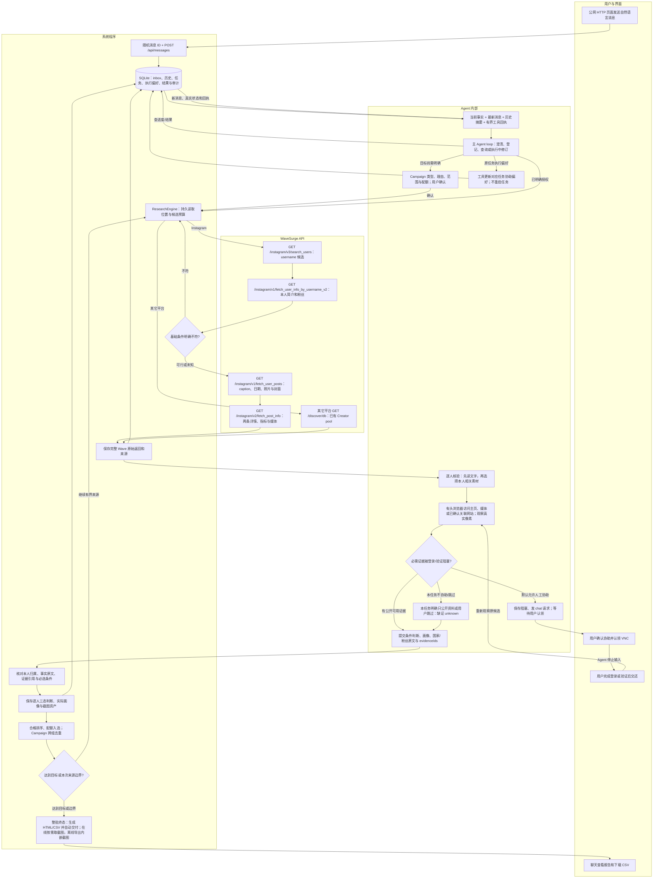

# 面试反馈分析、补救实施与真实验证

日期：2026-10-13，Asia/Shanghai。实际交付入口：[Creator Studio](http://101.201.237.219:33332/)。原密码保留。

## 结论与验收口径

后续口径确认：用户已选择“本人 Geek／书卷形象＋日常框架眼镜”，书本静物和墨镜单列边界候选。本文两个历史程序入选不能自动算作新严格口径通过；后续新关键词、实际用例和发布结论见 [公网验收补救报告](../public-acceptance-2026-10-13/report.md)。

面试官指出的两项问题都成立：原公网 HTTP 页面不能发送消息；原题没有交付 20 位全部条件通过的创作者。此前 localhost 浏览器验证和两个指定账号测试不能证明公网可用、开放搜索成功或原题名单达标。旧验收报告已增加明确更正，历史证据保留。

公网发送代码已修复并部署。真实开放检索取得 **65 条逐人核验记录、64 个去重账号、2 名供审阅候选**，完整理由、来源、截图和报告均已保存。**这不等于原题通过，也不等于交付了 20 位无争议合格者。** 两名候选中，一名有普通框架眼镜画面，另一名是太阳镜边界；两名的风格依据主要是书籍/书架场景，不能称为本人 Geek 穿搭已经证实。

用户明确批准族裔改为本人公开自述画像，缺证 unknown，不再作为必选条件；其它约束保留。测试请求将 Geek 风操作化为“Geek/书卷风，包括阅读与书架场景”，没有限定镜片类型。这一操作化比“本人 Geek 外观/穿搭、普通框架眼镜”宽，尚不能把该测试的两个 `match` 直接称为用户批准口径的全部条件通过。下面明确区分程序记录和实际审阅结论，不静默改写已结束研究。

最终版本已通过 279 项单元/集成/React 测试、类型检查、Docker 构建和 5 个完整浏览器场景，并完成原公网地址的真实 API、自然语言续聊、VNC、在线报告和实际下载验证。真实名单交付仍为部分完成；通过这些程序验证不等于 20 人名单达标。

## 真实开放搜索与候选证据

| 研究 | 开放关键词 | 本人基础读取 / 基础排除 | 逐人核验 | 程序 match / unknown / no_match | 程序入选 / 目标 |
|---|---|---:|---:|---:|---:|
| 保留的原题研究 | geek、bookish、glasses | 75 / 35 | 40 | 0 / 15 / 25 | 0 / 20 |
| 批准调整后的第一组测试 | bookstagram、nerdy、geekgirl | 93 / 58 | 35 | 0 / 33 / 2 | 0 / 20 |
| 补充开放检索 | bookish、bookworm、nerd | 72 / 42 | 30 | 2 / 18 / 10 | 2 / 20 |

两组补救请求均通过实际公网页面、自然语言、真实模型与真实 WaveSurge Token 启动，没有指定 handles、预置候选或用测试夹具补人数。65 条判断记录中有一个账号在两组出现，最终按 64 个账号理解，不能声称两项 20 人研究共交付 40 人。原题记录单独保留，不与补救人数相加。

第一组分析上限 40、基础读取上限 200；补充组分别为 30、150。任务到达本次关键词来源或分析边界后结束，`partial` 和缺额真实保留，不代表全站穷尽。原题记录含 3 次核验/来源错误，第一组保留 2 次、补充组保留 1 次错误提示。第一次部署时的两个桌面传输失败已归档，并在同一原任务、相同候选与条件下真实重试；结果修订号为 2，未通过结果仍未入选。

| 可审核候选 | WaveSurge 粉丝数 | 本人所在地原文 → 本地国家事实 | 实际视觉证据 | 审阅边界 |
|---|---:|---|---|---|
| [bookish.in.baltimore](https://www.instagram.com/bookish.in.baltimore/)（Cassie） | 27,518 | `Baltimore, MD` → US | 自我介绍轮播中本人戴深色框眼镜，画面有同账号标识；WaveSurge 返回原帖时间 2026-08-28 12:06:16 UTC | 普通框架眼镜有证据。风格 match 依据另一张藏书/书衣静物照片；不能把静物推成本人 Geek 穿搭，仍需审阅风格定义。 |
| [bookishwbomberry](https://www.instagram.com/bookishwbomberry/)（Destiney） | 47,207 | `Toronto, Ontario` → CA | 本人剪发自述视频的镜前自拍封面戴黑色太阳镜；API 返回原帖时间 2026-09-22 21:15:17 UTC | 明确是太阳镜、视频封面，不能称为普通透明镜片眼镜、照片帖或已观看完整视频。书架和阅读场景仅支持内容呈现的书卷风。 |

两人族裔画像均为 unknown；没有用外貌、姓名或所在地推断。粉丝数是当次 API 返回值；原帖日期来自 WaveSurge，而不是独立重新读取 Instagram 时间。截图采集时间另存。画像与核验理由完整保留在 [实际检索摘要](evidence/real-open-search.json) 中。

普通框架眼镜来源：[自我介绍原帖](https://www.instagram.com/p/DclUrB_lVZB/)，[实际浏览器截图](evidence/baltimore-introduction.png)。太阳镜来源：[视频原帖](https://www.instagram.com/p/DdmrPsCJxl8/)，[实际浏览器截图](evidence/toronto-sunglasses.png)。截图为应用实际观察后保存的资产，没有用头像、资源 URL 或人工声明代替像素。

### API 返回示例与派生信息

`GET /instagram/v1/fetch_user_info_by_username_v2?username=bookish.in.baltimore` 的实际返回中，提取相关字段如下（省略其它字段）：

```json
{
  "data": {
    "username": "bookish.in.baltimore",
    "full_name": "Cassie",
    "edge_followed_by": { "count": 27518 },
    "is_private": false,
    "is_verified": false
  }
}
```

系统从同一本人简介中取得 `Baltimore, MD`，保留原文和证据编号，再解析为 `creator.facts.country.code = "US"`。原始 `creator.region` 仍为 null。这是本地核验事实，不能把 US 冒充 API 直接返回的国家字段。前端、HTML 和 CSV 的主资料现优先展示有效国家事实，完整原始资料未改写。

V3 搜索先返回 username 等候选资料；本人详情取得简介、粉丝、认证/私有状态等；帖子列表及详情取得 caption、媒体类型、code、时间、点赞/评论、照片 URL 与视频封面。所在地区、个人 KOC、Geek 风、眼镜、族裔等不能假定已由 API 证明，必须分别核验。互动率只在粉丝分母、样本点赞与评论均有效时计算 `mean(likes + comments) / followers`，否则保持未知。

补救时间窗口的主应用实际 WaveSurge 调用如下，统计截至 `real-open-search.json` 的采集时间；不包括后续续聊专项小研究，也不伪称逐任务精确归因：

| 实际 GET 接口 | 次数 | HTTP 200 且无记录错误 | 失败 |
|---|---:|---:|---:|
| `/instagram/v3/search_users` | 6 | 6 | 0 |
| `/instagram/v1/fetch_user_info_by_username_v2` | 166 | 164 | 2 |
| `/instagram/v1/fetch_user_posts` | 125 | 124 | 1 |
| `/instagram/v2/fetch_post_info` | 124 | 124 | 0 |
| `/discover/db` | 1 | 1 | 0 |

`/discover/db` 是额外只读探测，返回 500 条记录，未用来预埋补救候选。受众国家不是创作者所在地。关联个人网站只在实际归属证据和明确当前本人所在地声明都成立时补充事实；客户评价国家、历史学校/实习、语言、币种、域名不充当所在地。例如实际查看的 [个人网站服务页](https://www.bookishwithyo.com/services) 和 [介绍页](https://www.bookishwithyo.com/about) 没有提供足够的当前本人居住证明，相应条件仍未知。

## 功能与技术修复

| 功能/问题 | 最终方案 |
|---|---|
| 公网 HTTP 消息发送 | 用 `crypto.getRandomValues` 的 16 字节随机值生成 32 位十六进制 ID；生成与网络请求都在 try 中。保留草稿、失败反馈、重试幂等和后端冲突检查。 |
| 持续对话和后台任务 | 消息先持久进入 inbox。主会话与 ResearchEngine 独立运行；新消息在工具边界和每段压缩之间注入。修改偏好读取真实工具回执，进度答复重新读取当前事实，不因新消息自动取消研究。 |
| 上下文与长历史回复 | 原始历史/回执完整保存，仅向模型投影必要字段；历史结果去掉重复 raw/长签名媒体列表。旧记录按约 24k 字符前缀、完整工具批次压缩，保留最新输入。设置阈值过高时增加 80k 字符保护界限；摘要优先保留未完成约束与授权，旧终态记录保留检索线索，目标约 800 汉字。 |
| 状态可信度 | 继续校验模型回答前后的数量、终态、权限、异常和设置修订。不让正常轮询时间/阶段文案变化无限丢弃答复。阶段时间不能冒充人数，历史摘要不能覆盖当前事实。 |
| 历史规模导致接口阻塞 | 结果按任务使用 SQLite 索引读取；报告元数据用轻量 task_states 并在一次投影内复用。Campaign/综合报告只加载相关记录。结果页请求 `view=summary`，省去重复原始响应与媒体列表；默认完整结果查询、证据、HTML/CSV 和审计资料仍保留。 |
| 候选上下文与素材选择 | 原始 Wave 返回完整保存。模型读取近期 12 条帖子及最多两条自我介绍补充、最多 16 个不重复媒体；保留媒体的 parentEvidenceId/parentPostUrl，防止串帖。最多观察 6 项相关媒体，不凭第一张静物推断本人。 |
| API 读取效率 | 两条帖子详情按实际发表时间排序、独立并发读取；旧置顶不占据全部近期详情预算。基础粉丝明确不符者先排除，不占定性核验预算。 |
| 国家来源解析 | 接受本人简介中的明确定位符、完整州/省、无歧义城市地址、后置定位与 `UK based` 等声明；保留原文。拒绝受众/客户地址、错误页、旅行/历史经历和装饰性国旗等错误归属。 |
| 浏览器访问范围 | 先加入模型可见的真实媒体，再补全其它来源；通过 evidenceId 解析当前候选完整签名 URL，拒绝冲突地址、其它候选和无效动作。桌面 `/scope` 只对瞬时传输/5xx 做有限重试，点击等有副作用动作不盲目重放。 |
| 人工确认与 VNC | 默认遇必需的登录/验证阻塞，保存原因并在 chat 请求用户协助。用户明确认领同一持久桌面后，Agent 停止输入；用户交还后重新观察，继续原候选。不会自动填账号密码，也不会把“我登录好了”当作已成功取证。 |
| 执行偏好与单次跳过 | 独立持久记录 `research-execution`，避免在途任务旧副本覆盖新要求；每轮及请求协助前读取许可。`skip_browser_assistance` 只结束当前阻塞，后续默认协助不变。公开资料测试的 false 仅约束对应任务，系统默认 VNC 交接保留。 |
| 逐人判断、标签和文档 | 平台、粉丝、所在地与定性必选条件独立计算；match/no_match/unknown 与内容方向/呈现风格画像分开。未知不补名额；合格、入选、备选、跨组去重与归属分别统计。 |
| 任务完成交付 | 每次请求的工作清单封口后，全部成员终态才交付一次综合报告；终态保存立即检查交付，不再等待同一个后台 tick 的其它慢模型请求。 |
| 公网报告过大 | 实测第一份原 HTML 74,734,325 字节，FRP 传输超过180秒失败。在线版本按需从鉴权资产接口加载截图，保留完整证据文字与统计；另提供 `view=offline` 含内嵌截图的自包含 HTML 下载。研究、Campaign 与综合报告一致采用此策略。 |
| Campaign 进阶目标 | 产品/受众/目标 → 交互澄清 → Creator 类型、理由、条件和配额草案 → 用户修订确认 → 分组研究 → 跨组账号去重分配 → 总报告及逐人匹配说明。 |

`randomUUID()` 需要安全上下文，`getRandomValues()` 可在非安全上下文使用，见 [MDN randomUUID](https://developer.mozilla.org/en-US/docs/Web/API/Crypto/randomUUID) 与 [MDN getRandomValues](https://developer.mozilla.org/en-US/docs/Web/API/Crypto/getRandomValues)。实际公网验证始终使用 `isSecureContext=false`、没有 `randomUUID` 的交付环境。

默认系统/工作流/核验提示词已检查角色边界、最新消息、真实状态、三态证据、原始与模型预览、执行偏好、人工交接及交付口径。仅对精确匹配的旧默认提示词迁移；用户自定义提示词和模型凭据保留。新增信息以上下文与少量持久记录表达，没有增加庞大业务状态机。

## 完整执行流程



VNC 控制属于同一持久浏览器，确认前不自动移交输入权。遇登录/验证后是否继续等待、只跳过这一项、或该任务只使用公开资料，分别保存不同授权；默认人工交接流程不因补救测试改为关闭。

## 分阶段验证记录

| 阶段 | 验证方式 | 实际结论 |
|---|---|---|
| 公网发送复现与修复 | 原 FRP 地址真实浏览器点击，核对网络、nonce、消息保存和回复 | 修复前无 POST 且页面异常；修复后非安全上下文实际 1 次 POST、32 位 ID、收到真实回复。 |
| 来源/视觉/执行偏好 | 实际 token 开放检索、真实模型、有头浏览器截图；运行中自然语言更新对应任务许可 | 两组实际结果如上。地区缺证、画面缺证与边界不计为原题通过；任务条件不静默改变。 |
| 默认人工协助回归 | 实际配置模型、受控挑战页面、真正有头 Chrome/noVNC；人工认领、点击、交还；另测自然语言只跳过当前挑战 | 原候选续接、截图证据、聊天请求、控制权及后续默认许可通过。该测试不伪称已真人登录 Instagram。 |
| 综合回归 | 单元/集成/React、类型、Docker；5 个完整浏览器场景 | 最终 36 个测试文件、279/279 通过；类型与构建通过；5/5 E2E 通过（6.0分钟），含默认人工交接及单次跳过、Campaign、研究/画像/导出/补标、Instagram、三次正常重启。 |
| 长历史/公网报告 | 原公网地址查询、消息时间、设置删项、VNC、真实 HTML/CSV/交付及图片加载 | 全部通过。[公网断言](evidence/public-validation.json) 保留真实消息和人数；未新建、取消或遗失任务。最终查询回复约67秒；两份在线 HTML 分别4,247,281和3,341,045字节，实际GET约26和11秒。CSV分别约17和14秒。 |
| 实际下载 | 公网结果页筛选 match 后点击 CSV；在线报告实际加载本人框架镜截图，再点击离线 HTML | [下载断言](evidence/public-downloads.json) 全部通过；[候选 CSV](http://101.201.237.219:33332/api/reports/research-09db3d47bf4ee8edb2830bb3?format=csv)、[含截图离线报告](http://101.201.237.219:33332/api/reports/research-09db3d47bf4ee8edb2830bb3?view=offline) 实际保存，离线文件4,947,448字节。两人仍是前述宽口径程序候选，边界不被下载操作消除。 |
| 运行中再次消息 | 真实开放文字研究，在 running、核验0人时实际发送第二条自然消息 | [续聊断言](evidence/public-ongoing.json) 通过。约27秒回复“仍运行、0/3”；不改目标、预算或条件，不重复登记、不取消；随后分析2人、入选1/3、partial并自动交付。此专项不计入补救名单。 |
| 数据与部署 | 私有 SQLite 快照、380 条受保护记录比对、运行源码哈希 | 最后部署后缺失0、误改0，62个运行源文件与工作区一致；原题仍为partial、40人核验、0入选。 |

完整 E2E 明确使用受控 Wave 响应与候选网页，实际模型、应用、Chrome、VNC 和持久卷真实运行；用来证明程序流程。真实候选供给由上述独立 token 检索证明。覆盖率为100%（60个可执行生产文件、1个空声明文件），不能替代真实原题验收。详情见 [测试方案](test-plan.md)、[最终自动化摘要](evidence/automation-summary.json) 与 `validation/2026-10-13/interview-rescue/` 中保留的成功和失败记录。

**性能限制仍需如实说明。** 本次长历史冷整理中，小型研究登记曾等待约4分40秒；后续运行中进度回复27秒，最后较详细的公网进度回复67秒。不能用后两项替代首次响应时间。分段投影、当前终态提示与摘要优先级已经改进，但没有证明任意长度旧历史都能秒级响应，也没有证明复杂视觉筛选可以一分钟交付20人。在线 HTML 不再内嵌全部截图；离线全量导出仍可能很大，选取候选或筛选后的离线报告更便于审阅。

目前没有达到 20 位原题全条件通过或 20 位调整口径的无争议交付。可用资料和自然筛选流程已得到真实验证，但平台登录限制、本人所在地缺失、风格定义与眼镜类型仍限制名单数量。演示时应使用明确的风格/镜型口径及实际缺额报告；需要登录/验证时，继续由 Agent 请求用户确认并移交 VNC。
