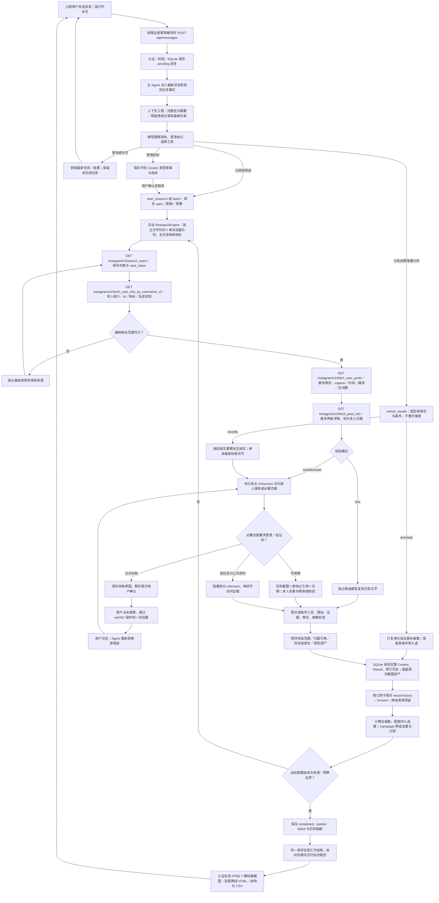

# 公网验收补救：原因、真实新用例与部署

日期：2026-10-13（Asia/Shanghai）。交付入口：<http://101.201.237.219:33332/>，使用原管理员密码。

## 0/20 到底表示什么

0/20 是保留的原题研究的真实入选数，不表示 API 返回了零账号，也不表示所有功能均未执行。原题开放搜索 `geek / bookish / glasses` 读取了 75 个账号的基础资料，35 个在基础数值阶段排除，逐人核验 40 个，最终没有一位全部必选条件通过。

| 原题核验条件 | match | unknown | no_match |
|---|---:|---:|---:|
| 粉丝 1万–10万 | 40 | 0 | 0 |
| 本人所在地在指定欧美国家 | 0 | 40 | 0 |
| 本人 Geek／书卷形象 | 0 | 40 | 0 |
| 本人公开画面戴眼镜 | 2 | 38 | 0 |
| 族裔本人公开自述 | 0 | 40 | 0 |
| 个人消费者 KOC 身份 | 9 | 6 | 25 |

这些条件不是互斥的失败分类，不能把各行人数相加。`glasses` 等账号搜索词会召回眼镜店、活动和品牌，不能理解成“筛出戴眼镜的欧美个人”。实际搜索服务返回原始账号列表，所在地、个人身份和视觉条件需要本地逐人验证。

去掉族裔硬条件后的两组开放检索有 65 条核验记录、64 个账号。所在地只有 8 条通过；眼镜 13 条通过，且包括当时未排除的墨镜；原程序的两位入选包含书本静物及墨镜边界。用户现已明确 **必须本人 Geek／书卷形象、日常框架眼镜**，这两位不能自动算进新严格名单。旧研究的条件和记录保留，新口径另建研究。

地区 unknown 有两类原因：资料没有本人所在地声明；程序未识别明确地点。实际简介 `🇮🇳🇺🇸 | sf bay area 🌁` 曾因城市别名和装饰字符处理不足而被拒绝，本轮已修复。保留完整原文及来源；旗帜本身、旅行经历、观众所在地和含糊城市仍不能证明本人所在地。

## 本轮修改

- 公网 HTTP 发送使用 `crypto.getRandomValues()` 生成幂等消息编号，在发送错误边界内处理。实际公网浏览器 `isSecureContext=false`、`randomUUID=undefined` 也能收到后端 201，消息不会静默丢失。
- 上下文按完整旧批次压缩，去除模型输入中的重复原始大结果与图片字节，保留原始数据库、未完成请求、任务编号、授权和最新纠正。后台普通轮询不使回复一直失效；真实数量、终态、错误及权限变化仍检查。
- 支持明确本人城市和装饰后的独立所在地声明。自动浏览优先本人介绍素材，减少先看书本静物的往返；图像判断严格遵循本次条件，不用静物或墨镜凑数。
- 本轮真实新资料暴露 `Manassas, VA` 被解析成梵蒂冈。现已区分完整国家名、明确城市地址和歧义州缩写，不能把任意 `City, VA/CA/MA` 当作国家。已知 Manassas 地址归一为 US；同一原文与证据产生的旧派生代码，在重新核验时重算并保留 result-history，真正不同所在地声明仍报告冲突。州缩写依据 [USPS 官方表](https://pe.usps.com/text/pub28/pub28apb.htm)，Manassas 地址可由 [弗吉尼亚州政府页面](https://www.dvs.virginia.gov/Home/Components/FacilityDirectory/FacilityDirectory/55/30?sortd=desc&sortn=FCAddress) 核对。
- 未确认身份的关联网页、纯关联链接及来源错误，不能独自支持本人条件通过或正向画像标签。确认回链／同名域名及姓名的来源继续保留，但仍由 LLM 判断实际内容是否支持条件。
- ResearchEngine 将文字核验与单个共享浏览器分开调度。浏览器等待页面或视觉模型时，后来登记的文字任务可立即启动；重复 wake 不重复执行，同一桌面始终串行。基础账号每次最多连读四个粉丝数不合格者，保留原来的来源队列、分析预算及读取上限。
- 在线 HTML 使用认证资产地址懒加载截图；离线 HTML 下载包含截图。修复真实 35 人报告曾内嵌约 75MB 图片而在公网超时的问题。CSV、逐条件理由、分组归属和入选口径一致。
- 默认登录／验证码流程仍为 Agent 说明原因 → 用户确认 → 接管同一 VNC 浏览器 → 用户交还 → Agent 重新观察原候选。本次公开资料测试的禁用协助是单任务设置，不修改系统默认值。
- 已有结果重核验默认继承原研究当前协助许可；运行中改变的许可、后台浏览器与提供给主 Agent 的任务事实使用同一读取逻辑。指定重核验任务可只覆盖这次工作；不能误释放其他工作的桌面。

## 真实验收用例

### A：严格本人形象和框架眼镜

新关键词：`booknerd / booklover / bibliophile / geeky`，真实 v3 开放搜索；没有指定 handles 或手选账号。预探测四个词返回 122 行原始账号（须按身份去重），另一个 `techgirl` 请求返回 HTTP 400，未采用该词，不隐瞒失败或自动换 API 版本。

研究 `research-b7829d5a507c7425f3601697` 通过原公网 UI 发送自然语言请求创建。目标 1 人、Instagram 1万–10万粉丝、明确欧美本人所在地、三个必选条件为本人形象、日常框架镜、个人消费者体验；最多分析 25 位、读取 125 个基础账号。族裔仅注释，不硬筛。公开资料测试明确禁止本任务人工登录。

登记约 25.1 秒。任务运行期间从公网再次发送补充，Agent 约 47.3 秒回复工具核实的“核验 6、合格 0、入选 0/1、仍在执行”，没有取消、新建或降低条件。这不是终态结论。

实际终态为 `partial`，核验 **25 人、合格 0、入选 0/1**；读取 79 个基础账号、排除 54 个。完整报告、CSV 和聊天终态交付正常，但此组关键词的严格人数目标未通过。此任务执行于本轮地区与素材优先级修复部署之前；不能把后续修复反推成已改变这些历史结果。[公网断言及逐人判断](evidence/strict-public.json) 保留失败业务结果 `realQualifiedDelivery=false`。

### B：基础开放书评 KOC 流程

这是独立的功能用例，不能用其人数替代严格外观名单。实际自然语言输入：

> 请帮我找2位Instagram个人书评KOC，粉丝1万至10万，地区不限。必须有本人第一人称阅读或使用书籍的体验，排除出版社、商店、品牌、机构官方、明星和纯搬运账号。只核验已有公开文字，标注内容方向和呈现方式。用booknerd、booklover做开放账号搜索，不指定账号；分析预算8人、基础账号读取上限50。请直接开始，结束给我报告和CSV。

实际研究 `research-b6a28edf401b3a52ebb44143`，系统自然生成标题“Instagram个人书评KOC公开文字筛选”，不是手动修改数据库标题。需要验证真实目标人数、每位理由、标签、自动交付和公网 HTML／CSV。

实际终态为 `completed`：**核验 4 人、合格 2、入选 2/2**，读取 10 个基础账号、排除 6 个。入选 `booknerdkat`（15,757 粉丝）和 `bookloveraly`（39,370 粉丝），均有本人第一人称阅读经历、具体原帖与逐条理由，并保存内容方向和呈现方式。`booknerd_sa` 是书店账号，明确排除；`booknerd` 缺少本人阅读内容，保留 unknown。报告、CSV 和聊天自动交付全部通过。[实际公网证据](evidence/reading-public.json)。

从公网消息保存到研究终态用时 **743.861 秒（约 12 分 24 秒）**。当时 A 的浏览器工作与 B 的文字工作仍共用串行调度；这一真实耗时触发本轮分开调度的修复，不能将此结果描述为即时交付。发布后另建文字用例复核新调度。

### C：发布后的严格开放搜索

原公网自然语言消息创建 `research-9ad67d8142750fb21a31634c`，仅用通用 `bookworm` 做 v3 搜索，没有指定账号或把历史候选灌入队列。条件与 A 相同：明确欧美所在地、1万–10万粉丝、本人书卷／Geek画面、日常框架眼镜、个人消费者KOC；目标 1 人、分析预算25、基础读取上限125，族裔仅注释。本次消息明确无最近30天限制，来源时间分开记录。这是用户接受的调整口径，不是原题20人名单。

**completed：核验 5 人、合格 1、入选 1/1**；读取18个基础账号、排除13个。消息登记约25.2秒，保存消息到任务终态 **498.712秒（8分19秒）**。运行期间再次公网续聊约89.8秒返回真实0/1运行态，没有重复研究或改条件；后续完成后自动交付。[完整实际断言](evidence/strict-bookworm-public.json)。

| 入选账号 | 粉丝／所在地 | 本人形象、眼镜及个人体验证据 |
|---|---|---|
| `bookwormbullet` | 17,241；简介原文 `🇮🇳🇺🇸 \| sf bay area 🌁` → US，依据地点而非旗帜 | 本人持翻开的书阅读，佩戴可见透明镜片的日常框架镜；第一人称阅读总结与小说书评支持个人消费者身份 |

实际有头浏览器取得 [框架镜阅读截图](evidence/bookworm-framed-reading.png)，主分析和独立审计均查看过像素。来源是本人账号原帖 [DeUbnpYqDQd](https://www.instagram.com/p/DeUbnpYqDQd/) 的 **视频封面**，不是照片帖，不声称观看过视频；本次已确认口径接受本人实际画面。WaveSurge 提供发表时间 `2026-10-10T15:46:49Z`，截图采集时间 `2026-10-12T23:13:52.460Z`，二者不能混用。个人身份还引用本人9月阅读总结及小说体验文字。族裔为 unknown，不推断外貌、国籍旗帜或书籍作者族裔。地区指本人公开声明，未声称独立验证居住证件。

### D：发布后慢浏览器期间新到文字任务

C 运行后，通过公网另发自然语言创建 `research-dbd0a595c74c88337d88bdad`，与 B 的文字口径相同，仍为开放 `booknerd / booklover`，不指定账号。**核验3人、合格2、入选2/2，completed**；读取7个基础账号、排除4个。两位分别是 `booknerdkat`（15,757）和 `bookloveraly`（39,371，当次实时数值）。

登记约12.4秒，消息保存到终态 **188.483秒（3分8秒）**。此时 C 仍 running、核验2人、入选0/1；文字研究先完成并自动交付，证明后来收到的工作可以独立推进。HTML、CSV、原任务保留均通过，无页面错误。[实际公网证据](evidence/reading-deployed-public.json)。前后来源和分析人数并非完全相同，因此这是新调度的真实并发验收，不能当成严格的性能倍数基准。

### E：真实错误记录的审计修订

地理修复发布后，通过原公网 UI 自然语言要求仅重新核验 C 的已有 `bookwormcentral`，没有写库改结论或重新搜索。实际后台任务 `enrich-76597d2b5b2a492fcf854323` completed，处理1条、合格0条；本轮本人主页真实观察1/1。新结果 revision=2、country=US，原文仍为 `📍Manassas, VA`；result-history中的旧revision=1保留VA。机构条件仍为no_match、未入选，C仍核验5人、入选1/1，原spec不变，WaveSurge调用增加0次，聊天自动交付更新报告。[实际修订证据](evidence/country-revision.json)。

该修订快照又发现重核验任务的外显协助许可与实际继承值不一致，随后统一许可读取并补回归。修订JSON保存当时错误显示，最终API事实及浏览器复核记录修复后的值，不将旧快照改写成从未发生问题。

### F：最终代码更新后从公网重新完整执行

`9a79ed4` 更新到本地Docker后，重新在原公网输入自然语言，实际登记 `research-d8b24e517e7613d03f994eee`，标题“公网最终发布验收：开放书评KOC”。开放关键词和文字范围同B，没有指定账号、复用旧研究或修改已有名单。**核验3人、合格2、入选2/2，completed**；7个基础账号读取、4个基础排除。登记约14.7秒，从保存消息到终态 **205.905秒（3分26秒）**。

实际入选 `booknerdkat`（15,757）和 `bookloveraly`（39,371）。范围、三态与逐人理由、自动聊天交付、HTML、CSV、原任务保留全部通过。[最终新搜索公网证据](evidence/reading-final-public.json)。这次完整执行位于最后一次功能代码提交与部署之后。

## 面试时可直接验收

先在 [公网工作室](http://101.201.237.219:33332/) 用原密码登录。已保存的“公网严格验收：本人书卷形象与框架镜（bookworm）”可立即查看1名入选、逐条件理由及实际截图；“公网最终发布验收：开放书评KOC”可查看2名书评候选。页面内均可打开报告、下载CSV，不需要调用后台接口绕过前端。

需要重新验证新搜索时，可直接在聊天输入：

> 找2位Instagram个人书评KOC，粉丝1万至10万，地区不限。必须有本人第一人称阅读或使用书籍的体验，排除出版社、商店、品牌、机构官方、明星和纯搬运。只核验公开文字，不打开浏览器，标注内容方向及呈现方式。用booknerd、booklover开放搜索，不指定账号；逐人分析预算8、基础账号读取上限50。请直接开始，结束在对话里给我报告和CSV。

严格外观的实际用例为：

> 找1位Instagram个人阅读消费者KOC，粉丝1万至10万，本人公开声明所在地在美国、加拿大、英国、德国、法国、荷兰、比利时、爱尔兰、西班牙、意大利、葡萄牙、挪威、瑞典、芬兰、丹麦、瑞士、奥地利、波兰、捷克或希腊。必须实际看到本人持书或阅读的书卷形象，并佩戴日常透明镜片框架眼镜；书本静物、墨镜和他人画面不能算。用bookworm开放搜索，不指定账号；分析预算25、基础账号读取上限125。族裔只记本人公开自述，缺证unknown且不硬筛。不加最近30天限制，标明来源发表时间与截图采集时间。这项演示只用无需登录的公开资料，阻塞部分unknown并继续，不改变系统默认VNC协助规则。请直接开始，结束交付真实人数、报告和CSV。

两条消息分别验证文字和严格调整口径。普通新任务默认在必要登录／验证码阻塞时先请求用户确认；用户选择接管后才能操作VNC，交还后重新观察。公开资料许可只来自对应任务消息，不能全局关闭这一流程。真实任务需等待API、浏览器和模型，当前记录为数分钟；已保存结果可立即审阅。

## 完整执行流程

图中 WaveSurge 路径均在 `/api/v1` 下。非 Instagram 平台通过 `GET /discover/db?platform=…&limit=500&sort=fit_desc` 读取已有名单，再按本次画像筛选与核验，当前不自动进行付费平台搜索。所有三态和实际画像保存到本地，而不是把 HTTP 200 或搜索返回当成筛选通过。

## 回归与发布

本轮新增修复后的全量回归：36 文件、292 测试全部通过；类型检查、前端生产构建、Docker 构建通过；5/5 完整浏览器场景通过（最后一轮6.9分钟），使用真实配置 LLM、受控 WaveSurge 和候选页面。浏览器场景包括人工接管／续接、Campaign 交互与去重、增量研究与标签导出、Instagram GET 与视觉核验、浏览器 Cookie／localStorage 三次重启保留。

这些结果只证明对应程序行为；真实业务验收以 A–F 的实际 API、自然语言、公网终态、证据和下载为准。[独立提交前审计](ship-audit.md) 记录了关联网页归属缺陷及修复复核。

发布代码已正常提交并push至 `origin/main`：`c24e3af` 修复HTTP、上下文、证据及并发；`9bfeeb0` 修复地理解析与旧事实修订；最后功能代码为 [`9a79ed4`](https://github.com/shawnyangcis/wavesurge_testing/commit/9a79ed49d3e11052ad69a3064d271b3ce0fcce47)，统一重核验许可。随后重建并只更新Compose的app，未重建desktop、删除持久卷或改变管理员密码。

最终运行镜像为 `sha256:30df27a277dbec7a1ba443ff377ab3b5425b1a2ce64ece8a9cf618f0de367909`，app与desktop健康。**62个源码文件与工作区及已提交代码一致**；原始380条保护记录及发布前521条记录均零丢失、零改写，原研究仍40人核验、0/20。明确授权的本轮新结果修订单独保存历史。[发布与保留核对](evidence/release.json)。之后提交的文档及测试证据不改变运行源码。

[最终公网界面复核](evidence/deployed-public-ui.json) 全部通过：HTTP非安全上下文登录、消息年月日时分秒、设置删项、VNC只读连接、原研究与重核验许可同为false且其他默认任务为true、合格/入选统计、实际框架镜截图加载、点击CSV与含图离线HTML下载；发送新消息的完整执行见 Case F。当前入选1人CSV为200,686字节，离线含图HTML为530,535字节，无浏览器页面错误。默认人工确认及交还续接由本轮完整有头E2E独立覆盖。

原题20人仍未通过；已确认调整口径的严格1人和独立文字2人均有真实开放来源、明确理由、保存结果及公网交付，不能混算或称为20人通过。提交中只保留整理后的断言、截图和复现脚本，大型原始HTML/CSV、私有数据库、配置与凭据留在本机和认证应用中。
