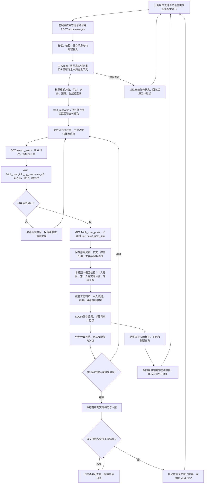

# Creator Studio 公网端到端测试报告

日期：2026-10-13，Asia/Shanghai。访问 [公网工作室](http://101.201.237.219:33332/)，使用原管理员密码。

## 验收结论

**实测入选：跑步训练与参赛体验3位，家用咖啡制作体验2位，均达到本次用例目标。** 从公网浏览器发送自然语言需求，由主Agent自行选择关键词，读取WaveSurge实际资料、逐人调用模型核验、保存画像和结果，并在聊天中自动交付综合报告及CSV。

本次测试范围：Instagram公开文字核验，粉丝1万–10万、地区不限，内容时间范围为已公开资料；输入采用开放搜索，由Agent生成检索词。验证内容包括运行中续聊、标签精确查询、逐条分组归属、页面与导出一致性、实际下载及刷新后持久化。

| 场景 | 主Agent生成的检索词 | 基础资料读取／排除 | 逐人核验 | 合格／入选／目标 | 任务终态 |
|---|---|---:|---:|---|---|
| 跑步训练与参赛体验 | `runner / marathon / trailrunner` | 28／17 | 11 | 3／3／3 | completed |
| 家用咖啡制作体验 | `homebarista / pourover / espresso` | 51／46 | 5 | 2／2／2 | completed |

合计读取79个账号基础资料、基础排除63个，逐人核验16个；5个合格且入选、4个待核实、7个不符合。综合报告对应2组、16条核验记录、5位去重入选者，各组和逐条归属清晰。[综合报告](http://101.201.237.219:33332/api/work-batches/ba652d587214e85a3a31509da4d1062d/report) · [综合CSV](http://101.201.237.219:33332/api/work-batches/ba652d587214e85a3a31509da4d1062d/report?format=csv)。报告接口需要先登录工作室。

## 实际入选名单与匹配依据

测试时逐条复核了以下入选者的已保存简介、原帖文字、判断和标签。粉丝数来自本轮本人资料接口；帖文日期是WaveSurge返回的发表时间，采集时间另存。完整源文及逐条件依据保留在应用报告中。

| 创作者 | 粉丝 | 本人体验及对应来源 | 实际画像示例 |
|---|---:|---|---|
| [runswithmal](https://www.instagram.com/runswithmal/) | 51,737 | [Grindstone 50K复盘](https://www.instagram.com/p/Ddhf9JBJY7u/)，2026-09-20：本人讲述去年退赛后重新参赛、爬升和冲线经历 | 越野跑与超马参赛、详细赛事复盘 |
| [jimesantacruz](https://www.instagram.com/jimesantacruz/) | 74,617 | [跑步专项训练](https://www.instagram.com/p/DdZFTG8xymm/)，2026-09-17：西班牙语第一人称说明与教练进行力量、增强式及跑步专项训练 | 跑步专项力量训练、第一人称训练分享 |
| [caitsouthkeen](https://www.instagram.com/caitsouthkeen/) | 20,489 | [悉尼马拉松体验](https://www.instagram.com/p/DeACc2yG0-o/)，2026-10-02：本人记录抽签参赛、出行安排和参赛感受 | 马拉松参赛体验、分点实用经验分享 |
| [homebarista.ig](https://www.instagram.com/homebarista.ig/) | 28,017 | [家用Breville制作记录](https://www.instagram.com/p/Ct_coq4h4e0/)，2023-06-27；[家庭咖啡工作台恢复](https://www.instagram.com/p/DMu3pVmy6OA/)，2025-07-30：明确本人家庭设备及实际拉花经历 | 家用意式咖啡制作、拿铁拉花、第一人称日常体验分享 |
| [espresso.archives](https://www.instagram.com/espresso.archives/) | 36,654 | [家庭冰拿铁制作](https://www.instagram.com/p/DePBjPMgYSq/)，2026-10-08：本人调整espresso甜度、制作奶泡并评价口味；家庭场景有简介和帖文共同支持 | 家庭意式咖啡与冰拿铁、配方与步骤讲解、个人口味评价 |

个人的品牌合作与商业分享作为实际画像保留，和品牌／店铺官方身份分别判断。证据分别保存内容发表时间和本次采集时间。

排除样本：`marathonthegame`为游戏宣传账号，`marathonfuel`为燃油品牌，`longbeachmarathon`为赛事官方；`thetopoffespresso`和`misbehaveespresso`的简介列有营业地址及咖啡店定位。逐人结果保存身份、本人体验、来源归属和实际标签。[跑步实际断言](evidence/running.json) · [咖啡实际断言](evidence/coffee.json)。

## 公网完整执行与结果交付

两项任务均在实际HTTP交付地址通过浏览器填写消息并点击发送，收到后端201。浏览器记录为`isSecureContext=false`、`crypto.randomUUID=undefined`，消息仍正常保存与执行。

| 检查点 | 实际验证 | 结果 |
|---|---|---|
| 自然语言理解与自主检索 | 输入无指定账号和关键词；持久化人数、范围、文字核验、分析12人／基础资料80人的预算；由Agent生成两组不同检索词 | 通过 |
| 基础筛选与逐人分析 | 粉丝筛选、个人身份、本人实际体验分开判断；每位保存理由、证据ID和原始来源 | 通过 |
| 内容画像 | 形成跑步／咖啡内容方向和表达方式标签，并为各画像值保存依据 | 通过 |
| 运行中续聊 | 两项仍运行时发送进度查询，16.122秒返回工具核实的状态；条件、任务ID及任务总数不变 | 通过 |
| 结果查询与导出 | 精确查询“越野跑与超马参赛”和“家用意式咖啡制作”，各返回对应1位；页面、CSV、在线及离线报告的记录ID一致 | 通过 |
| 聊天自动交付 | 本次连续消息归入同一交付批次；两项结束后自动发送一次综合交付，含两项子报告及综合CSV | 通过 |
| 多组报告 | 2组、16条记录、5位入选；逐条来源任务与分组、统计和入选标记一致 | 通过 |
| 实际点击下载 | 通过结果页下载CSV、报告页下载离线HTML；通过聊天点击综合报告及综合CSV | 通过 |
| 持久化与界面 | 刷新后结果仍在；消息展示年月日时分秒；浏览器未处理异常为0 | 通过 |

运行中答复的数量与答复当时的任务快照一致，后续终态另行自动交付。[续聊证据](evidence/follow-up.json)。两项属于同一交付批次：跑步先完成后可在侧栏查看；整批就绪后生成综合聊天报告，实际交付消息时间比最后任务终态晚101毫秒。[下载、标签及综合报告断言](evidence/delivery-ui.json)。

| 保存的实际下载 | CSV字节 | 离线HTML字节 |
|---|---:|---:|
| 跑步完整研究 | 1,173,514 | 960,684 |
| 咖啡完整研究 | 250,141 | 228,934 |
| 跑步精确标签查询 | 88,151 | 79,158 |
| 咖啡精确标签查询 | 70,327 | 68,199 |
| 两组综合报告 | 1,423,344 | 1,188,911 |

综合报告保留整批全量判断；按标签／平台／判断筛选及对应导出，在各研究结果页操作。本轮保存的下载文件与应用报告接口均可复核，仓库保留整理后的断言和截图。

## 执行时间与真实接口

| 场景 | 公网消息到任务登记 | 消息保存到任务完成 | 实际完成时间（上海） |
|---|---:|---:|---|
| 跑步 | 13.777秒 | 878.872秒，约14分39秒 | 2026-10-13 09:11:23 |
| 咖啡 | 17.415秒 | 1,121.648秒，约18分42秒 | 2026-10-13 09:15:53 |

时间包括真实资料读取和逐人模型核验，两项在同一部署环境共同运行。已保存的结果现在可以直接查看；重新搜索的耗时取决于资料读取及核验数量。

| WaveSurge实际接口（均为GET，前缀`/api/v1`） | 调用次数 | HTTP 200 | 记录错误 |
|---|---:|---:|---:|
| `/instagram/v3/search_users` | 6 | 6 | 0 |
| `/instagram/v1/fetch_user_info_by_username_v2` | 79 | 79 | 0 |
| `/instagram/v1/fetch_user_posts` | 30 | 29 | 1 |
| `/instagram/v2/fetch_post_info` | 28 | 28 | 0 |

本次两项研究的共同执行窗口合计调用143次接口。一次帖子请求返回400，系统保存该来源错误并继续处理其余资料，最终判断与证据一同落库。[运行环境与接口摘要](evidence/environment.json)。

## 程序与Agent执行流程

本轮走公开文字核验路径。系统的其他核验模式及默认人工确认、同一有头浏览器VNC接管、交还后重新观察，见[架构与Agent设计](../../architecture.md)及[容器桌面协议](../../container-computer-use.md)。

## 如何现场验收

登录公网工作室后，在研究进展中选择“公网场景验收：跑步训练与参赛体验”或“公网场景验收：家用咖啡制作体验”，点击查看结果，即可审阅已保存名单和逐条件依据。也可直接打开[跑步合格名单](http://101.201.237.219:33332/api/reports/research-371b25cdd89962fcb9c395e9?verdict=match)和[咖啡合格名单](http://101.201.237.219:33332/api/reports/research-c862ed11e2e7d7d9abcc20fa?verdict=match)。

需要从新消息开始重跑，可使用以下两条输入；研究名称可换成当次演示名称，其余范围保留：

> 请帮我找3位Instagram跑步类个人创作者，研究命名为「跑步体验演示」。粉丝1万至10万，地区不限。必须有本人第一人称的跑步训练、马拉松或越野跑参赛体验；排除运动品牌、店铺、赛事或机构官方、明星和纯搬运账号。只核验已有公开文字，标注内容方向和表达方式。请自行选择合适的英文账号检索词开放搜索，不指定账号；逐人分析预算12人，基础资料最多80个账号。请直接开始，结束在聊天里给我名单、逐人匹配说明、报告和CSV。

> 请帮我找2位Instagram个人咖啡爱好者，研究命名为「家用咖啡体验演示」。粉丝1万至10万，地区不限。必须在公开文字中分享本人在家制作手冲或意式咖啡的第一人称实际体验；排除咖啡品牌、咖啡店、器材商、机构官方、明星和纯搬运账号。只核验已有公开文字，标注内容方向和表达方式。请自行选择合适的英文检索词开放搜索，不指定账号；逐人分析预算12人，基础资料最多80个账号。请直接开始，结束在聊天里给我名单、逐人说明、报告和CSV。

执行前固定的完整输入、标题与预算见[场景定义](../../../validation/2026-10-13/public-scenarios/scenarios.json)，验收规则见[本轮测试方案](test-plan.md)。截图：[聊天自动交付](evidence/running-chat.png)、[跑步名单](evidence/running-selected.png)、[咖啡名单](evidence/coffee-selected.png)、[精确标签查询](evidence/running-tag-filter.png)、[综合报告](evidence/combined-report.png)。

## 版本与证据

测试对应功能代码`9a79ed4`，62个运行源码文件与已提交源码一致。公网健康接口200，app及desktop均healthy；380条及521条存量保护记录核对一致。研究、续聊及报告已持久保存，管理员密码、模型配置和浏览器数据保持原配置。

该功能版本的自动化回归记录为292/292单元及集成测试、5/5完整浏览器场景通过。本次实测为上述两组公网自然语言研究、执行中续聊及浏览器交付验证，使用真实WaveSurge接口和配置的模型服务。

验证记录：[跑步场景](evidence/running.json)、[咖啡场景](evidence/coffee.json)、[执行中续聊](evidence/follow-up.json)、[界面与实际下载](evidence/delivery-ui.json)、[环境与接口](evidence/environment.json)。
